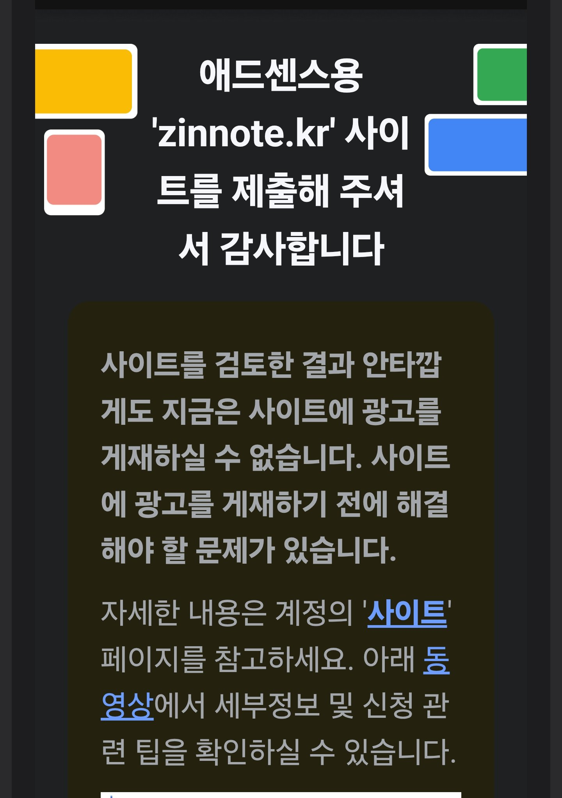
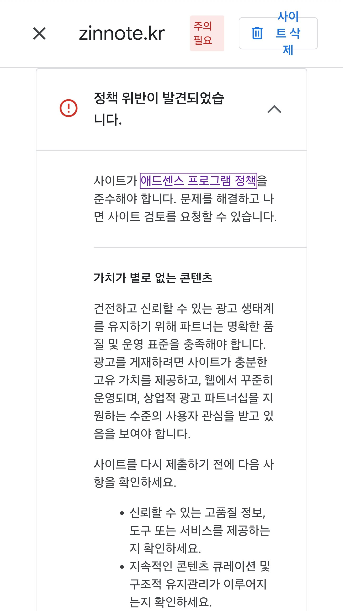

[애드센스 심사 기다리는 중](/adsense-review-waiting) 글에서 "승인이 나든, 거절이 되든 결과를 그대로 올리겠다"고 약속했습니다. 결과는 **거절**이었습니다. 약속대로 받은 메일부터 무엇을 고치고 있는지까지 그대로 적어 둡니다.

> **제 이야기**: 2026년 10월 29일 오후 4시 53분에 신청했고, 약 **8일 뒤** 결과 메일이 왔습니다. 블로그를 연 지 열흘쯤 됐을 때 신청한 거라, 지금 생각하면 조금 서둘렀습니다.

## 1. 실제로 받은 거절 메일

메일을 열어 보니 이렇게 적혀 있었습니다.

> 사이트를 검토한 결과 안타깝게도 지금은 사이트에 광고를 게재하실 수 없습니다. 사이트에 광고를 게재하기 전에 해결해야 할 문제가 있습니다.

메일에는 자세한 이유가 없고, 애드센스 계정의 **사이트** 페이지를 보라고만 되어 있습니다.

## 2. 애드센스 화면에 나온 거절 이유

애드센스(adsense.google.com)에 로그인해 **사이트** 메뉴로 들어가면 `zinnote.kr` 옆에 **주의 필요**가 붙어 있고, 눌러 보면 이유가 나옵니다.

이유는 **"가치가 별로 없는 콘텐츠"** 였습니다. 화면에 적힌 설명을 요약하면 이렇습니다.

- 사이트가 **충분한 고유 가치**를 제공해야 합니다.
- 웹에서 **꾸준히 운영**되고 있어야 합니다.
- 광고를 붙일 만큼 **사용자 관심**을 받고 있어야 합니다.

다시 신청하기 전에 확인하라는 항목도 있었습니다.

- 신뢰할 수 있는 **고품질 정보**, 도구 또는 서비스를 제공하는지
- **지속적인 콘텐츠 관리**와 구조적인 유지관리가 이루어지는지

"가치가 별로 없는 콘텐츠"는 애드센스 거절 사유 중 아주 흔한 편입니다. 사이트가 나쁘다는 뜻이라기보다, **아직 다른 곳에서 볼 수 없는 내용이 부족하다**는 뜻에 가깝습니다.

## 3. 제가 생각한 거절 이유

구글이 정확한 이유를 하나하나 알려 주지는 않습니다. 그래서 아래는 제 블로그를 다시 보면서 **제가 짐작한 이유**입니다.

1. **블로그가 너무 새것이었습니다.** 신청할 때 블로그를 연 지 열흘 정도였습니다. "꾸준히 운영되고 있다"는 걸 보여 주기엔 짧았습니다.
2. **어디서나 볼 수 있는 IT 글이 많았습니다.** "윈도우 업데이트 오류 해결" 같은 글은 이미 비슷한 글이 아주 많습니다. 제 경험 없이 방법만 적은 글은 고유 가치가 낮아 보였을 겁니다.
3. **주제가 두 갈래로 나뉘어 있었습니다.** IT 팁 글과 제가 만드는 무협 게임 개발기가 섞여 있어서, 어떤 블로그인지 한눈에 알기 어려웠을 수 있습니다.

## 4. 그래서 지금 고치고 있는 것

거절 메일을 받고 바로 고치기 시작했습니다.

- **새 글을 늘리기보다 이미 있는 글을 다듬기로 했습니다.** 글 개수보다 글 하나하나의 내용이 중요하다고 생각했습니다.
- **글마다 제 이야기를 넣고 있습니다.** 배터리가 갑자기 줄어 불안했던 일, 크롬 캐시 때문에 화면이 안 바뀌어 당황했던 일처럼 실제로 겪은 일을 "제 이야기"로 적고 있습니다.
- **제가 직접 찍은 사진을 넣고 있습니다.** 가비아 도메인 문자, 블루투스 이어폰, 갤럭시 캡처 화면 같은 사진을 하나씩 바꿔 넣는 중입니다.
- **IT 글마다 출처를 달았습니다.** 마이크로소프트, 구글, 삼성 같은 공식 도움말을 참고했다고 글 끝에 적었습니다.

이 글도 그중 하나입니다. 거절 메일과 화면은 제 계정에만 있는 것이라, 이런 글은 다른 블로그에서는 볼 수 없습니다.

## 5. 다시 신청은 언제?

애드센스는 거절돼도 **문제를 고친 뒤 다시 신청**할 수 있습니다. 저는 바로 다시 내지 않고, **2~3주 정도** 글을 다듬은 뒤 11월 하순쯤 다시 신청할 생각입니다. 그 사이에 블로그가 운영된 기간도 자연스럽게 늘어납니다.

처음 신청하기 전에 확인한 것들은 [애드센스 신청하기 전에 준비할 것](/before-applying-adsense)에 정리해 두었습니다.

## 정리

- 신청 후 약 8일 만에 **"가치가 별로 없는 콘텐츠"** 로 거절됐습니다.
- 자세한 이유는 메일이 아니라 애드센스의 **사이트** 메뉴에서 볼 수 있습니다.
- 제 짐작으로는 **너무 새 블로그 + 흔한 IT 글 + 섞인 주제**가 문제였습니다.
- 글 수를 늘리는 대신 **제 이야기, 직접 찍은 사진, 출처**를 더하고 있습니다.

두 번째 신청 결과도 이 블로그에 그대로 올리겠습니다. 도메인 값 16,500원을 다시 벌겠다는 목표는 아직 그대로입니다.

_참고: Google 애드센스 고객센터 「애드센스 프로그램 정책」, 「가치가 별로 없는 콘텐츠」 도움말_
