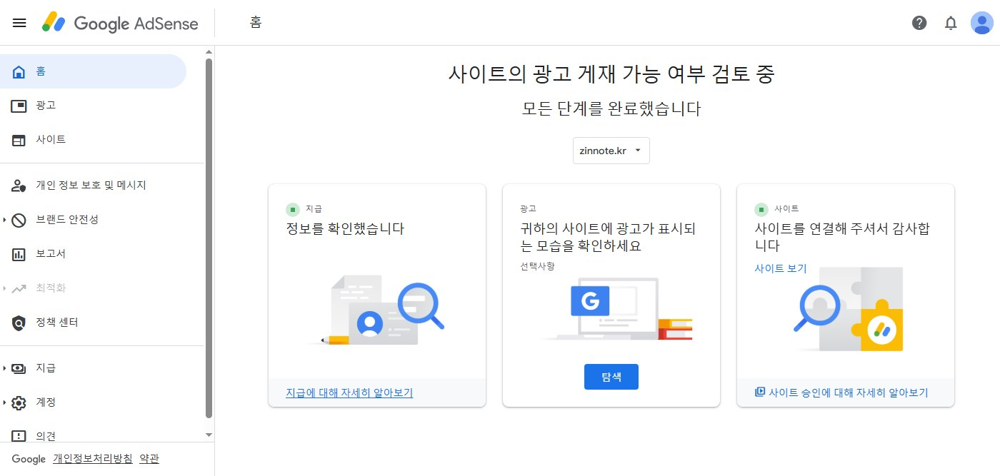
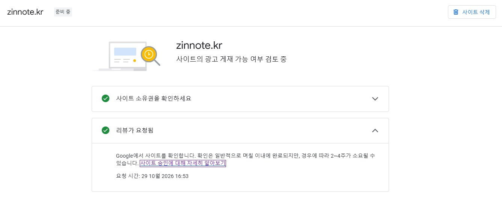

드디어 눌렀습니다. **구글 애드센스 심사 신청** 버튼.

마우스를 올려 두고 한참을 망설였습니다. "아직 글이 부족한 거 아닐까", "한 번 떨어지면 다시 신청하기 어렵다던데" 같은 생각이 머리를 스쳤습니다. 그래도 언젠가는 눌러야 하는 버튼이니까, 에라 모르겠다 하고 클릭했습니다.

## 신청 직후 화면

신청을 마치니 애드센스 홈 화면에 **"사이트의 광고 게재 가능 여부 검토 중"** 이라는 문구가 떴습니다. 그 아래에는 **"모든 단계를 완료했습니다"** 라고 적혀 있었습니다. 지급 정보 확인, 사이트 연결까지 초록색 표시가 붙어 있으니 일단 제가 할 수 있는 건 다 한 셈입니다.

**사이트** 메뉴에 들어가 보니 `zinnote.kr` 옆에 **"준비 중"** 이라는 작은 딱지가 붙어 있었습니다. **사이트 소유권 확인**과 **리뷰가 요청됨** 두 줄에 체크 표시가 있고, 이런 안내가 보였습니다.

> Google에서 사이트를 확인합니다. 확인은 일반적으로 며칠 이내에 완료되지만, 경우에 따라 2~4주가 소요될 수 있습니다.

요청 시간은 **2026년 10월 29일 오후 4시 53분**. 이 시간을 기억해 두려고 이 글을 씁니다.

며칠이면 끝날 수도 있고, 한 달 가까이 걸릴 수도 있다는 이야기입니다. 그 사이에 할 수 있는 건 기다리는 것, 그리고 글을 계속 쓰는 것뿐입니다.

## 신청하기까지 준비한 것들

솔직히 처음엔 "글 몇 개 쓰고 신청하면 되겠지" 하고 가볍게 생각했습니다. 막상 알아보니 챙길 게 꽤 많았습니다. 제가 한 것들을 적어 보면 이렇습니다.

1. **내 도메인 사기.** `아이디.github.io` 같은 무료 주소 대신, 가비아에서 `zinnote.kr` 을 1년 16,500원에 샀습니다. 그 과정은 [도메인 구매기](/buy-kr-domain-gabia)에 적어 두었습니다.
2. **필수 페이지 만들기.** 소개, 개인정보처리방침, 이용약관 페이지를 만들고, 연락받을 이메일도 적어 두었습니다.
3. **글 쌓기.** 스마트폰, 윈도우, 오류 해결처럼 제가 직접 겪은 IT 문제 해결법과, 혼자 만들고 있는 무협 게임 개발기를 꾸준히 올렸습니다. 직접 찍은 스크린샷도 최대한 넣었습니다.
4. **검색 등록.** 구글 서치 콘솔과 네이버 서치어드바이저에 사이트를 등록하고 사이트맵을 제출했습니다. 방법은 [서치 콘솔 등록 글](/google-search-console-register)에 있습니다.
5. **애드센스 코드 넣기.** 애드센스가 준 코드 한 줄을 모든 페이지의 머리말에 넣고, `ads.txt` 파일도 올렸습니다.

신청 전에 챙길 것들은 예전에 [애드센스 신청 전에 준비할 것](/before-applying-adsense)으로 정리해 둔 적이 있는데, 이번에 제가 그 체크리스트를 하나씩 직접 지워 나간 셈입니다.

## 솔직한 걱정

그래도 걱정이 없는 건 아닙니다.

- **블로그를 연 지 얼마 안 됐습니다.** 오래 운영한 블로그가 아니라서, 구글 눈에 "아직 덜 익은 사이트"로 보이지 않을까 싶습니다.
- **주제가 두 갈래입니다.** IT 생활 정보와 무협 게임 개발기. 저한테는 둘 다 소중한 이야기인데, 심사하는 쪽에서 보기엔 어떨지 모르겠습니다.
- **떨어지면 이유를 정확히 알려 주지 않는다고 합니다.** "가치가 별로 없는 콘텐츠" 같은 말만 듣고 다시 고쳐서 신청하는 분들이 많다고 하네요.

떨어지면 어쩌나. 그러면 또 고쳐서 다시 신청하면 됩니다. 마흔 넘어서 홈페이지를 처음 만들어 본 사람이 한 번에 붙으면 그게 더 이상한 일 아닐까요.

## 목표는 딱 하나

도메인을 산 날 다짐한 게 있습니다. **이 16,500원만큼은 애드센스로 다시 벌어 보자.** 큰돈을 바라는 게 아닙니다. 내가 쓴 글이 누군가에게 도움이 되고, 그게 작게라도 돌아온다면 그걸로 충분합니다.

## 결과가 나오면

승인이 나든, 거절이 되든 결과는 이 블로그에 그대로 올리겠습니다. 며칠 걸렸는지, 어떤 메일이 왔는지, 떨어졌다면 무엇을 고쳤는지까지요. 저처럼 처음 애드센스에 도전하는 분들께 조금이라도 참고가 됐으면 좋겠습니다.

그때까지 저는 평소처럼 글을 쓰고 있겠습니다. 두근두근.
