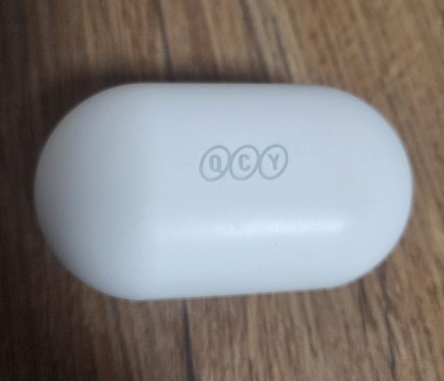
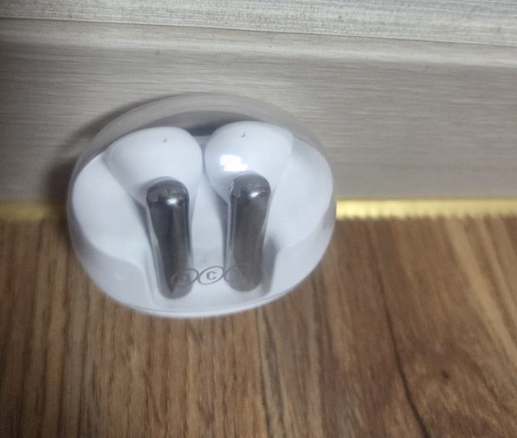

휴대폰에는 잘 붙는 블루투스 이어폰이 PC에는 연결되지 않을 때가 있습니다. 아래 순서대로 하나씩 확인해 보세요.

> **제 이야기**: 노트북으로 한창 작업하던 중에 블루투스 이어폰이 연결되지 않아 꽤 답답했던 적이 있습니다. 그때 같은 상황을 겪는 분들을 위해 확인할 순서를 정리했습니다.

제가 쓰는 QCY 블루투스 이어폰들입니다.

## 1. PC의 블루투스가 켜져 있는지 확인

**설정** → **Bluetooth 및 장치**에서 **Bluetooth**가 **켬**으로 되어 있는지 확인합니다. 작업 표시줄 오른쪽의 빠른 설정에서도 켜고 끌 수 있습니다.

## 2. 이어폰을 '페어링 모드'로 만들기

블루투스 이어폰은 **페어링 모드**일 때만 새 기기와 연결됩니다.

- 대부분 케이스를 연 상태에서 **케이스 버튼을 몇 초간 길게** 누르거나, 이어폰을 **길게 터치**하면 불빛이 깜빡이며 페어링 모드가 됩니다.
- 방법은 제품마다 다르니 설명서를 확인하세요.

> **휴대폰과 이미 연결된 상태라면** PC와 연결이 안 될 수 있습니다. 휴대폰의 블루투스를 잠시 끄고 시도해 보세요.

## 3. 배터리와 거리 확인

- 이어폰이나 스피커를 **충분히 충전**한 뒤 껐다 켜고 다시 시도합니다.
- PC와 **가까운 곳**에서 연결합니다.

## 4. 블루투스 껐다 켜기

**Bluetooth 및 장치**에서 Bluetooth를 **끄고 10초 정도 기다린 뒤** 다시 켜고 연결해 봅니다.

## 5. 장치 제거 후 다시 등록하기

예전에 연결했던 기록이 꼬여 있으면 연결이 안 될 수 있습니다.

1. **설정** → **Bluetooth 및 장치**에서 해당 기기 옆의 **…(더 보기)** → **장치 제거**를 누릅니다.
2. 이어폰을 페어링 모드로 만든 뒤 **장치 추가** → **Bluetooth**를 선택합니다.
3. 목록에 나타난 이어폰을 눌러 연결합니다.

<!-- 스크린샷 자리: Bluetooth 및 장치 > 장치 추가 화면 -->

## 6. 윈도우 업데이트 후 다시 시작

- **설정** → **Windows 업데이트** → **업데이트 확인**
- 업데이트가 끝나면 PC를 **다시 시작**합니다.

## 연결은 됐는데 소리가 안 난다면

이어폰이 **연결됨**으로 나오는데 소리가 PC 스피커로 나온다면, 출력 장치가 바뀌지 않은 것입니다. 작업 표시줄 스피커 아이콘 → 볼륨 막대 옆 **화살표(>)** 에서 이어폰을 선택하세요. 자세한 방법은 [컴퓨터에서 소리가 안 날 때 확인할 5가지](/pc-no-sound) 글을 참고하세요.

_참고: Microsoft 고객지원 「Windows에서 Bluetooth가 연결되지 않는 문제 해결」_
