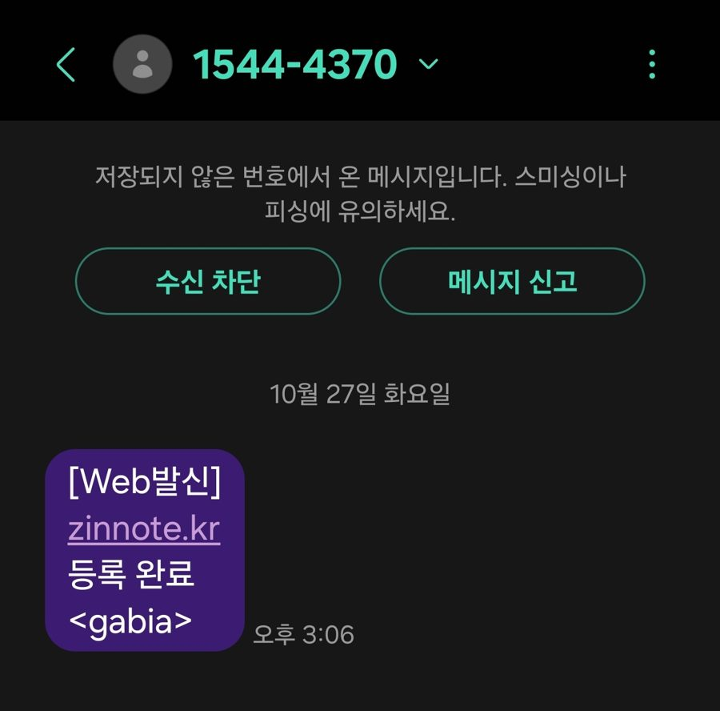
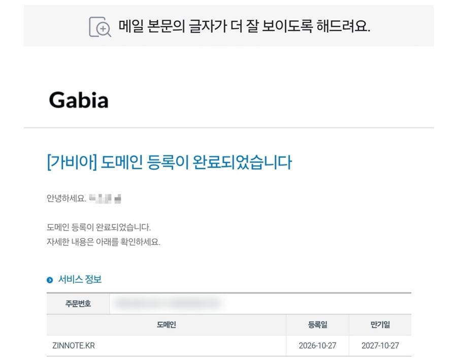

블로그를 무료로 만들고 나니, 다음으로 고민된 게 **나만의 주소(도메인)** 였습니다. 애드센스를 신청하려면 `아이디.github.io/홈페이지` 같은 주소보다 내 도메인이 있는 편이 낫다고 해서, 직접 사 보기로 했습니다.

> **제 이야기**: 저는 Cloudflare와 가비아 두 곳을 놓고 꽤 고민했습니다. 돈은 조금 더 들지만, 결국 **대한민국 .kr** 만큼은 포기할 수 없어서 가비아를 골랐고, `zinnote.kr` 을 1년 **16,500원**에 결제했습니다. 이 블로그 주소가 바로 그 도메인입니다.

## 1. 처음에 비교한 두 곳

### 가격표 (1년 기준, 2026년 10월 확인)

|           | Cloudflare                      | 가비아                                            |
| --------- | ------------------------------- | ------------------------------------------------- |
| .com 신규 | 약 $10.46 (약 1만 5천 원)       | 정상가 26,400원 (첫해 할인 행사가 자주 있음)      |
| .com 연장 | 신규와 같은 가격                | 정상가 기준                                       |
| .kr 신규  | **판매 안 함**                  | 정상가 23,100원 (저는 첫해 할인으로 **16,500원**) |
| 결제 방법 | 해외 결제되는 카드, 달러로 결제 | 국내 카드, 간편결제                               |

- 가비아 가격은 부가세 포함 금액입니다.
- Cloudflare는 달러로 결제해서 환율에 따라 원화 금액이 조금씩 달라집니다. 해외 결제 수수료가 붙을 수도 있습니다.

> 도메인 가격은 업체 행사나 환율에 따라 자주 바뀝니다. 정확한 금액은 꼭 결제 화면에서 확인하세요.

### 장단점 비교

**Cloudflare**

- 👍 도메인을 원가에 팔아서 **가장 싼 편**이고, 다음 해 연장 가격도 처음과 같습니다.
- 👍 DNS 설정, 보안 기능이 무료로 함께 붙어 있습니다.
- 👎 화면이 **전부 영어**라 처음이면 헤매기 쉽습니다.
- 👎 **해외 결제** 카드가 있어야 합니다.
- 👎 **.kr 같은 한국 주소는 살 수 없습니다.**

**가비아**

- 👍 화면이 **한글**이고, 막히면 전화 상담도 받을 수 있습니다.
- 👍 국내 카드나 간편결제로 바로 살 수 있습니다.
- 👍 **.kr, .co.kr 같은 한국 주소**를 살 수 있습니다.
- 👎 정상가는 Cloudflare보다 비쌉니다.
- 👎 첫해 할인이 끝나면 **다음 해 연장 가격이 오를 수 있습니다.**

가격만 보면 Cloudflare가 더 싸서 처음엔 마음이 기울었습니다. 그런데 영어 화면에 해외 결제까지 해야 해서 망설여졌습니다.

## 2. 결국 .kr 때문에 가비아로

결정적인 이유는 **.kr** 이었습니다. 한국 사람이 한국어로 쓰는 블로그인데, 주소 끝에도 대한민국을 뜻하는 `.kr` 을 달고 싶었습니다. 그런데 Cloudflare에서는 .kr 주소를 아예 팔지 않습니다. Cloudflare가 공개한 판매 도메인 목록에 .kr이 없습니다.

가격만 따지면 Cloudflare에서 .com을 사는 쪽이 더 쌌습니다. 몇천 원 차이로 한참 고민했지만, 결국 **대한민국 .kr은 포기할 수 없었습니다.** 조금 더 비싸도 매일 보는 내 블로그 주소니까, 마음에 드는 걸로 하기로 했습니다.

그래서 한글 화면이라 편하고, .kr도 살 수 있는 가비아로 정했습니다.

## 3. 가비아에서 도메인 사는 순서

1. 가비아에 **회원가입**하고 로그인합니다. 휴대폰 본인인증이 필요합니다.
2. 맨 위 검색창에 원하는 이름을 넣고 검색합니다. (저는 `zinnote`)
3. 결과 목록에서 **.kr** 에 체크하고 **신청하기**를 누릅니다.
4. 등록 기간은 **1년**으로 했습니다. 처음엔 1년만 써 보고 연장할지 정하면 됩니다.
5. **네임서버**는 "가비아 네임서버" 그대로 둡니다.
6. 호스팅, 메일, 웹빌더 같은 **추가 상품은 선택하지 않습니다.** 블로그 주소만 필요하면 없어도 됩니다.
7. 결제합니다. 저는 이 단계에서 **16,500원**이 나왔습니다.

결제하고 나니 바로 휴대폰으로 **"zinnote.kr 등록 완료"** 문자가 왔습니다.

메일로도 등록 완료 안내가 왔는데, 등록일과 **만기일**이 함께 적혀 있었습니다. 1년으로 신청해서 만기일이 정확히 1년 뒤입니다. 이 날짜 전에 연장하지 않으면 주소가 끊기니, 달력에 꼭 적어 두세요.

## 4. 사고 나서 할 일

도메인을 샀다고 바로 블로그가 그 주소로 열리지는 않습니다. **DNS 설정**으로 "이 주소로 오면 내 블로그로 보내 줘"라고 알려 줘야 합니다. 저는 GitHub Pages로 블로그를 운영해서, 가비아 DNS 관리 화면에 GitHub이 안내하는 주소 4개(A 레코드)와 www 주소 1개(CNAME 레코드)를 넣었습니다.

여기서 한 번 막혔습니다. 여러 줄을 한꺼번에 입력하고 저장을 누르니 **"추가/수정 중인 레코드가 존재합니다"** 라며 저장이 안 됐습니다. 알고 보니 **한 줄 입력할 때마다 그 줄의 확인 버튼을 먼저 누르고**, 마지막에 저장을 눌러야 했습니다.

GitHub Pages 블로그를 만드는 과정은 [서버비 0원 홈페이지 만들기](/free-homepage-github-pages) 글에 정리해 두었습니다.

## 정리

- 싸게 .com을 사고 싶고 영어 화면과 해외 결제가 괜찮다면 **Cloudflare**도 좋은 선택입니다.
- **.kr 주소를 원하거나 한글 화면이 편하다면** 가비아처럼 국내 업체가 낫습니다.
- 저는 조금 더 비싸도 .kr을 포기할 수 없어서 가비아를 골랐고, 1년 16,500원을 냈습니다.
- 다음 해 연장 가격은 첫해와 다를 수 있으니, 결제 전에 꼭 확인하세요.

이제 목표는 하나입니다. 이 16,500원, 애드센스로 꼭 다시 벌어 보겠습니다.

_참고: Cloudflare Registrar 지원 도메인 목록(TLD Policies), 가비아 도메인 등록 안내 페이지, 도메인 가격 비교 사이트(costgoat.com)_
