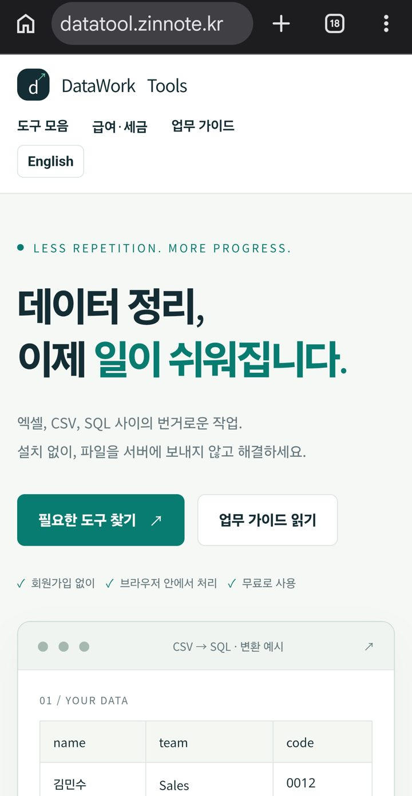
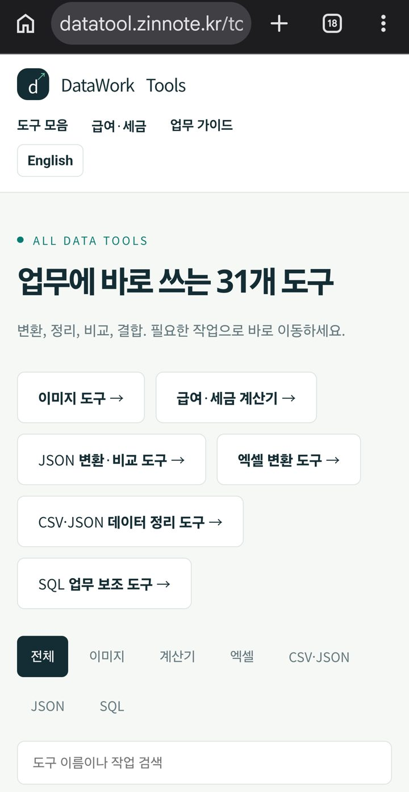
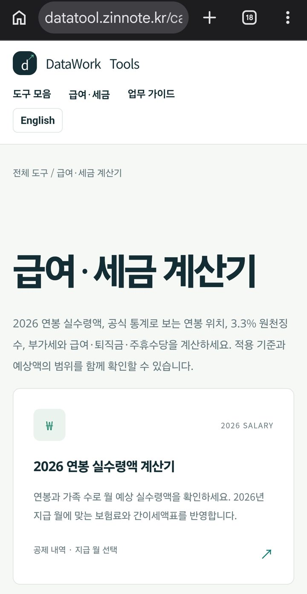
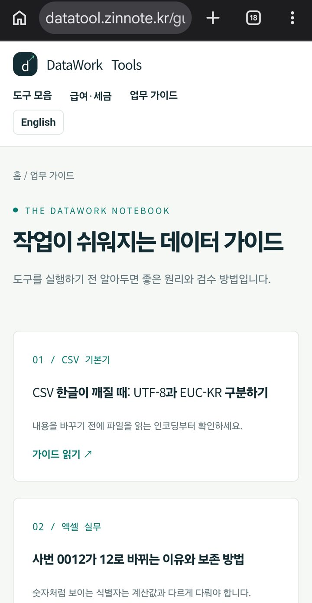

이 블로그(ZIN 노트)는 Claude와 함께 만들었습니다. 그런데 제가 AI로 만든 사이트가 하나 더 있습니다. **ChatGPT**와 함께 만든 업무용 데이터 도구 사이트, **DataWork Tools**입니다.

> **제 이야기**: 주소는 [datatool.zinnote.kr](https://datatool.zinnote.kr)입니다. 이 블로그와 같은 도메인(zinnote.kr) 아래에 따로 열어 두었습니다. 아래 화면은 모두 제 휴대폰으로 직접 캡처한 것입니다.

## 1. 어떤 사이트인가요?

첫 화면에 적어 둔 한 줄 소개는 이렇습니다.

> 엑셀, CSV, SQL 사이의 번거로운 작업. 설치 없이, 파일을 서버에 보내지 않고 해결하세요.

특징은 세 가지입니다.

- **회원가입 없이** 바로 씁니다.
- 파일을 서버로 보내지 않고 **브라우저 안에서 처리**합니다.
- **무료**로 사용합니다.

회사 파일에는 이름, 사번 같은 정보가 들어 있는 경우가 많습니다. 그래서 파일을 어딘가에 올리지 않고 내 브라우저 안에서만 처리하도록 만든 것이 이 사이트의 핵심입니다.

## 2. 업무에 바로 쓰는 31개 도구

**도구 모음** 메뉴에는 지금 31개의 도구가 있고, 이렇게 나뉘어 있습니다.

| 분류             | 하는 일                        |
| ---------------- | ------------------------------ |
| 이미지 도구      | 이미지 관련 작업               |
| 급여·세금 계산기 | 실수령액, 원천징수 등 계산     |
| JSON 변환·비교   | JSON 데이터 변환과 비교        |
| 엑셀 변환        | 엑셀 파일 변환                 |
| CSV·JSON 정리    | CSV, JSON 데이터 정리          |
| SQL 업무 보조    | CSV를 SQL로 바꾸는 등 SQL 작업 |

맨 아래 검색창에 도구 이름이나 하고 싶은 작업을 입력하면 바로 찾을 수 있습니다.

## 3. 급여·세금 계산기

직장인이라면 한 번쯤 궁금한 계산을 모아 둔 곳입니다.

- 2026 연봉 실수령액
- 공식 통계로 보는 연봉 위치
- 3.3% 원천징수
- 부가세, 퇴직금, 주휴수당

예를 들어 **2026 연봉 실수령액 계산기**는 연봉과 가족 수를 넣으면 월 예상 실수령액을 보여 주고, 2026년 지급 월에 맞는 보험료와 간이세액표를 반영합니다. 계산 결과는 어디까지나 **예상액**이라, 정확한 금액은 회사 급여 명세서로 확인하는 것이 맞습니다.

## 4. 업무 가이드

도구만 있으면 "왜 이렇게 되지?"를 알기 어렵습니다. 그래서 **업무 가이드** 메뉴에 도구를 쓰기 전에 알아 두면 좋은 내용을 글로 정리해 두었습니다.

- **CSV 한글이 깨질 때**: UTF-8과 EUC-KR 구분하기
- **사번 0012가 12로 바뀌는 이유**와 보존 방법

둘 다 엑셀이나 CSV를 다루다 보면 자주 만나는 문제입니다.

## 5. ChatGPT와 Claude, 둘 다 써 보니

저는 지금 두 AI를 모두 쓰고 있습니다. 실제로 드는 비용은 [AI로 블로그 만들기, 실제로 들어간 돈과 시간 공개](/ai-blog-real-cost-time)에 적어 두었습니다.

- **DataWork Tools**: ChatGPT와 함께 만들었습니다.
- **ZIN 노트(이 블로그)**: Claude와 함께 만들고 운영합니다.

코드를 직접 짜지 못해도, 무엇을 만들고 싶은지 설명하고 결과를 확인하는 방식으로 사이트를 두 개나 만들 수 있었습니다.

## 정리

- DataWork Tools는 ChatGPT와 함께 만든 **업무용 데이터 도구 사이트**입니다.
- 회원가입 없이, 파일을 서버에 보내지 않고, 무료로 씁니다.
- 지금 **31개 도구**와 급여·세금 계산기, 업무 가이드가 있습니다.

엑셀이나 CSV 때문에 막히는 일이 있다면 [datatool.zinnote.kr](https://datatool.zinnote.kr)에서 한 번 찾아보세요.

## 함께 보면 좋은 글

- [클로드 스킬 설치 방법, SEO 점검 스킬로 내 블로그를 점검해 봤습니다](/claude-skill-seo-audit)
- [AI로 블로그 만들기, 실제로 들어간 돈과 시간 공개](/ai-blog-real-cost-time)
