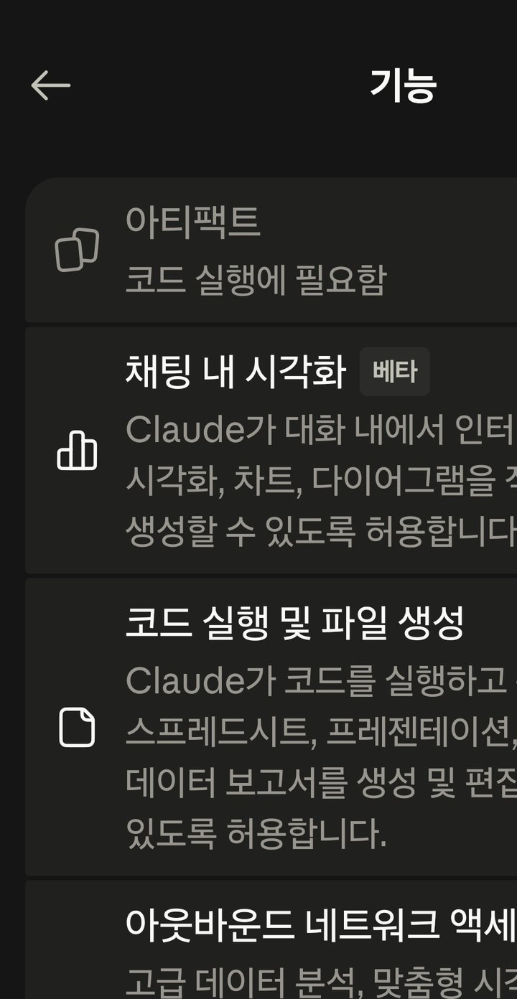
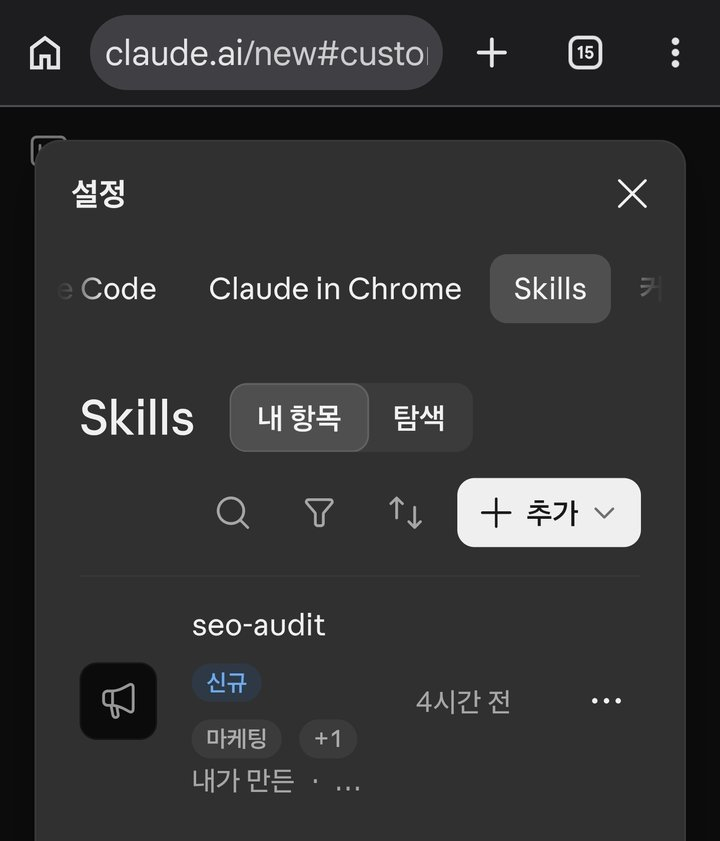
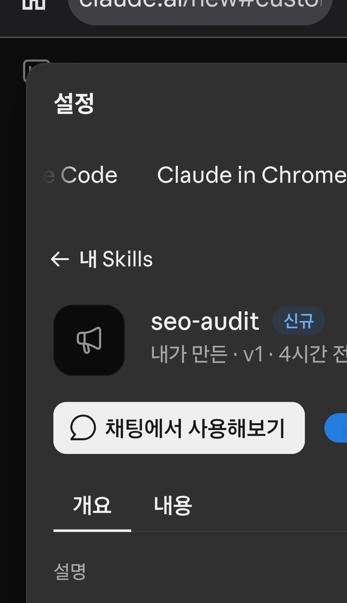
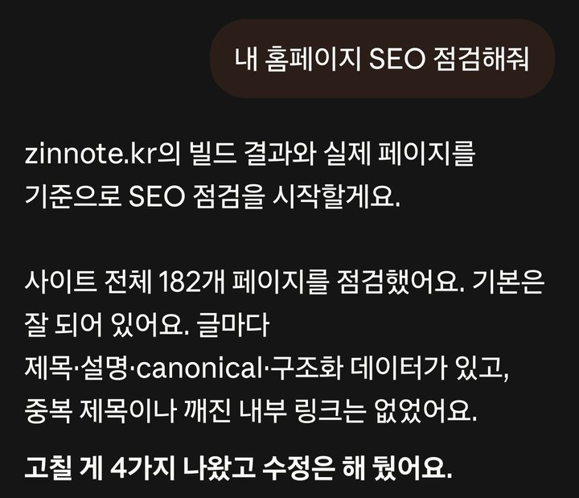

AI에게 일을 시키다 보면 매번 같은 설명을 반복하게 됩니다. "검색 노출을 점검할 때는 이것부터 보고, 결과는 이런 순서로 정리해 줘" 같은 말이죠. 클로드(Claude)의 **스킬(Skill)** 은 이런 작업 방법을 미리 묶어 두는 기능입니다.

이 글에서는 스킬이 무엇인지, 어떻게 설치하는지 정리하고, 실제로 **SEO 점검 스킬**을 설치해서 이 블로그(ZIN 노트)를 점검받은 결과를 공개합니다.

## 클로드 스킬이란?

Anthropic 공식 도움말은 스킬을 "클로드에게 전문 지식과 작업 방식을 더해 주는 기능"이라고 설명합니다. 쉽게 말해 **특정 일을 잘하는 방법이 적힌 설명서 묶음**입니다.

- 스킬은 폴더 하나로 되어 있고, 그 안에 작업 방법을 적은 문서(skill.md)가 들어 있습니다.
- 설치해 두면 관련된 요청을 했을 때 클로드가 알아서 그 설명서를 꺼내 따라 합니다.
- 다른 사람이 만들어 공개한 스킬을 받아서 설치할 수도 있습니다.

## 스킬 쓰기 전에 확인할 것

공식 도움말 기준으로 정리하면 다음과 같습니다.

- **사용 가능한 요금제:** Free, Pro, Max 등 개인 요금제와 Team, Enterprise 모두 쓸 수 있습니다.
- **코드 실행 기능이 켜져 있어야 합니다.** 개인 요금제라면 **설정 > 기능** 에서 **코드 실행 및 파일 생성** 스위치가 켜져 있는지 확인합니다. 영어 화면에서는 Settings > Capabilities > Code execution and file creation 입니다.

## 스킬 설치 방법 (ZIP 파일 올리기)

1. 클로드 웹(claude.ai)에서 **설정 > Skills** 로 들어갑니다. 영어 화면에서는 Customize > Skills 이고, 주소창에 claude.ai/customize/skills 를 넣어도 됩니다.
2. **내 항목** 에서 **+ 추가** 버튼을 누릅니다.
3. 스킬 올리기(영어 화면은 Upload a skill)를 고르고, 스킬 폴더를 압축한 **ZIP 파일**을 올립니다.
4. 목록에 스킬이 생기면 스위치로 켜고 끌 수 있습니다. 꺼 둔 스킬은 클로드가 쓰지 않습니다.

옆의 **탐색** 탭에서는 이미 만들어진 스킬을 둘러볼 수 있습니다.

저는 휴대폰 앱에서 이 메뉴를 찾지 못해서, 휴대폰 **크롬 브라우저로 claude.ai에 들어가** 설정을 열었습니다. 스킬 목록에 올린 seo-audit이 '내가 만든' 스킬로 보입니다.

ZIP 파일을 만들 때 주의할 점도 있습니다. ZIP 안에 **스킬 폴더가 통째로** 들어 있어야 하고, 폴더 이름은 스킬 이름과 같아야 합니다. 파일만 풀어서 압축하면 올릴 때 오류가 납니다.

공식 도움말은 **믿을 수 있는 곳에서 받은 스킬만 설치하라**고 당부합니다. 스킬 안의 설명을 클로드가 그대로 따르기 때문입니다. 받은 스킬은 설치하기 전에 안의 skill.md 내용을 한 번 열어 보는 것이 좋습니다.

## 설치한 스킬: SEO 점검 (seo-audit)

제가 설치한 것은 **seo-audit** 스킬입니다. 마케터 Corey Haines가 공개한 마케팅 스킬 모음(marketingskills, MIT 라이선스)에 들어 있는 스킬로, 검색 노출 문제를 아래 순서로 점검하게 되어 있습니다.

1. 구글이 페이지를 찾고 색인할 수 있는지 (robots.txt, 사이트맵, noindex)
2. 사이트 속도와 기술적 기본기
3. 제목, 설명, 제목 태그(H1) 같은 페이지 요소
4. 글 내용의 품질
5. 외부 링크와 신뢰도

스킬을 누르면 설명과 켜기/끄기 스위치, **채팅에서 사용해보기** 버튼이 나옵니다. **내용** 탭에서는 스킬에 적힌 설명서 전체를 읽어 볼 수 있습니다.

## 클로드에게 "내 홈페이지 SEO 점검해줘"라고 했더니

스킬을 켜 둔 상태에서 한 줄만 보냈습니다. 클로드는 이 블로그 전체(182페이지)를 하나씩 검사했고, 결과를 문제의 크기 순서로 알려 줬습니다. 좋은 점부터 말하면, 글마다 제목·설명·대표 주소(canonical)가 다 있었고 제목이 겹치거나 깨진 내부 링크도 없었습니다.

대신 고칠 것이 4가지 나왔습니다.

### 1. 사이트맵에 검색 제외 페이지가 102개 섞여 있었다

이 블로그는 태그별 글 목록 페이지(예: '#갤럭시' 태그 모음)를 **검색 결과에 나오지 않게(noindex)** 해 두었습니다. 그런데 구글에 "이 페이지들을 봐 주세요"라고 제출하는 사이트맵에는 이 태그 페이지 102개가 그대로 들어 있었습니다. 구글 입장에서는 "봐 달라면서 검색에는 넣지 말라"는 엇갈린 신호입니다.

실제로 구글 서치 콘솔에서 noindex 관련 경고 메일을 받은 적이 있는데, 이것이 원인 중 하나였습니다. 태그 페이지를 사이트맵에서 빼자 **179개였던 주소가 72개**로 줄었습니다.

### 2. 공유 이미지가 템플릿 광고 화면이었다

이 블로그는 AstroWind라는 무료 템플릿으로 만들었습니다. 그런데 카카오톡 같은 곳에 글 링크를 붙였을 때 뜨는 대표 이미지가 157개 페이지에서 **템플릿 홍보 화면** 그대로였습니다. 방문자가 보기에도 어색하고, 템플릿을 손대지 않은 사이트처럼 보일 수 있습니다. ZIN 노트 이름이 들어간 이미지로 바꿨습니다.

### 3. 홈 화면 제목이 'ZIN 노트' 한 단어뿐이었다

검색 결과에 나오는 홈 화면 제목에 블로그가 무엇을 다루는지가 없었습니다. 지금은 "ZIN 노트 — 스마트폰·PC 오류 해결과 IT 생활 팁"으로 바꿨습니다. 카테고리 페이지 설명도 "스마트폰 카테고리의 글 모음입니다" 같은 한 줄에서, 실제로 어떤 글이 있는지 알 수 있는 문장으로 바꿨습니다.

### 4. 쓰지 않는 관리자 페이지가 남아 있었다

템플릿에 딸려 온 글 관리 페이지(/decapcms)가 열려 있었습니다. 저는 쓰지 않는 기능이라 지웠습니다.

## 직접 써 보니

- **한 줄 요청으로 끝까지 해 줍니다.** 무엇을 어떤 순서로 볼지 제가 설명하지 않아도, 스킬에 적힌 순서대로 점검하고 우선순위까지 정리해 줬습니다.
- **제가 몰랐던 문제를 찾았습니다.** 서치 콘솔 경고 메일을 받고도 원인을 몰랐는데, 사이트맵과 noindex 설정이 엇갈린 것이 원인이었습니다.
- **고치는 것은 따로 확인했습니다.** 수정은 바로 실제 사이트에 반영되기 때문에, 클로드가 먼저 결과를 보여 주고 제가 "올려줘"라고 한 뒤에 반영했습니다.

### 느낀 점

- **AI도 잘 쓰려면 공부가 필요합니다.** 한 줄로 시키면 된다고 해도, 스킬이 무엇이고 어디서 켜는지는 직접 알아봐야 했습니다. AI를 쓰려면 공부해야 한다는 것을 다시 한번 느꼈습니다.
- **보안 문제는 꼭 확인해야 합니다.** 스킬은 클로드가 그대로 따르는 설명서라서, 누가 만든 것인지와 안에 무엇이 적혀 있는지 설치 전에 반드시 확인하려고 합니다.
- **설치는 PC가 기본입니다.** 휴대폰 앱에서는 스킬 메뉴를 찾을 수 없었고, 모바일에서는 안 되는 기능이 많았습니다. 휴대폰이라면 브라우저로 claude.ai에 들어가는 편이 낫고, 가능하면 PC에서 하는 것을 추천합니다.

남은 숙제도 하나 받았습니다. 글 23개는 다른 글 본문에서 한 번도 링크되지 않았다고 합니다. 앞으로 새 글을 쓸 때 관련 글을 2~3개씩 이어 주려고 합니다. 블로그를 만든 과정이 궁금하다면 [서버 비용 0원으로 나만의 홈페이지 만들기](/free-homepage-github-pages)와 [구글 서치 콘솔에 내 홈페이지 등록하는 방법](/google-search-console-register)도 같이 보세요.

## 정리

- 클로드 스킬은 **작업 방법을 묶어 둔 설명서**로, 설치해 두면 관련 요청에서 알아서 쓰입니다.
- 설치는 **Customize > Skills > + > Create skill > Upload a skill** 에서 ZIP 파일을 올리면 됩니다.
- 스킬은 믿을 수 있는 곳에서 받은 것만 쓰고, 설치 전에 내용을 한 번 확인합니다.

다음 글에서도 직접 설치해 본 AI 스킬을 하나씩 소개하겠습니다.
