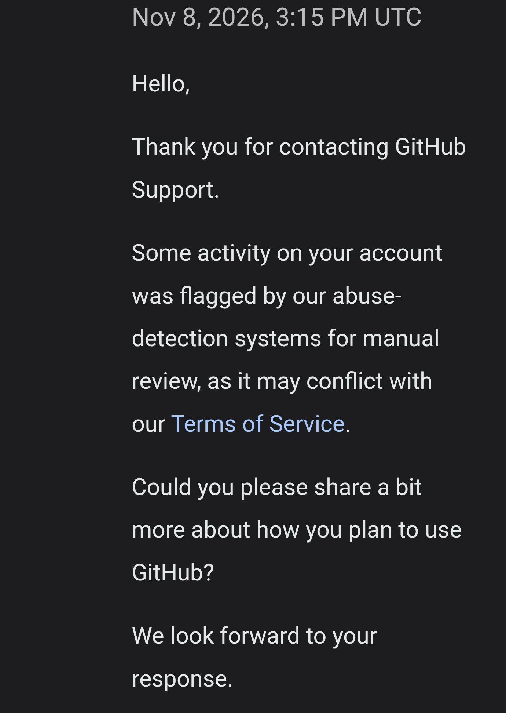

이 블로그는 GitHub Pages로 운영하고 있습니다. 서버비가 0원이라 좋았는데, 그만큼 **GitHub 계정 하나에 블로그 전체가 달려 있다**는 걸 이번에 제대로 알게 됐습니다. 계정이 갑자기 정지되면서 블로그가 통째로 안 열렸기 때문입니다.

> **제 이야기**: 정말 진땀 나는 기간이었습니다. 애드센스 재신청을 준비하던 중에 블로그가 404가 됐으니까요. 지금은 계정이 다시 풀렸고, 이 글도 그 계정으로 올리고 있습니다.

## 1. 무슨 일이 있었나

- **2026년 11월 8일 저녁**: 새 글을 올린 직후, GitHub에 접속하면 "계정이 정지되었습니다(Your account was suspended)"라는 안내만 나왔습니다.
- 같은 시각 **zinnote.kr이 404**가 됐습니다. GitHub Pages는 계정이 정지되면 사이트도 함께 내려갑니다.

## 2. 지원팀에 메일 보내기

GitHub 지원 페이지(support.github.com)는 로그인을 해야 문의를 쓸 수 있는데, 계정이 정지된 상태라 그 화면으로 들어갈 수가 없었습니다. 그래서 가입한 메일 주소에서 **GitHub 지원팀 메일로 직접** 이의신청을 보냈습니다.

## 3. 받은 답장

메일을 보내고 몇 시간 뒤 GitHub 지원팀에서 답장이 왔습니다. 답장 시각은 2026년 11월 8일 오후 3시 15분(UTC), 한국 시간으로는 11월 9일 0시 15분입니다.

우리말로 옮기면 이렇습니다.

> 계정의 일부 활동이 저희 **악용 감지 시스템**에 걸려 사람이 직접 검토하게 되었습니다. 서비스 약관과 맞지 않을 수 있기 때문입니다. GitHub를 **어떻게 사용할 계획인지** 조금 더 알려 주시겠어요?

정확히 어떤 활동이 걸렸는지는 답장에 나와 있지 않았습니다. 그래서 정지된 진짜 이유는 지금도 정확히 모릅니다.

## 4. 기다리는 동안 한 일

계정이 언제 풀릴지 알 수 없어서, 기다리는 동안 두 가지를 해 뒀습니다.

1. **블로그 전체 백업**: 다행히 작업하던 복사본이 남아 있어서, 글과 사진, 사이트 코드를 통째로 따로 저장해 뒀습니다.
2. **Cloudflare 연결**: 블로그가 계속 닫혀 있지 않도록 Cloudflare로 연결해서 다시 열리게 했습니다. 도메인(zinnote.kr)을 따로 사 둔 덕분에 주소는 그대로 쓸 수 있었습니다.

도메인을 산 이야기는 [블로그 도메인 어디서 살까?](/buy-kr-domain-gabia)에 있습니다.

## 5. 다시 풀렸습니다

**11월 12일 아침**에 확인해 보니 GitHub 계정이 다시 정상으로 돌아와 있었고, 블로그에 새 글을 올리는 것도 다시 됐습니다. 정지된 날부터 세면 나흘 만입니다.

## 6. 이번에 배운 것

- **무료 서비스 하나에 전부 맡기면 위험합니다.** 계정이 막히면 블로그도 같이 닫힙니다.
- **백업은 미리.** 정지되고 나서는 내 저장소에서 파일을 내려받는 것도 안 됩니다.
- **내 도메인은 꼭 필요합니다.** 주소가 내 것이어야 다른 곳으로 옮겨도 방문자가 길을 잃지 않습니다.
- **정지되면 가입한 메일로 지원팀에 바로 연락합니다.** 저는 몇 시간 만에 답장을 받았습니다.

## 정리

- 11월 8일 저녁 GitHub 계정 정지, 블로그 404
- 지원팀에 메일로 이의신청, 몇 시간 뒤 답장
- 기다리는 동안 백업과 Cloudflare 연결
- 11월 12일 아침 정상 확인

애드센스 거절에 이어 계정 정지까지, 한 달도 안 되는 사이에 일이 많았습니다. 그래도 이런 일까지 그대로 기록하는 게 이 블로그의 방향입니다. 애드센스 이야기는 [애드센스 첫 신청 거절 후기](/adsense-rejected-first)에 있습니다.
