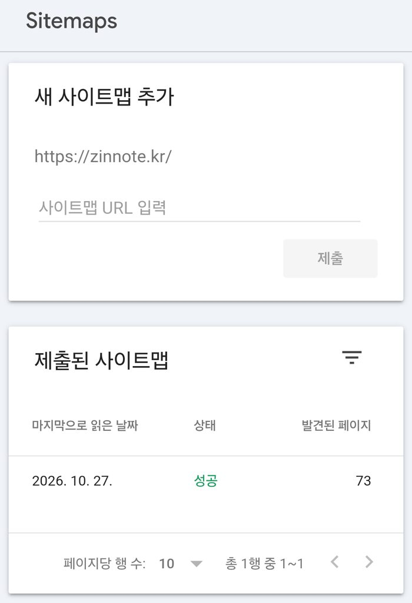
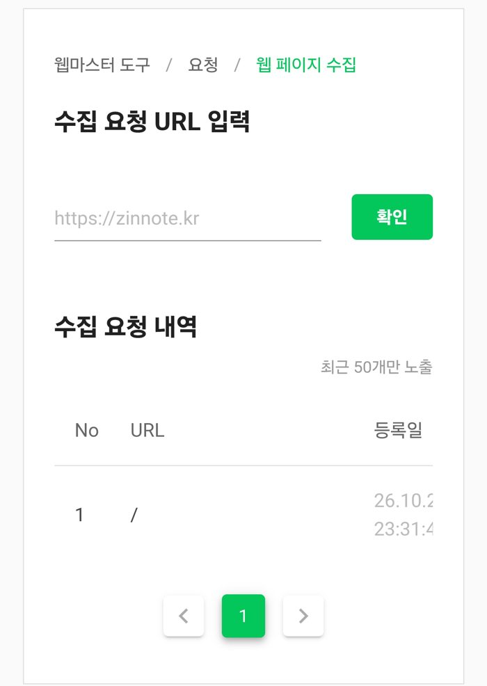

홈페이지를 만들었다면 다음은 **구글 검색에 나오게 하는 것**입니다. 그 첫걸음이 **구글 서치 콘솔(Google Search Console)** 등록입니다. 이 블로그도 실제로 이 순서대로 등록했습니다.

> **제 이야기**: 저도 이 등록을 직접 해 봤는데, 꽤 헤맨 끝에 간신히 성공했습니다. 특히 휴대폰에서는 '속성 추가' 메뉴가 왼쪽 위 ☰ 안에 숨어 있어서 한참 찾았습니다. 저도 했으니 당신도 할 수 있습니다.

## 서치 콘솔이 뭔가요?

구글이 무료로 제공하는 사이트 관리 도구입니다. 등록해 두면 다음과 같은 것을 확인할 수 있습니다.

- 내 사이트가 **어떤 검색어로** 구글에 노출되고 클릭되는지
- 구글이 내 페이지를 **제대로 읽어 갔는지(색인)**
- 사이트에 **오류**가 없는지

## 1단계: 속성 추가하기

서치 콘솔에 구글 계정으로 로그인한 뒤 **속성 추가**를 누르면 두 가지 방식이 나옵니다.

| 방식           | 특징                                                                                      |
| -------------- | ----------------------------------------------------------------------------------------- |
| **도메인**     | 하위 주소까지 한 번에 등록. 대신 **도메인 업체(DNS)에서만** 소유권 확인 가능              |
| **URL 접두어** | 입력한 주소로 시작하는 페이지만 등록. **HTML 파일, HTML 태그** 등 여러 방법으로 확인 가능 |

`아이디.github.io` 처럼 **내 도메인이 없는 무료 주소**라면 DNS를 직접 바꿀 수 없으니 **URL 접두어** 방식을 고르고, 내 홈페이지 주소를 정확히 입력합니다.

## 2단계: 소유권 확인하기 (HTML 파일 방식)

1. 소유권 확인 방법 중 **HTML 파일**을 선택합니다.
2. 구글이 주는 **확인용 HTML 파일**을 내려받습니다. 파일 이름은 계정마다 다릅니다.
3. 이 파일을 홈페이지의 **최상위 폴더**에 그대로 올립니다. (이 블로그처럼 Astro를 쓴다면 `public` 폴더에 넣으면 됩니다.)
4. 브라우저의 **시크릿 창**에서 `내주소/파일이름.html` 이 열리는지 확인합니다.
5. 서치 콘솔로 돌아와 **확인**을 누릅니다.

> **주의:** 확인이 끝난 뒤에도 이 파일을 **지우면 안 됩니다.** 구글이 주기적으로 다시 확인하기 때문에, 파일이 없어지면 소유권이 해제됩니다. 파일 이름과 내용도 바꾸지 마세요.

<!-- 스크린샷 자리: 소유권 확인 성공 화면 -->

## 3단계: 사이트맵 제출하기

사이트맵은 내 홈페이지에 어떤 페이지가 있는지 알려 주는 목록 파일입니다.

1. 서치 콘솔 왼쪽 메뉴에서 **Sitemaps(사이트맵)** 를 엽니다.
2. **새 사이트맵 추가** 칸에 사이트맵 주소를 입력하고 **제출**을 누릅니다.
3. 상태가 **성공**으로 나오면 완료입니다. **가져올 수 없음**이 나오면 주소가 맞는지 다시 확인하세요.

이 블로그처럼 Astro로 만든 사이트는 보통 `sitemap-index.xml` 이라는 이름으로 사이트맵이 자동 생성됩니다. 워드프레스나 다른 도구는 이름이 다를 수 있습니다.

제 블로그도 이렇게 제출했습니다. 상태에 초록색으로 **성공**이 뜨고, 구글이 찾은 페이지 수(제 경우 73개)가 나오면 제대로 된 것입니다. 처음엔 "가져올 수 없음"이 잠깐 뜰 수 있는데, 시간이 지나면 바뀌니 너무 걱정하지 않아도 됩니다.

## 덤: 네이버에도 등록하기

한국에서는 네이버 검색도 중요해서, 저는 **네이버 서치어드바이저**에도 같이 등록했습니다. 순서는 구글과 거의 같습니다.

1. 네이버 서치어드바이저의 **웹마스터 도구**에서 내 사이트 주소를 추가합니다.
2. **HTML 태그** 방식으로 소유 확인을 합니다. 네이버가 주는 `<meta ...>` 한 줄을 홈페이지에 넣고 **소유확인**을 누릅니다.
3. **요청 → 사이트맵 제출**에서 사이트맵 주소를 넣습니다.
4. **요청 → 웹 페이지 수집**에서 첫 화면 주소를 넣어 두면 조금 더 빨리 수집됩니다.

저는 처음에 소유확인 버튼을 끝까지 누르지 않아서 사이트 목록에 아예 안 보였습니다. 결국 처음부터 다시 등록했습니다. **소유확인이 "완료"로 바뀌는 것까지** 꼭 확인하세요.

## 등록한 뒤에 알아 둘 것

- **데이터가 쌓이기까지 며칠이 걸립니다.** 등록 직후에는 아무것도 안 보여도 정상입니다.
- 사이트맵을 제출해도 **모든 페이지가 바로 검색에 나오는 것은 아닙니다.** 구글이 판단해서 차례로 색인합니다.
- 결국 검색에 잘 나오는 가장 확실한 방법은 **도움이 되는 글을 꾸준히 쓰는 것**입니다.

## 정리

**속성 추가(URL 접두어) → HTML 파일로 소유권 확인 → 사이트맵 제출.** 한 번만 해 두면 이후로는 글만 쓰면 됩니다.

_참고: Google Search Console 고객센터 「사이트 소유권 확인」, 「Sitemaps 보고서」_
