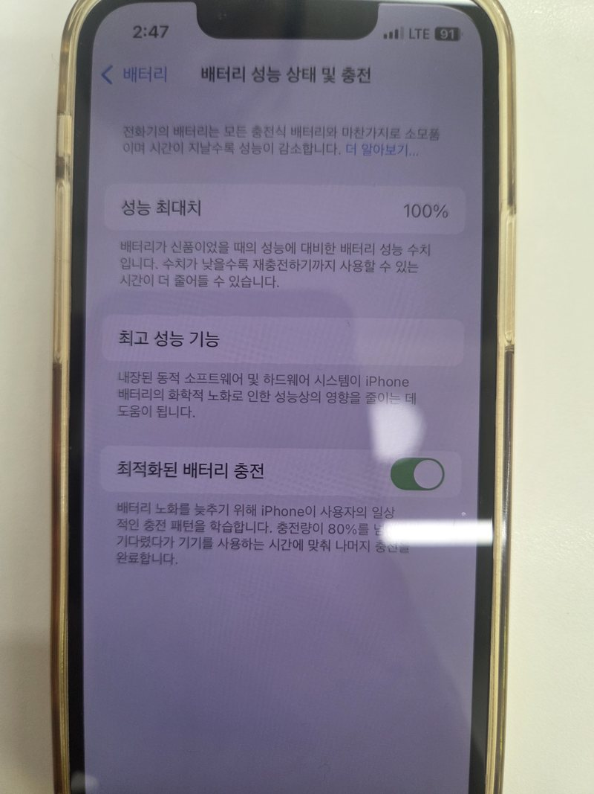

아이폰을 오래 쓰다 보면 "배터리가 예전보다 빨리 닳는 것 같은데, 교체해야 하나?" 하는 생각이 듭니다. 아이폰에는 배터리가 얼마나 남았는지(얼마나 닳았는지) 숫자로 보여 주는 메뉴가 있어서, 서비스 센터에 가지 않아도 직접 확인할 수 있습니다.

> **제 이야기**: 지인 아이폰이 1시간 정도 썼을 뿐인데 배터리가 70%나 깎인 적이 있습니다. 결국 배터리를 교체했는데, 비용이 125,000원 나왔습니다. 교체하기 전에 배터리 상태가 어느 정도인지 직접 확인해 보는 방법을 정리했습니다.

> 이 글은 애플 공식 지원 문서를 바탕으로 정리했습니다. 메뉴 이름은 iOS 버전에 따라 조금 다를 수 있습니다.

## 1. 배터리 성능 상태 확인하는 방법

1. **설정** 앱을 엽니다.
2. **배터리**를 누릅니다.
3. **배터리 성능 상태**를 누릅니다.

제 아이폰에서는 메뉴 이름이 **배터리 성능 상태 및 충전**이었고, 용량 숫자는 **성능 최대치**라는 이름으로 나왔습니다. iOS 버전과 모델에 따라 이름이 조금 다를 뿐 같은 메뉴입니다.

이 화면에서 두 가지를 보면 됩니다.

- **최대 배터리 용량**: 새 배터리일 때와 비교해서 지금 배터리가 담을 수 있는 양을 %로 보여 줍니다. 숫자가 낮을수록 배터리가 많이 닳은 것입니다.
- **최고 성능 기능**: 지금 배터리가 아이폰의 최고 성능을 제대로 받쳐 주고 있는지 문구로 알려 줍니다.

## 2. 최대 배터리 용량, 몇 %가 정상일까?

배터리는 소모품이라서 쓸수록 조금씩 용량이 줄어듭니다. 애플은 이렇게 안내합니다.

| 모델                   | 애플이 안내하는 설계 기준                                    |
| ---------------------- | ------------------------------------------------------------ |
| iPhone 14 및 이전 모델 | 전체 충전 사이클 **500번** 후에도 원래 용량의 **80%** 유지   |
| iPhone 15 모델         | 전체 충전 사이클 **1,000번** 후에도 원래 용량의 **80%** 유지 |

- 이 숫자는 **이상적인 조건**에서의 기준입니다. 실제 수치는 평소에 아이폰을 어떻게 쓰고 충전하는지에 따라 달라집니다.
- **전체 충전 사이클**은 한 번에 0%에서 100%까지 충전하는 것만 말하는 게 아닙니다. 여러 번에 나눠 쓴 양을 합쳐서 배터리 용량의 100%를 쓰면 1사이클로 칩니다.
- 새 아이폰인데 100%가 아니라 조금 낮게 나올 수도 있습니다. 애플은 아이폰이 **만들어진 때와 처음 켜서 사용(활성화)한 때 사이의 기간** 때문에 그럴 수 있다고 안내합니다.

## 3. 최고 성능 기능 문구별 뜻

배터리 성능 상태 화면 아래쪽에 나오는 문구로 배터리 상태를 알 수 있습니다.

### "사용자의 배터리가 현재 정상적인 최고 성능을 지원하고 있습니다."

정상입니다. 따로 할 일은 없습니다.

### "...시스템이 예기치 않게 종료되었습니다. 동일 문제의 재발을 막기 위해 성능 관리가 실행되었습니다."

배터리가 순간적으로 필요한 전력을 내지 못해서 아이폰이 갑자기 꺼진 적이 있다는 뜻입니다. 그래서 아이폰이 다시 꺼지지 않도록 성능을 조금 조절(성능 관리)하고 있는 상태입니다.

- 문구 옆의 **비활성화**를 누르면 이 성능 관리를 끌 수 있습니다.
- 애플 안내에 따르면 한 번 끄면 직접 다시 켤 수는 없고, 갑자기 꺼지는 일이 또 생기면 자동으로 다시 켜집니다.

### "...사용자가 성능 관리 보호를 수동으로 껐습니다."

위의 성능 관리를 직접 꺼 둔 상태라는 뜻입니다.

### "배터리 성능이 매우 저하되었습니다. Apple 공인 서비스 센터에서 배터리를 교체 받아..."

배터리가 많이 닳았다는 뜻입니다. 애플은 이 문구가 **안전 문제는 아니며 배터리를 계속 쓸 수는 있다**고 안내합니다. 다만 사용 시간이 짧거나 성능이 떨어지는 게 불편하다면 애플 또는 공인 서비스 센터에서 배터리 교체를 알아보면 됩니다.

### "이 iPhone이 Apple 정품 배터리를 사용하는지 확인할 수 없습니다."

정품 배터리인지 확인되지 않을 때 나오는 문구입니다(iPhone XS 이후 모델). 이때는 화면에 나오는 배터리 정보가 정확하지 않을 수 있습니다.

## 4. 이럴 때 배터리 교체를 생각해 보세요

- **최대 배터리 용량**이 많이 떨어져서 하루를 버티기 힘들 때
- **"배터리 성능이 매우 저하되었습니다"** 문구가 보일 때
- 아이폰이 배터리가 남아 있는데도 **갑자기 꺼지는** 일이 생길 때

배터리가 빨리 닳는 원인이 배터리 자체가 아니라 앱 사용 때문일 수도 있습니다. **설정** > **배터리**에서 어떤 앱이 배터리를 많이 쓰는지도 함께 확인해 보세요. 충전이 아예 안 된다면 [아이폰 충전이 안 될 때 해결 방법](/iphone-not-charging) 글도 참고하세요.

## 정리

- 확인 경로: **설정 > 배터리 > 배터리 성능 상태**
- **최대 배터리 용량** %가 낮을수록 배터리가 많이 닳은 것
- 애플 기준: iPhone 14 이전은 500사이클, iPhone 15는 1,000사이클 후에도 80% 유지하도록 설계
- **최고 성능 기능** 문구로 성능 관리 여부와 교체 필요 여부를 알 수 있음

_참고: Apple 지원 「iPhone 배터리 및 성능」_
