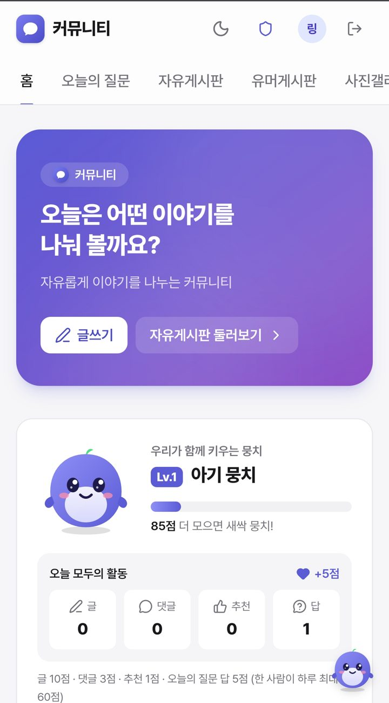
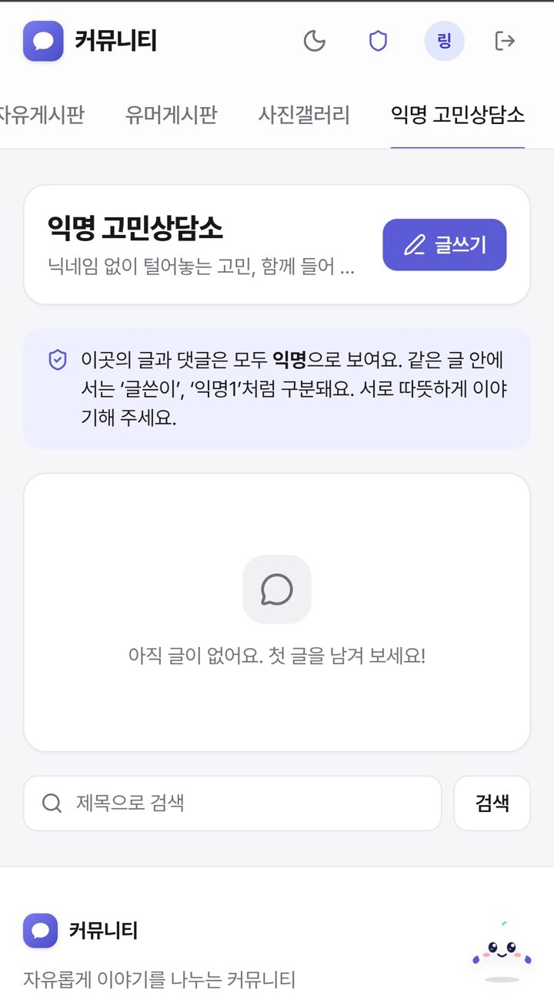
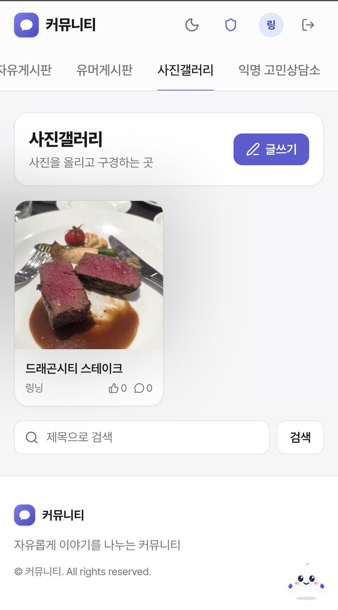

블로그(ZIN 노트), 돈 관리 블로그(ZIN 머니), 데이터 도구 사이트에 이어 이번에는 **커뮤니티 사이트**를 하나 열었습니다. 이름은 **뭉치네**입니다.

> **주소**: [community.zinnote.kr](https://community.zinnote.kr)
> 이 블로그와 같은 도메인(zinnote.kr) 아래에 따로 열어 두었습니다.

## 1. 어떤 곳인가요?

사이트 소개 문구는 이렇습니다.

> 뭉치랑 같이 노는 동네 커뮤니티. 매일 오늘의 질문에 한마디 남기고, 다 같이 뭉치를 키워요.

큰 커뮤니티처럼 정보가 쏟아지는 곳이 아니라, **하루에 한마디만 남겨도 되는 작은 동네**를 생각하고 만들었습니다. 첫 화면 제목도 "오늘은 어떤 이야기를 나눠 볼까요?"입니다. 위 화면은 제 휴대폰으로 직접 캡처한 것입니다.

## 2. 오늘의 질문: 하루 한 줄이면 충분해요

뭉치네의 중심은 **오늘의 질문**입니다. 매일 질문이 하나 올라오고, 답은 그날 밤 12시에 마감됩니다.

오늘(11월 23일) 질문은 이것이었습니다.

> 딱 하루 동안 아무 능력이나 가질 수 있다면?

답은 **300자**까지 쓸 수 있어서 한 줄이면 충분합니다. 재밌는 건 **내 답을 남겨야 다른 사람들의 답이 보인다**는 점입니다. 그리고 좋아요를 가장 많이 받은 답은 **명예의 전당**에 올라갑니다.

글쓰기가 부담스러워서 커뮤니티를 구경만 하던 분도 질문 하나에 답하는 건 쉽다고 생각해서 이렇게 만들었습니다.

## 3. 다 같이 키우는 캐릭터, 뭉치

뭉치네에는 **뭉치**라는 캐릭터가 삽니다. 혼자 키우는 게 아니라 **커뮤니티 전체가 같이 키웁니다.** 누가 글을 쓰든 댓글을 달든, 활동이 쌓이면 뭉치가 자랍니다.

처음은 **Lv.1 아기 뭉치**에서 시작하고, 점수를 더 모으면 **새싹 뭉치**가 됩니다. 첫 화면에서 지금 뭉치의 레벨과 오늘 모두가 모은 점수를 볼 수 있습니다.

점수 규칙은 이렇습니다.

| 활동                 | 점수 |
| -------------------- | ---- |
| 글 쓰기              | 10점 |
| 댓글                 | 3점  |
| 추천(좋아요)         | 1점  |
| 오늘의 질문에 답하기 | 5점  |
| 1인 하루 최대        | 60점 |

하루 최대 점수를 둔 건 한 사람이 몰아서 키우기보다 **여러 사람이 조금씩** 키우는 쪽이 더 재밌을 것 같아서입니다.

## 4. 다섯 개의 게시판

| 게시판          | 이런 글을 올려요          |
| --------------- | ------------------------- |
| 자유게시판      | 아무 이야기나 편하게      |
| 유머게시판      | 웃긴 글, 짤               |
| 사진갤러리      | 사진 올리고 구경하기      |
| 익명 고민상담소 | 닉네임 없이 고민 털어놓기 |
| 생활정보        | 알아 두면 좋은 생활 정보  |

**익명 고민상담소**는 글과 댓글이 모두 익명으로 보입니다. 같은 글 안에서는 '글쓴이', '익명1'처럼 구분돼서, 익명이어도 누가 누구에게 답하는지는 알 수 있습니다. 아는 사람에게 말하기 애매한 고민을 가볍게 꺼내 놓을 수 있는 곳이 하나쯤 있으면 좋겠다고 생각했습니다.

사진갤러리에는 첫 사진으로 **드래곤시티 스테이크**가 올라가 있습니다. 다른 게시판은 아직 "첫 글을 남겨 보세요!"라는 빈 화면이라, 지금 글을 쓰면 그 게시판의 첫 글이 됩니다.

## 5. 이런 분께 맞아요

- 커뮤니티 구경은 좋은데 **긴 글 쓰기는 부담스러운 분**
- 맛집, 여행, 반려동물 사진을 **조용한 곳에서 자랑하고 싶은 분**
- 누가 썼는지 모르게 **고민 한 줄 털어놓고 싶은 분**
- 하루 한 번 들러서 **질문 하나에 답하는 습관**을 만들고 싶은 분

## 정리

- 뭉치네는 매일 **오늘의 질문**에 한마디 남기는 작은 동네 커뮤니티입니다.
- 글, 댓글, 추천, 질문 답이 모두 점수가 되어 **다 같이 뭉치를 키웁니다.**
- 자유, 유머, 사진, 익명 고민, 생활정보 게시판이 있습니다.

아직 막 문을 연 동네라 사람이 많지 않습니다. 그래서 지금 오시면 한마디 한마디가 더 잘 보입니다. 오늘의 질문에 한 줄만 남겨 주세요. 뭉치가 좋아합니다.

👉 [뭉치네 놀러 가기: community.zinnote.kr](https://community.zinnote.kr)

## 함께 보면 좋은 글

- [ChatGPT로 업무용 데이터 도구 사이트를 만들었습니다: DataWork Tools 소개](/chatgpt-datawork-tools-site)
- [AI로 블로그 만들기, 실제로 들어간 돈과 시간 공개](/ai-blog-real-cost-time)
- [서버 비용 0원으로 나만의 홈페이지 만들기](/free-homepage-github-pages)
