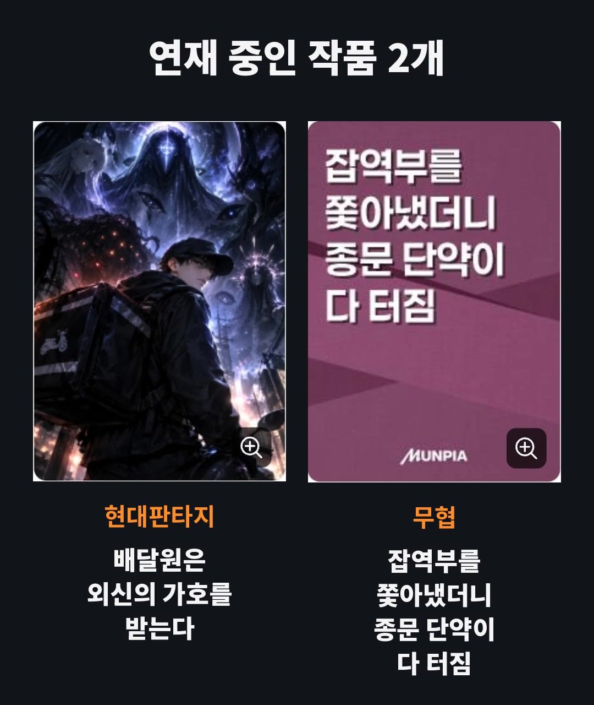
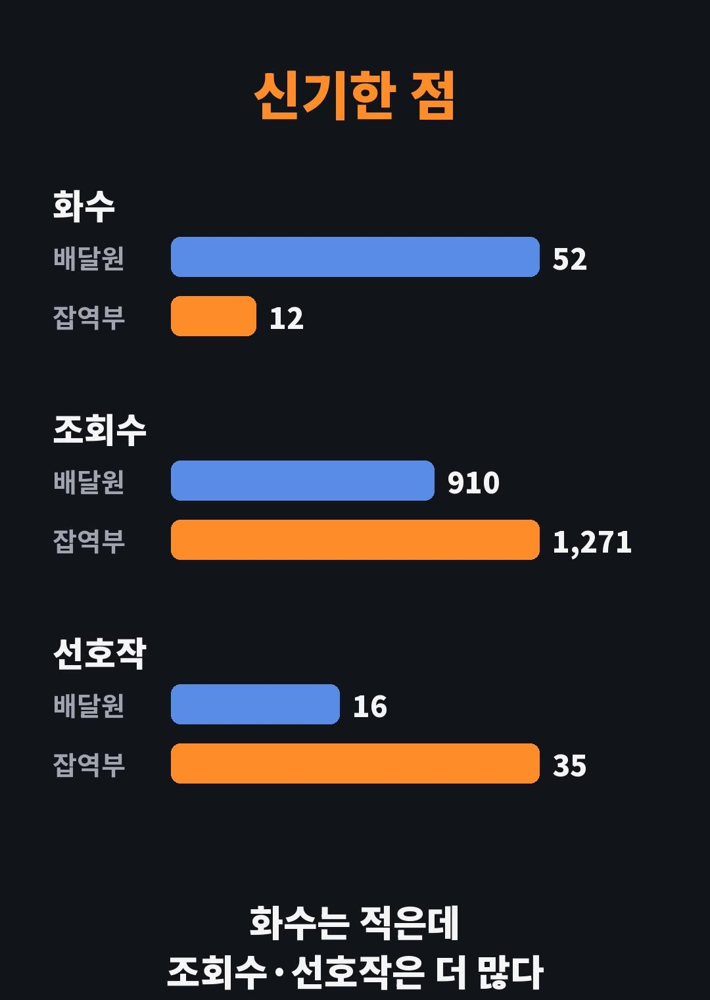

저는 문피아에서 **이천재**라는 이름으로 웹소설을 쓰고 있습니다. 목표는 하나, **유료화**입니다. 취미로만 쓰는 게 아니라 수익을 내기 위해 씁니다. 이 도전 과정을 잘 된 날도, 안 된 날도 **실제 숫자 그대로** 기록해 보려고 합니다.

> **제 이야기**: 이 기록은 유튜브 쇼츠로도 만들었습니다. 2026년 11월 4일에 시작했고, 영상 속 목소리는 제 목소리입니다.

## 영상 보기

  

    <iframe
      src="https://www.youtube-nocookie.com/embed/6DpaYNvsbw4"
      title="웹소설 작가, 유료화 도전 1일차 | 지금 내 숫자 공개"
      style="position: absolute; inset: 0; width: 100%; height: 100%; border: 0;"
      allow="accelerometer; autoplay; clipboard-write; encrypted-media; gyroscope; picture-in-picture"
      allowfullscreen
      loading="lazy"
    ></iframe>
  

영상이 안 보이면 [유튜브에서 바로 보기](https://youtube.com/shorts/6DpaYNvsbw4)를 눌러 주세요.

## 1. 연재 중인 작품 2개

| 작품                                    | 장르       | 연재 시작  | 연재 요일 |
| --------------------------------------- | ---------- | ---------- | --------- |
| 배달원은 외신의 가호를 받는다           | 현대판타지 | 2026.10.21 | 월~금     |
| 잡역부를 쫓아냈더니 종문 단약이 다 터짐 | 무협       | 2026.10.26 | 매일      |

## 2. 지금 내 숫자 (11월 4일 기준)

| 작품   | 연재 일수 | 화수 | 조회수 | 좋아요 | 선호작 |
| ------ | --------- | ---- | ------ | ------ | ------ |
| 배달원 | 15일차    | 52화 | 910    | 117    | 16     |
| 잡역부 | 10일차    | 12화 | 1,271  | 31     | 35     |

## 3. 신기한 점

숫자를 나란히 놓고 보니 신기한 게 있었습니다. **잡역부는 화수가 배달원의 4분의 1도 안 되는데, 조회수와 선호작은 오히려 더 많습니다.**

- 화수: 배달원 52화, 잡역부 12화
- 조회수: 배달원 910, 잡역부 1,271
- 선호작: 배달원 16, 잡역부 35

왜 이런 차이가 나는지는 아직 모릅니다. 숫자가 더 쌓이면 다음 화에서 다시 비교해 보겠습니다.

## 다음 화 예고

다음 화에서는 새로 찍은 숫자로 두 작품이 얼마나 달라졌는지 보여 드리겠습니다. 이 블로그에서는 블로그·애드센스 도전기, [무협 게임 개발기](/wuxia-devlog-start)와 함께 이 웹소설 유료화 도전기도 계속 기록합니다.
