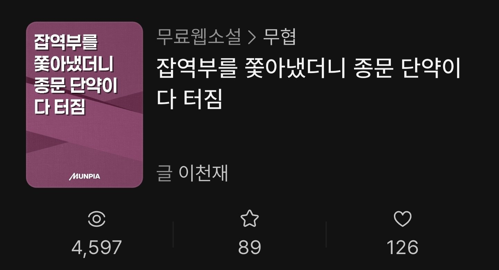

[유료화 도전기 1화](/novel-paid-challenge-ep1)에서 2026년 11월 4일 기준 숫자를 공개했습니다. 그로부터 8일이 지난 11월 12일, 두 작품의 숫자를 다시 확인했습니다. 잘 된 것도, 덜 된 것도 그대로 적습니다.

> **제 이야기**: 저는 문피아에서 **이천재**라는 이름으로 현대판타지와 무협 두 작품을 연재하고 있습니다. 목표는 유료화입니다. 아래 화면은 제 작가 화면을 직접 캡처한 것입니다.

## 1. 배달원은 외신의 가호를 받는다 (현대판타지)

|        | 11월 4일 | 11월 12일 | 늘어난 수 |
| ------ | -------- | --------- | --------- |
| 조회수 | 910      | 1,314     | +404      |
| 선호작 | 16       | 22        | +6        |
| 좋아요 | 117      | 153       | +36       |

## 2. 잡역부를 쫓아냈더니 종문 단약이 다 터짐 (무협)

|        | 11월 4일 | 11월 12일 | 늘어난 수 |
| ------ | -------- | --------- | --------- |
| 조회수 | 1,271    | 4,597     | +3,326    |
| 선호작 | 35       | 89        | +54       |
| 좋아요 | 31       | 126       | +95       |

## 3. 두 작품을 나란히 놓고 보면

| 8일 동안 늘어난 수 | 배달원 | 잡역부 |
| ------------------ | ------ | ------ |
| 조회수             | +404   | +3,326 |
| 선호작             | +6     | +54    |
| 좋아요             | +36    | +95    |

- **잡역부**는 조회수가 1,271에서 4,597로 **약 3.6배**가 됐습니다. 선호작도 35에서 89로 두 배 넘게 늘었습니다.
- **배달원**은 조회수가 910에서 1,314로 **약 1.4배**가 됐습니다. 오르긴 했지만 속도가 훨씬 느립니다.
- 1화 때도 잡역부가 화수는 적은데 숫자는 더 많았는데, 8일 사이에 그 차이가 더 벌어졌습니다.
- 반대로 **좋아요**는 아직 배달원(153)이 잡역부(126)보다 많습니다.

같은 사람이 같은 곳에 올리는데 왜 이렇게 다른지는 아직 정확히 모릅니다. 장르 차이인지, 제목 차이인지, 연재 요일 차이인지는 숫자를 더 모아 봐야 알 것 같습니다.

## 다음 화 예고

다음 화에서도 같은 화면을 다시 캡처해서 비교하겠습니다. 숫자가 줄어도 그대로 올립니다.

이 블로그에서는 [블로그·애드센스 도전기](/adsense-rejected-first), [무협 게임 개발기](/wuxia-devlog-start)와 함께 웹소설 유료화 도전기를 계속 기록합니다.
