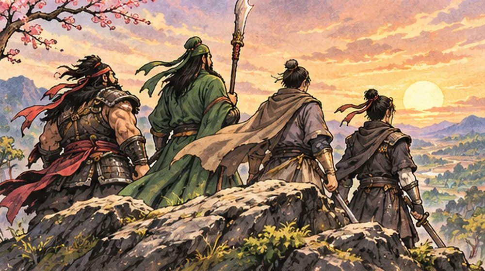

무협 게임을 만들고 있는 와중에, 게임을 하나 더 시작했습니다. 이름은 「**삼국지 회귀**」입니다.

"하나도 다 못 만들었는데 또?"라는 말이 나올 것 같아서 먼저 고백합니다. 맞습니다. 그래도 머릿속에서 계속 맴도는 이야기가 있어서, 일단 적어 두고 만들어 보기로 했습니다. 앞으로 이 메뉴에 하나씩 개발일지를 쌓아 가겠습니다. 오늘은 그 첫 편, **왜 이 게임을 시작하게 됐는지**입니다.

## 시작은 "만약에"였습니다

삼국지를 읽다 보면 늘 비슷한 생각이 듭니다. **"내가 저 시대에 떨어지면 어떻게 살아남을까?"**

유비, 관우, 장비처럼 이름이 남은 영웅이 될 수는 없겠죠. 현대 사람이 갑자기 칼 한 자루 들고 서기 184년에 떨어지면, 아마 처음엔 하루 먹고살 일부터 걱정할 겁니다. 그런데 한 가지는 남들보다 낫습니다. **앞으로 무슨 일이 일어날지 대충 안다**는 것.

곧 황건적의 난이 터진다는 걸 알고 있는 평범한 사람. 이 사람이 무엇을 할지 궁금해서 이 게임을 만들기 시작했습니다.

## 주인공은 영웅이 아니라 용병입니다

이 게임의 주인공은 현대의 서울에 살던 사람입니다. 눈을 떠 보니 한나라 말기, 탁군 땅이었습니다. 살아남으려고 칼을 잡았고, 어쩌다 보니 용병 몇 명을 거느린 작은 부대의 대장이 됩니다.

제가 그리고 싶은 흐름은 이렇습니다.

1. **용병으로 시작합니다.** 처음엔 이름도 없고 돈도 없습니다. 낡은 칼 한 자루와 따라다니는 용병 몇 명이 전부입니다.
2. **의뢰를 받아 돈과 경험을 모읍니다.** 마을 관청이나 상인의 부탁을 받아 짐수레를 지키고, 길목의 산적을 쫓아냅니다. 그렇게 레벨이 오르고 점점 세집니다.
3. **휘하 병사가 늘어납니다.** 혼자 싸우는 게 아니라, 내가 모은 병사들을 이끌고 다니며 싸웁니다. 병사마다 쓰는 무기와 성격이 달라서, 누구를 데리고 다닐지 고르는 재미를 넣고 싶었습니다.
4. **역사 속 큰 전투에 뛰어듭니다.** 그러다 황건적의 난 같은 역사 속 대전투가 벌어지면, 나도 그 판에 들어갑니다.

## 어느 편에 설지는 내가 정한다

이 게임에서 가장 해 보고 싶었던 부분이 이겁니다.

황건적의 난이 터졌을 때, **유비·관우·장비와 같은 편이 되어 함께 싸울 수도 있고, 반대로 황건적의 용병이 되어 그들을 막아설 수도 있습니다.** 정해진 길을 따라가는 이야기가 아니라, 내가 고른 길에 따라 결과가 달라지는 이야기를 만들고 싶었습니다.

역사를 아는 사람이 역사를 그대로 따라갈지, 아니면 바꿔 볼지. 그 선택을 플레이하는 사람에게 맡기는, **자유로운 오픈월드 RPG**가 목표입니다.

## 어떤 게임으로 만들고 있나

아직 아주 초기라서 크게 말씀드릴 건 없지만, 정해 둔 것만 적어 보겠습니다.

- **첫 무대는 1장 「황건적의 난」, 서기 184년입니다.** 탁군 주변 마을에서 시작합니다.
- **브라우저에서 바로 하는 웹 게임입니다.** 설치 없이 주소만 열면 되도록 만들고 있습니다.
- **휴대폰 가로 화면을 먼저 생각합니다.** PC는 그다음입니다.
- **나중에는 스팀 출시도 꿈꿉니다.** 웹 게임을 PC용 프로그램으로 포장하는 방법이 있어서, 언젠가 그 단계까지 가 보고 싶습니다.

그림은 이번에도 제가 직접 그리지 못합니다. 위의 그림들도 ChatGPT에게 설명을 적어 주고 받은 것입니다. 이 이야기는 [무협 게임 그림 고뇌 글](/wuxia-solo-dev-art-struggle)에 적은 것과 비슷한데, 삼국지 쪽은 도트 그림에 수묵화 느낌 초상까지 더해서 고민이 하나 더 늘었습니다. 그 이야기는 나중 편에서 따로 풀겠습니다.

## 앞으로 올릴 이야기

실제 게임 화면은 아직 보여 드리지 않겠습니다. 대신 하루에 하나씩, 조금씩 열어 보려고 합니다. 대략 이런 순서를 생각하고 있습니다.

- 주인공과 처음 함께하는 용병들
- 1장 지도를 어떻게 설계했는지
- 의뢰판: 호위, 산적 토벌, 소굴 소탕
- 병사를 이끄는 전투
- 장비와 말
- 그림 이야기: 도트와 수묵
- 일기토
- 황건적의 난 대전투
- 앞으로의 계획

혼자 만드는 게임이라 속도는 느리겠지만, 만드는 과정을 솔직하게 남겨 두겠습니다. 삼국지 좋아하시는 분들이라면 "나라면 그 시대에 이렇게 살겠다" 하는 생각, 한 번쯤 해 보셨을 거예요. 그 상상을 게임으로 옮겨 보겠습니다.

다음 편에서는 주인공과, 그 곁을 지키는 첫 용병들을 소개하겠습니다.
