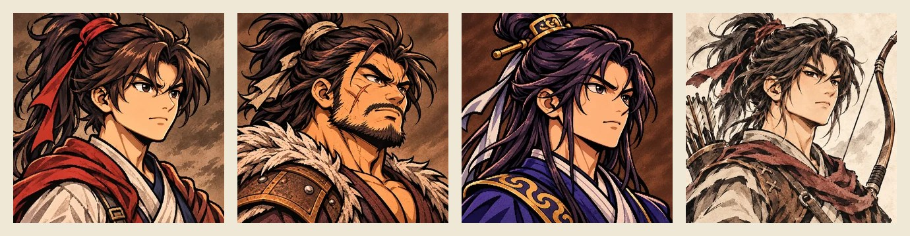

[1탄](/samguk-devlog-01-why)에서는 이 게임을 왜 시작했는지 적었습니다. 2탄에서는 처음으로 사람들을 소개합니다. 주인공 **한소**, 그리고 처음부터 그 곁을 지키는 용병 셋입니다.

왼쪽부터 한소, 마철, 단목현, 연석입니다. 게임 속 대화창에 나오는 초상인데, 이번에도 ChatGPT에게 인물 설명을 적어 주고 받은 그림입니다.

## 주인공 한소(韓昭)

한소는 **현대의 서울에서 살던 사람**입니다. 어느 날 눈을 떠 보니 서기 184년 봄, 한나라 말기의 탁군이었습니다. 게임은 그가 이 시대에 떨어진 지 석 달째 되는 날부터 시작합니다.

게임 첫 장면에서 한소는 속으로 이렇게 말합니다.

> 살아남으려고 칼을 잡았고, 어쩌다 보니 용병 셋을 거느린 대장이 됐다.

시작할 때 가진 건 많지 않습니다. 이 빠진 **낡은 검** 한 자루, 갑옷이라 부르기 민망한 **헌 옷**, 그리고 돈 몇 푼이 전부입니다. 나이는 스물다섯으로 시작해서, 게임 속에서 한 해가 지날 때마다 한 살씩 먹습니다.

대신 한소에게는 남들에게 없는 게 하나 있습니다. **앞으로 일어날 역사를 안다**는 것입니다. 곧 황건적의 난이 터진다는 것, 그때 누가 이름을 날리게 되는지를 알고 있습니다. 게임 안에는 "한소가 아는 역사"를 따로 모아 보는 칸이 있어서, 지금 어떤 일이 다가오고 있는지 플레이하는 사람도 같이 볼 수 있게 했습니다. 이 지식을 어떻게 쓸지는 플레이어의 몫입니다.

전투는 자동으로 흘러가고, **한소의 기술만 직접 씁니다.** 첫 기술 이름은 **노도(怒濤)**. 7초 동안 한소의 공격이 두 배가 되고, 부대원들의 공격도 30% 오릅니다. 대장이 앞장서서 밀어붙이면 부하들도 따라 힘을 낸다는 느낌을 내고 싶었습니다.

## 용병 셋

한소가 처음부터 데리고 있는 용병은 셋입니다. 셋 다 **쓰는 무기가 다르고, 성격 특성이 하나씩** 붙어 있습니다.

### 마철 · 둔기 · 술꾼

덩치 크고 수염 거친 사내입니다. 게임을 시작하면 제일 먼저 입을 여는 사람이 마철인데, 첫마디가 이렇습니다.

> 대장, 배고프오. 오늘은 일거리 좀 잡읍시다.

무기는 **둔기**. 사거리는 짧지만 한 방이 묵직하고 맷집도 좋습니다. 성격 특성은 **술꾼**입니다. 공격이 30% 오르는 대신 체력이 15% 줄어듭니다. 세게 치지만 잘 쓰러질 수도 있는, 위험한 장사입니다. 싸움 중에는 "한잔 걸쳤더니 칼이 잘 드는군!" 같은 말을 던집니다.

### 단목현 · 창 · 의리

말수가 적고 단정한 창잡이입니다. 무기는 **창**이라 검이나 둔기보다 조금 먼 곳을 찌릅니다.

성격 특성은 **의리**. 한소가 위험해지면 공격이 50%나 오릅니다. 대장이 몰리면 가장 먼저 달려드는 사람이죠. 대사도 그렇습니다.

> 대장 등은 내가 지킨다.

### 연석 · 활 · 명궁

셋 중 유일한 궁수입니다. 활은 사거리가 아주 길어서 뒤에서 적을 먼저 맞힙니다. 대신 체력과 기본 공격은 근접 병사보다 낮습니다.

성격 특성은 **명궁**. 활을 쓰면 공격이 35% 오릅니다. 활잡이에게 딱 맞는 특성이라, 연석은 처음부터 부대의 든든한 후방입니다.

> 바람이 좋군. 하나도 안 빗나가.

## 무기는 다섯 갈래, 성격은 여덟 가지

용병을 만들면서 정한 규칙은 두 가지입니다.

**1. 무기마다 역할이 다르다.** 용병이 쓰는 무기는 검, 창, 둔기, 활, 기병(말 탄 병사) 다섯 갈래입니다.

| 무기 | 특징                                    |
| ---- | --------------------------------------- |
| 검   | 가장 기본이 되는 근접 병사              |
| 창   | 검보다 조금 먼 곳을 찌른다              |
| 둔기 | 공격과 체력이 조금씩 더 높다            |
| 활   | 아주 멀리서 쏘지만 몸이 약하다          |
| 기병 | 이동이 1.5배 빠르고, 공격과 체력도 높다 |

**2. 사람마다 성격이 하나씩 있다.** 성격 특성은 지금 여덟 가지입니다. 용맹, 강골, 명궁, 날랜발, 술꾼, 겁쟁이, 의리, 노련. 대부분은 숫자를 올려 주지만, 술꾼처럼 장단점이 같이 있는 것도 있고, **겁쟁이**는 다치면 뒤로 빠져서 숨을 고릅니다. 겁쟁이 궁수를 데리고 다닐지 말지 고민하게 만드는 게 목표였습니다.

## 부대는 주막에서 늘린다

처음 셋으로 끝이 아닙니다. 마을 **주막**에 가면 떠돌이 검병, 창병, 궁병, 기병이 앉아 있고, 돈을 내면 부대에 들일 수 있습니다. 주막에 있는 사람은 하루가 지나면 바뀌고, 성격 특성도 그때그때 무작위로 붙습니다. 같은 창병이라도 의리 있는 창병과 겁쟁이 창병은 완전히 다른 사람이 됩니다.

데리고 다닐 수 있는 인원은 처음엔 셋이지만, 한소의 레벨이 오를수록 늘어나서 최대 열 명까지 거느릴 수 있습니다. 1탄에서 말한 "휘하 병사를 이끌고 다니는 용병 대장"이 바로 이 부분입니다.

## 만들면서 든 생각

처음에는 용병을 그냥 숫자만 다른 병사로 만들려고 했습니다. 그런데 막상 해 보니 정이 안 붙더라고요. 이름이 있고, 얼굴이 있고, 싸우면서 한마디씩 던지니까 그제야 "내 부하"라는 느낌이 들었습니다. 술꾼 마철이 먼저 쓰러지면 괜히 아깝고, 단목현이 대장을 지키겠다고 달려들면 든든합니다.

다음 편에서는 이 넷이 돌아다니는 **1장 지도**를 어떻게 설계했는지 보여 드리겠습니다.
