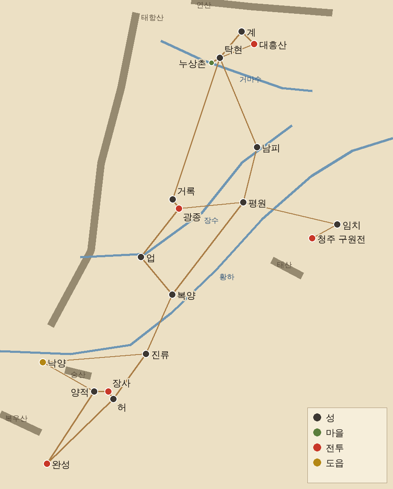

[2탄](/samguk-devlog-02-party)에서 주인공 한소와 용병 셋을 소개했습니다. 이번 3탄에서는 이 넷이 돌아다닐 **1장 지도**를 어떻게 만들었는지 보여 드리겠습니다.

1장의 제목은 「황건적의 난」, 무대는 서기 184년입니다. 오픈월드 RPG를 만들겠다고 했으니, 지도가 곧 게임의 뼈대입니다.

## 원칙 하나: 진짜 지도 위에 올린다

삼국지 게임이라면 "탁현에서 거록까지 얼마나 먼가" 같은 감각이 맞아야 한다고 생각했습니다. 그래서 지명을 대충 흩뿌리지 않고, **실제 위도·경도를 게임 좌표로 바꾸는 방식**을 택했습니다.

규칙은 간단합니다.

- **위도 1도 = 1,000픽셀**로 정했습니다.
- 경도는 위도가 높아질수록 실제 거리가 짧아지니, 지도 한가운데쯤인 북위 36.5도 기준으로 줄여서 맞췄습니다.
- 범위는 북위 32.6도~~40.4도, 동경 111.6도~~119.4도. 북쪽 유주부터 남쪽 형주 남양까지 들어갑니다.

이렇게 해서 큰 지도 위에 1장에 나오는 고을과 싸움터 18곳을 올렸습니다. 아래는 그 설계 초안을 알아보기 쉽게 다시 그린 것입니다.

검은 점은 성, 초록 점은 마을, 빨간 점은 전투가 벌어지는 곳, 노란 점은 도읍 낙양입니다.

## 길과 강도 역사를 따라

점만 찍는다고 지도가 되지는 않습니다. 사이를 잇는 것도 정했습니다.

- **큰 길(역참길)**: 한나라 때 도로망을 단순하게 줄여서 22개 구간으로 이었습니다. 탁현에서 계, 탁현에서 거록, 진류에서 낙양 같은 식입니다.
- **강**: 황하, 장수, 그리고 탁군 남쪽을 흐르는 거마수를 넣었습니다. 특히 **황하는 184년 당시 물길이 지금보다 북쪽**으로 흘렀다고 해서, 지금 지도와 다르게 북쪽으로 올려 그렸습니다.
- **산**: 서쪽의 태항산, 북쪽의 연산, 그리고 태산, 숭산, 복우산을 넣었습니다.

남쪽으로 내려갈수록 적이 세지도록 **주(州)마다 강함 단계**도 매겼습니다. 유주를 1로 두면 기주는 1.4, 청주와 연주는 1.5, 낙양이 있는 사례는 1.6, 예주는 1.8, 형주는 2입니다. 탁현 근처에서 실력을 쌓고, 남쪽으로 내려갈수록 험해지는 구조입니다.

## 탁현 주변: 한소가 처음 걷는 땅

큰 지도만으로는 초반이 너무 휑합니다. 그래서 탁현 둘레에는 한 칸 더 확대한 **작은 지역 지도**를 따로 만들어, 큰 지도 위 제자리에 끼워 넣었습니다. 한소의 이야기는 여기서 시작합니다.

| 장소               | 어떤 곳인가                                                                      |
| ------------------ | -------------------------------------------------------------------------------- |
| **탁현(涿縣)**     | 탁군의 중심 성. 관청 의뢰판이 있는 출발점                                        |
| **누상촌(樓桑村)** | 큰 뽕나무가 선 작은 마을. 짚신 파는, 귀가 유난히 큰 젊은이가 산다는 소문이…      |
| **거마진(巨馬津)** | 거마수 강가의 나루터. 호위를 구하는 상인들이 서성인다                            |
| **흑석촌(黑石村)** | 검은 돌이 많은 산기슭 마을. 산적이 곡식을 빼앗아 간다                            |
| **류가장(劉家莊)** | 피난민이 몰려든 큰 장원. 노란 두건을 숨긴 사내들이 용병을 찾는다는 이야기가 돈다 |
| **흑풍채(黑風寨)** | 흑석촌 너머 산속, 산적 두목 흑풍의 소굴                                          |
| **대흥산(大興山)** | 탁현 동북쪽의 산. 황건적이 진을 쳤다는 곳                                        |

누상촌의 그 젊은이가 누군지는, 삼국지를 읽어 보신 분이라면 바로 아실 겁니다. 이렇게 **역사 속 인물이 아직 이름 없는 사람으로 동네에 섞여 있는 느낌**을 꼭 내고 싶었습니다.

## 지도 그림은 수묵화 느낌으로

맨 위의 그림이 필드 지도의 배경 그림입니다. 산은 회청색 먹으로, 들판은 황토색과 연두색으로, 그 사이로 흙길이 갈라집니다. 이번에도 ChatGPT에게 "위에서 살짝 비스듬히 내려다본 전통 수묵 채색화 느낌"으로 부탁해서 받았습니다.

거록, 영천, 청주, 남양, 황하 쪽에도 같은 그림체로 **지역 수묵 지도**를 한 장씩 따로 두었습니다. 그림을 그냥 배경으로만 쓰면 산 위로도 걸어 다닐 수 있게 되니, 그림을 20픽셀 칸으로 나눠서 **산이나 강처럼 못 지나가는 칸을 따로 기록**해 두었습니다. 덕분에 그림에 산이 그려진 곳에서는 정말로 길을 돌아가야 합니다.

## 만들면서 든 생각

처음엔 "지도야 그럴듯하게 그리면 되지" 했는데, 막상 해 보니 지도가 정해지자 이야기도 따라 정해졌습니다. 탁현에서 대흥산까지의 거리가 정해지니 "황건적이 모였다는 소식이 얼마 만에 오나"가 정해지고, 황하의 물길이 정해지니 "어디서 강을 건너나"가 정해졌습니다. 오픈월드에서는 지도가 곧 시나리오라는 걸 배웠습니다.

다음 편에서는 이 지도 위에서 돈과 명성을 버는 방법, **의뢰판**을 소개하겠습니다.
