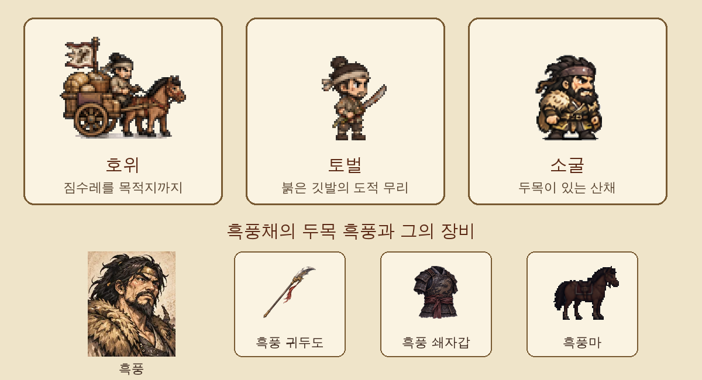

[3탄](/samguk-devlog-03-map)에서 1장 지도를 보여 드렸습니다. 지도를 만들었으니 이제 그 위에서 **무엇을 하며 사느냐**가 남았습니다. 한소는 영웅이 아니라 이름 없는 용병으로 시작합니다. 용병이 먹고사는 길은 하나, 일감을 받는 것입니다. 그래서 성과 마을마다 **의뢰판**을 붙였습니다.

## 의뢰는 세 종류

처음 설계할 때 의뢰를 너무 여러 종류로 나누면 만들기도, 하기도 피곤해질 것 같았습니다. 그래서 딱 세 가지로 정했습니다.

- **호위**: 짐수레를 정해진 곳까지 데려갑니다. 그냥 걸어가면 끝일 것 같지만, 가는 길 어딘가에서 반드시 **매복**이 튀어나옵니다. 마철이 "매복이다! 수레를 지켜라!" 하고 외치면 전투가 시작됩니다.
- **토벌**: 지도에 붉은 깃발이 꽂힌 곳으로 가서 도적 무리를 쓸어버립니다.
- **소굴**: 산적의 뿌리를 뽑는 의뢰입니다. 두목이 직접 나오고, 이기면 두목을 **사로잡을** 수 있습니다.

## 탁현 주변 첫 의뢰 여덟 개

1장 시작 지역에는 이야기가 붙은 의뢰를 여덟 개 넣었습니다. 몇 개만 골라 보면 이렇습니다.

| 의뢰             | 맡기는 곳 | 종류 | 보수               |
| ---------------- | --------- | ---- | ------------------ |
| 오씨 상단 호위   | 탁현      | 호위 | 금 30 · 명성 1     |
| 뽕밭 도적        | 누상촌    | 토벌 | 금 15 · 명성 1     |
| 소금 상인 호위   | 거마진    | 호위 | 금 40 · 명성 1     |
| 흑석촌 산적 토벌 | 흑석촌    | 토벌 | 금 35 · 명성 2     |
| **흑풍채 소탕**  | 흑석촌    | 소굴 | **금 80 · 명성 3** |
| 피난민 호송      | 류가장    | 호위 | 금 20 · 명성 2     |

경험치도 따로 붙습니다. 보수만 보면 피난민 호송은 금 20으로 짠 편인데, 명성은 2나 줍니다. 돈이 급한지 이름이 급한지에 따라 고르는 맛이 생기길 바랐습니다.

의뢰끼리는 이야기로 이어집니다. 흑석촌에서 외눈박이 두목을 잡아 오면 촌장이 이렇게 말합니다.

> "허나 그 외눈박이는 흑풍채 흑풍의 졸개일 뿐이오. 뿌리를 뽑아 주시오."

그제야 흑석촌 의뢰판에 **흑풍채 소탕**이 새로 열립니다. 그리고 황건적 척후를 치는 의뢰는 이야기가 한 단계 진행된 뒤에야 탁현 관청에 붙습니다.

## 두목을 잡으면: 등용할까, 벨까, 풀어줄까

소굴 의뢰의 두목을 사로잡으면 세 가지 중 하나를 골라야 합니다.

- **등용**: 부대원으로 삼습니다. 대신 부대 정원이 남아 있어야 합니다.
- **참살**: 베고 두목의 무구를 얻습니다. 흑풍이라면 위 그림의 **흑풍 귀두도, 흑풍 쇄자갑, 검은 말 흑풍마**를 한꺼번에 얻습니다.
- **풀어준다**: 명성이 1 오릅니다.

강한 장비, 쓸 만한 부하, 좋은 평판. 셋 다 가질 수는 없게 만들었습니다. 저도 테스트할 때마다 고민합니다.

## 반복 의뢰: 할 일이 떨어지지 않게

이야기 의뢰 여덟 개는 금방 끝납니다. 오픈월드 RPG인데 할 일이 없으면 곤란하니, 성과 마을마다 **반복 의뢰**를 하나씩 붙였습니다. "들판 도적 소탕", "강가 수적", "떠돌이 황건" 같은 자잘한 토벌입니다.

- 도적 위치는 마을 둘레에서 걸어갈 수 있는 곳 중 하나를 무작위로 고릅니다.
- 한소 레벨이 오를수록 적 수가 늘고, 남쪽 주(州)로 내려갈수록 적도 보수도 커집니다. 3탄에서 말한 주별 강함 단계가 여기서 쓰입니다.
- 류가장이나 거록처럼 황건적 세력이 강한 곳은 도적 대신 노란 두건이 나오기도 합니다.
- 대신 **명성은 거의 안 줍니다.** 명성이 낮은 초반이나 험한 지역에서만 1씩 줍니다. 반복 의뢰만 돌아서는 이름을 날릴 수 없게 했습니다.

## 의뢰는 세 개까지만

처음에는 의뢰를 얼마든지 받을 수 있게 했는데, 해 보니 의뢰판을 전부 쓸어 담고 지도 위를 정신없이 뛰어다니게 되더군요. 그래서 **한 번에 세 개까지만** 받도록 막았습니다. 네 번째를 받으려 하면 "의뢰는 세 개까지만 받을 수 있어요"라는 말이 뜹니다. 어느 길로 갈지 미리 생각하게 만드는 작은 규칙입니다.

명성은 이야기를 움직이는 열쇠이기도 합니다. 명성이 7에 닿으면(또는 40일이 지나면) 파발꾼이 들판을 달려와 대흥산 소식을 전합니다. 그 이야기는 9탄쯤에서 하겠습니다.

## 주막의 소문

의뢰판 옆에는 **주막**이 있습니다. 용병을 고용하는 곳이지만, 주막 주인이 한마디씩 흘리는 소문이 있습니다.

> "관우라는 붉은 얼굴 사내가 장사치 행세를 하며 떠돈다지."

> "도살업자 장비네 고기는 질겨도 술은 좋아."

길을 가다 길가 주막 평상에서 나그네들의 수군거림을 엿듣기도 합니다. "남쪽에서 장각이라는 도사가 부적 물로 병을 고친다더군" 같은 말을 들으면, 미래에서 온 한소가 속으로 한마디를 덧붙입니다. 역사를 아는 사람만 알아듣는 이런 순간을 넣는 게 이 게임에서 제일 재미있는 작업입니다.

## 만들면서 든 생각

의뢰를 만들기 전에는 "보수를 얼마로 할까"가 제일 어려울 줄 알았습니다. 막상 해 보니 더 어려운 건 **보수 말고 무엇을 줄까**였습니다. 돈만 주면 어떤 의뢰든 똑같이 느껴지는데, 촌장의 한마디, 새로 열리는 의뢰, 두목을 어떻게 할지 고르는 순간이 붙으니 같은 싸움도 다르게 느껴졌습니다.

다음 5탄에서는 이 의뢰들 끝에 벌어지는 **부대 전투**를 보여 드리겠습니다.
