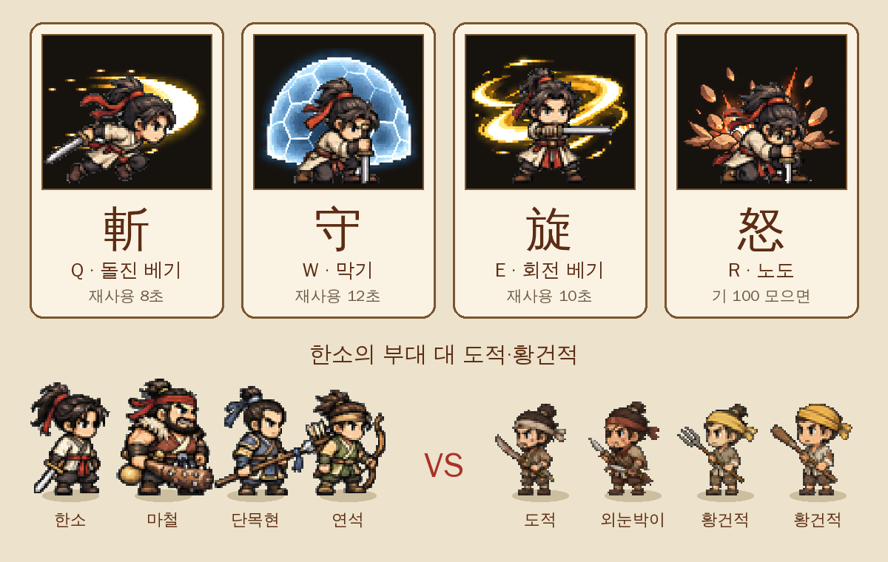

[4탄](/samguk-devlog-04-quests)에서 의뢰판 이야기를 했습니다. 호위를 가든 토벌을 가든 소굴을 치든, 의뢰의 끝에는 결국 **싸움**이 기다립니다. 이번 5탄에서는 그 **부대 전투**를 어떻게 만들었는지 보여 드리겠습니다.

## 병사는 알아서, 대장은 기술로

처음부터 정한 원칙이 하나 있었습니다. **모바일 가로 화면에서 손가락 하나로도 할 수 있을 것.** 병사 한 명 한 명을 끌어다 놓는 전투는 휴대폰에서 너무 피곤합니다.

그래서 전투는 자동으로 흘러갑니다. 아군과 적은 각자 **가장 가까운 상대**를 골라 다가가 치고, 0.5초마다 누구를 노릴지 다시 고릅니다. 창은 칼보다 조금 멀리서 찌르고, 연석 같은 활잡이는 훨씬 먼 거리에서 화살을 날립니다.

플레이어가 직접 하는 건 **한소의 기술 네 개**뿐입니다. PC에서는 Q·W·E·R 키, 휴대폰에서는 화면 아래 버튼으로 씁니다.

## 기술 네 개

- **斬 (Q, 돌진 베기)**: 가까운 적에게 번개처럼 돌진하면서 지나가는 길에 있는 적을 한꺼번에 벱니다. 공격력의 세 배로 들어가고, 이어지는 평타 두 번도 더 세게 들어갑니다. 재사용 8초.
- **守 (W, 막기)**: 땅을 짚고 방패 기운을 펼칩니다. 5초 동안 받는 피해가 크게 줄고, 바로 옆에 붙은 적은 밀려나며 잠깐 어지러워합니다. 재사용 12초.
- **旋 (E, 회전 베기)**: 제자리에서 세 바퀴를 돌며 주변을 베고, 마지막에 둘레의 적을 날려 버립니다. 적에게 둘러싸였을 때 쓰라고 만든 기술입니다. 재사용 10초.
- **怒 (R, 노도)**: [2탄](/samguk-devlog-02-party)에서 소개한 그 기술입니다. 이건 시간이 아니라 **기(氣)**가 100 차야 쓸 수 있습니다. 한소가 적을 때리면 기가 3씩, 맞으면 1.5씩 찹니다. 다 차서 쓰면 한소 얼굴이 화면을 가로지르는 연출과 함께 하늘로 뛰어올라 땅을 내려찍고, 7초 동안 공격이 두 배, 부대원 공격은 30% 오릅니다.

버튼에는 기술 이름 대신 斬·守·旋·怒 한 글자만 적었습니다.

## 부대원의 성격이 전투에서 드러난다

2탄에서 용병마다 성격 특성이 하나씩 있다고 했는데, 그 특성이 실제로 보이는 곳이 바로 전투입니다.

- 전투가 시작되면 부대원 중 한 명이 성격에 맞는 한마디를 외칩니다. 마철이라면 "한잔 걸쳤더니 칼이 잘 드는군!" 같은 식입니다.
- **의리** 특성인 단목현은 한소의 체력이 40% 아래로 떨어지면 공격이 50% 오릅니다. 대장이 몰릴수록 세지는 거죠.
- **겁쟁이** 특성은 체력이 30% 아래로 떨어지면 "살, 살려 줘!" 하고 적에게서 물러나 숨을 고릅니다. 체력이 70%까지 차면 "좋아, 다시 간다!" 하고 돌아옵니다. 도망만 치는 게 아니라 다시 돌아온다는 게 포인트입니다.

## 두목은 쓰러뜨리면 '포박'

소굴 의뢰처럼 두목이 있는 싸움에서는 두목의 체력이 다 떨어져도 죽지 않습니다. 머리 위에 **"포박!"** 글자가 뜨면서 사로잡힙니다. 그 뒤에 4탄에서 말한 등용·참살·풀어주기 선택이 나옵니다.

## 지면 어떻게 될까

전투가 끝나는 조건은 단순합니다. 적을 모두 쓰러뜨리면 **勝**, **한소가 쓰러지면** 부대원이 남아 있어도 **敗**입니다. 대장이 무너지면 용병들도 흩어진다는 생각이었습니다.

지면 정신을 차려 보니 가장 가까운 마을 객잔입니다. **사흘을 앓아눕고, 가진 금의 절반이 사라집니다.** 너무 가혹한가 싶었지만, 아무 손해가 없으면 전투가 긴장감이 없더라고요.

그래서 중간에 빠질 길도 열어 두었습니다. 작은 전투에서는 **퇴각** 버튼을 누를 수 있는데, 금 20%를 잃고 하루가 지나지만 받은 의뢰는 그대로 남습니다. 질 것 같으면 덜 잃고 물러나는 것도 실력입니다.

다행히 의뢰 전투에서 부대원은 영영 죽지 않습니다. 싸움 중에 쓰러져도 이기고 나면 "상처를 싸매고 다시 일어났다"는 말과 함께 돌아옵니다. 2탄에서 말했듯 이름과 얼굴이 있는 부하라서, 한 번 잃으면 끝인 방식은 넣고 싶지 않았습니다.

## 싸울수록 강해지는 부대원

부대원마다 쓰러뜨린 적의 수를 셉니다. **적을 8명 쓰러뜨릴 때마다** "싸움에 익숙해졌다"는 말이 뜨고 공격과 체력이 5%씩 오릅니다. 같은 창병이라도 오래 데리고 다닌 사람이 더 강해지니, 새 용병을 들일지 고참을 키울지 고민할 거리가 생깁니다.

한소 쪽은 레벨이 오를수록 적도 같이 강해집니다. 레벨이 하나 오를 때마다 적의 체력과 공격이 18%씩 늘어나서, 1장 초반 도적이라도 끝까지 만만하지는 않게 해 두었습니다. 대신 이긴 뒤에 받는 경험치에는 쓰러뜨린 적 한 명당 2씩이 더 붙습니다.

## 전장 바닥 그림

전투 바닥은 싸우는 곳에 따라 다르게 깝니다. 들판 의뢰는 풀밭, 산채를 치는 소굴 의뢰는 바위가 많은 산길입니다. 맨 위 성벽 앞 그림과, 누런 풀밭에 천막이 늘어선 진영 그림도 **준비한 그림**인데, 아직 1장 전투에는 쓰지 않았습니다. 나중에 성을 두고 싸우는 장면에서 꺼낼 생각입니다.

전투 중에는 일시정지(PC는 스페이스바)와 **두 배속**도 됩니다. 반복 의뢰처럼 익숙한 싸움은 빠르게 넘기라고 넣었습니다.

## 만들면서 든 생각

자동 전투를 만들면 "그럼 플레이어는 구경만 하나?"라는 걱정이 들었습니다. 그래서 기술 네 개에 각자 쓸 때가 따로 있게 했습니다. 멀리 있는 궁수에게는 斬으로 파고들고, 둘러싸이면 旋, 체력이 위험하면 守, 기가 차면 怒. 버튼은 네 개뿐이지만 언제 누르느냐에 따라 결과가 꽤 달라집니다.

다음 6탄에서는 한소가 이 싸움에서 번 돈으로 사는 **장비와 말** 이야기를 하겠습니다. 흑풍에게서 빼앗은 귀두도와 흑풍마도 다시 등장합니다.
