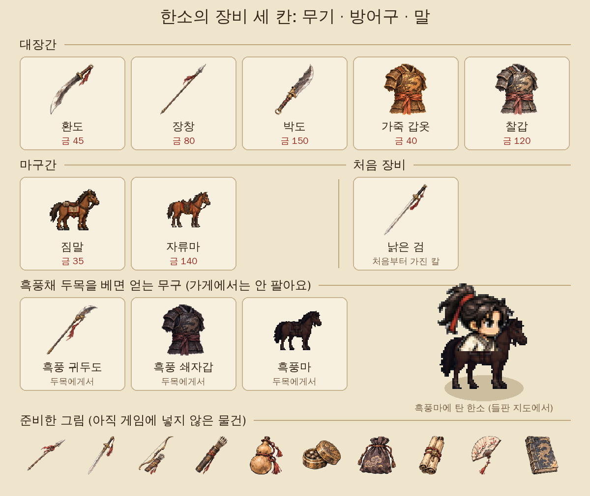

[5탄](/samguk-devlog-05-battle)에서 부대 전투 이야기를 했습니다. 의뢰를 끝내고 싸움에서 이기면 금이 들어옵니다. 그럼 그 돈은 어디에 쓸까요? 이번 6탄에서는 한소가 번 돈으로 사는 **장비와 말** 이야기를 하겠습니다. 예고한 대로 흑풍의 귀두도와 흑풍마도 나옵니다.

## 장비 칸은 딱 세 개

장비 칸을 몇 개로 할지 꽤 고민했습니다. 투구, 신발, 반지까지 나누면 모으는 재미는 있지만, 휴대폰 화면에서 칸이 많으면 보기도 고르기도 피곤합니다. 그래서 **무기 · 방어구 · 말** 세 칸으로 줄였습니다.

게임을 처음 시작하면 한소가 가진 건 이렇습니다.

- 무기: **낡은 검**. 설명은 "용병 시절부터 쓰던 이 빠진 검"입니다.
- 방어구: **헌 옷**. 설명은 "갑옷이라 부르기 민망하다"입니다.
- 말: **없음**. 걸어 다닙니다.
- 지갑: 금 40.

현대에서 떨어진 사람이 처음부터 좋은 칼과 말을 가지고 있으면 이상하니까, 맨손에 가깝게 시작하도록 했습니다.

## 장비가 올려 주는 것

일행 창을 열면 한소의 능력치가 보입니다. 그중 장비와 이어지는 건 세 가지입니다.

- **공격**: 레벨에 따라 오르고, 여기에 **무기**의 공격력이 더해집니다.
- **체력**: 레벨에 따라 오르고, 여기에 **방어구**의 체력이 더해집니다.
- **무력**: 레벨에 따라 오르고, 여기에 **무기와 말**의 무력이 더해집니다. 무력은 장수끼리 맞붙는 **일기토**에서 쓰이는 숫자인데, 일기토는 8탄에서 따로 이야기하겠습니다.

부대원들은 장비 칸이 따로 없습니다. 부대원은 5탄에서 말한 것처럼 싸우면서 강해지고, 장비는 대장인 한소만 챙깁니다. 신경 쓸 칸을 한 사람 몫으로 줄이려는 생각이었습니다.

## 대장간: 칼과 갑옷

큰 성에 들어가면 주막 옆에 **대장간**과 **마구간**이 있습니다. 대장간에서 파는 물건은 다섯 가지입니다.

| 물건      | 종류   | 올려 주는 것                    | 값     |
| --------- | ------ | ------------------------------- | ------ |
| 환도      | 무기   | 공격 +4, 무력 +2                | 금 45  |
| 장창      | 무기   | 공격 +6, 무력 +3, 사거리 늘어남 | 금 80  |
| 박도      | 무기   | 공격 +9, 무력 +5                | 금 150 |
| 가죽 갑옷 | 방어구 | 체력 +35                        | 금 40  |
| 찰갑      | 방어구 | 체력 +80                        | 금 120 |

장창만 조금 특별합니다. 설명이 "길어서 먼저 찌른다"인데, 실제로 한소의 공격 거리가 늘어납니다. 박도보다 공격은 약해도 적보다 한 박자 먼저 닿는 맛이 있습니다. 어떤 무기가 더 좋은지 정답이 하나로 정해지지 않게 하고 싶었습니다.

사면 바로 장착됩니다. 한 번 산 물건은 가방에 남아서, 일행 창의 장비 칸을 누르면 언제든 바꿔 낄 수 있습니다. 대신 되파는 기능은 아직 없습니다. 무엇을 살지 한 번 더 생각하게 하려고 일부러 뺐습니다.

## 마구간: 말은 지도에서 쓴다

마구간에서는 말 두 필을 팝니다.

- **짐말** (금 35): 들판 지도에서 이동이 15% 빨라집니다. 설명은 "느리지만 짐도 싣는다". 싸움에는 도움이 안 됩니다.
- **자류마** (금 140): 붉은 밤색 털의 날랜 군마입니다. 지도 이동이 40%, 전투에서 한소가 움직이는 속도가 25% 빨라지고, 무력도 2 오릅니다.

말이 제일 크게 느껴지는 곳은 **들판 지도**입니다. [3탄](/samguk-devlog-03-map)에서 말한 큰 지도는 원래 길 위를 걸으면 빠르고, 길이 없는 들판은 느립니다. 여기에 말 속도가 곱해지니, 호위 의뢰처럼 먼 길을 오가는 일이 훨씬 덜 지루해집니다.

말을 장착하면 지도 위의 한소도 바뀝니다. 걸어 다니던 도트가 **말 위에 올라탄 모습**으로 바뀌고, 움직일 때는 말이 다리를 번갈아 내딛습니다. 말 그림은 따로 그리고, 그 위에 한소의 상반신만 잘라 얹는 방식으로 만들었습니다. 그림 오른쪽의 흑풍마에 탄 한소가 바로 그 모습입니다.

## 길에서 만나는 떠돌이 행상

성까지 가지 않아도 물건을 살 기회가 있습니다. 들판을 다니다 보면 가끔 길 위에서 일이 생기는데, 그중 하나가 **떠돌이 행상**입니다.

> 등짐을 진 행상이 손짓한다. "좋은 물건 있소! 성안보다 싸게 드리지."

행상은 한소가 아직 갖고 있지 않은 물건 중 하나를 골라, **성안 값의 70%**에 팝니다. 박도라면 150이 아니라 105입니다. 무엇이 나올지는 운이라서, 마침 돈이 있을 때 원하던 물건이 나오면 꽤 반갑습니다.

## 흑풍채 두목의 전리품

4탄과 5탄에서 계속 이름이 나온 흑풍채 두목 **흑풍**. 흑석촌 촌장의 의뢰를 받아 소굴을 쳐서 흑풍을 포박하면, 4탄에서 말한 세 갈래 선택이 나옵니다. 그중 **참살**을 고르면 "베고 무구를 얻는다"는 말 그대로 두목이 쓰던 물건 세 가지가 한꺼번에 들어옵니다.

- **흑풍 귀두도**: "흑풍 두목이 쓰던 귀신 머리 칼". 공격 +12, 무력 +7.
- **흑풍 쇄자갑**: "두목의 쇠사슬 갑옷". 체력 +100.
- **흑풍마**: "두목이 타던 검은 말". 지도 이동 +45%, 전투 속도 +30%, 무력 +3.

셋 다 대장간이나 마구간에서 파는 어떤 물건보다 좋습니다. 그리고 가게에서도, 행상에게서도 살 수 없습니다. 얻고 나면 "두목의 무구를 얻었다. 일행 창에서 장착하자"라는 말이 뜹니다.

여기서 고민이 생기게 만들었습니다. 흑풍을 **등용**하면 무구는 못 얻는 대신 강한 둔기병 한 명이 부대에 들어오고, **풀어주면** 명성이 1 오릅니다. 좋은 장비냐, 쓸 만한 부하냐, 이름이냐. 어느 쪽이 정답인지는 정하지 않았습니다.

## 준비한 그림들

그림 맨 아래 줄의 창, 검, 활, 화살통, 호리병, 환약, 주머니, 두루마리, 부채, 책은 **준비한 그림**입니다. 아직 게임 코드에서는 쓰지 않습니다. 장비 칸을 세 개로 줄이면서 남은 것들인데, 나중에 장수 전용 무기나 쓰는 물건(약 같은)으로 꺼낼 수 있을지 고민 중입니다.

## 만들면서 든 생각

장비를 만들면서 가장 신경 쓴 건 **값과 보상의 균형**이었습니다. 의뢰 몇 개를 하면 환도나 가죽 갑옷은 금방 사지만, 박도나 자류마는 꽤 모아야 합니다. 그 사이에 주막에서 용병을 더 들일지, 장비를 먼저 살지 고르는 게 이 게임의 작은 재미라고 생각합니다. 5탄에서 말했듯 지면 금이 절반 날아가니, 모아 둔 돈을 언제 쓰느냐도 중요합니다.

다음 7탄에서는 지금까지 조금씩 보여 드린 **그림** 이야기를 하겠습니다. 걷고 싸우는 작은 **도트**와, 초상과 배경에 쓰는 **수묵 채색** 그림을 어떻게 섞어 쓰는지 적어 보겠습니다.
