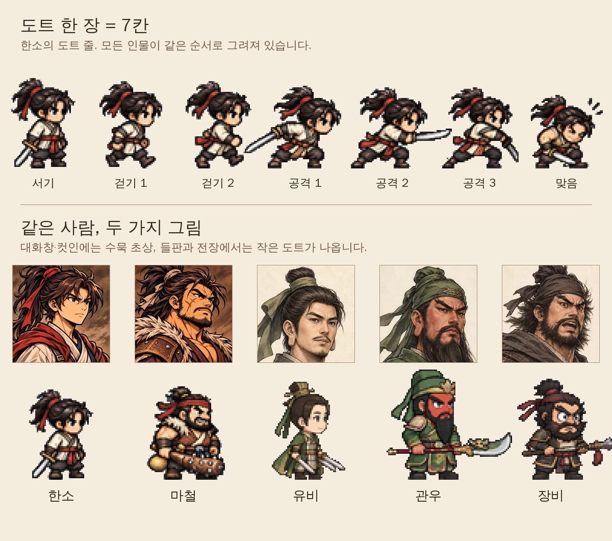

[6탄](/samguk-devlog-06-gear)에서 장비와 말 이야기를 했습니다. 그동안 개발일지마다 초상이나 도트, 아이콘을 한두 장씩 보여 드렸는데, 정작 그림을 어떻게 만들고 쓰는지는 말하지 않았습니다. 이번 7탄에서는 예고한 대로 **그림** 이야기를 하겠습니다. 이 게임에는 그림이 크게 두 종류 있습니다. 작은 **도트**와 **수묵 채색** 그림입니다.

## 왜 그림이 두 종류일까

처음에는 하나로 통일하려고 했습니다. 그런데 화면마다 필요한 게 달랐습니다.

- **들판과 전장**: 사람이 여러 명 동시에 뛰어다니고, 휴대폰 가로 화면에서도 한눈에 누가 누군지 보여야 합니다. 작고 또렷한 그림이 좋습니다.
- **대화창과 컷인**: 한 사람의 얼굴이 크게 나옵니다. 여기서는 표정과 분위기가 중요합니다.

그래서 움직이는 곳은 도트로, 얼굴이 크게 나오는 곳은 수묵 초상으로 나눴습니다. 같은 한소라도 들판에서는 머리가 큰 작은 도트로, 대화창에서는 붓으로 칠한 초상으로 나옵니다.

## 도트 한 장은 7칸

그림 위쪽이 한소의 도트입니다. 모든 인물의 도트는 **한 줄에 7칸**으로 되어 있고, 순서도 같습니다.

1. 서기
2. 걷기 1
3. 걷기 2
4. 공격 1
5. 공격 2
6. 공격 3
7. 맞음

순서가 모두 같으니, 게임 코드에서는 인물마다 "서기는 0번, 걷기는 1·2번, 공격은 3·4·5번, 맞으면 6번"이라는 같은 규칙 하나만 쓰면 됩니다. 새 인물을 넣을 때도 그림 일곱 장만 같은 순서로 넣으면 바로 걷고 싸웁니다.

도트는 정말 작습니다. 한소 한 칸이 가로 44, 세로 59 점입니다. 이걸 화면에서 크게 키워 그리는데, 그냥 키우면 가장자리가 뿌옇게 번집니다. 그래서 도트를 그릴 때는 **번짐을 끄고** 점을 네모 그대로 키웁니다. 그림의 도트가 계단처럼 또렷한 게 그 덕분입니다.

그림을 그릴 때 정한 규칙도 있습니다. 머리가 크고 몸이 작은 두 머리 반 정도의 비율, 진한 외곽선, 흙빛이 도는 차분한 색, 그리고 **모두 오른쪽을 보는 옆모습**입니다. 왼쪽으로 갈 때는 코드에서 그림을 좌우로 뒤집기만 합니다.

## 수묵 초상은 대화창에

그림 아래쪽이 수묵 초상입니다. 가슴 위까지, 살짝 오른쪽을 보는 비스듬한 얼굴을, 옅은 종이 같은 바탕에 그렸습니다. 게임 안에서는 가로세로 320 점짜리 정사각형으로 들어갑니다.

누가 말하면 대화창 옆에 그 사람의 초상이 뜹니다. 한소와 용병 셋, 유비·관우·장비, 노식·조조·손견 같은 장수들, 그리고 촌장·주막 주인·피난민 같은 마을 사람들까지 지금 수묵 초상이 스물아홉 장 있습니다. 5탄에서 말한 기술 컷인에도 같은 초상이 쓰입니다.

수묵 초상이 아직 없는 사람도 있습니다. 그럴 때는 도트 얼굴이나 도트 그림을 대신 띄웁니다. 이때는 수묵 초상과 달리 점이 번지지 않게 그립니다. 그림이 하나라도 있으면 일단 게임은 돌아가고, 초상은 나중에 채우면 되도록 만든 셈입니다.

## 그림은 ChatGPT로, 다듬기는 코드로

그림은 ChatGPT로 만들었습니다. 해 보니 제일 어려운 건 **그림체가 흔들리지 않게** 하는 것이었습니다. 그래서 몇 가지 요령을 정해 두었습니다.

- 도트, 수묵 초상, 배경·지도는 **대화를 따로** 열어서 뽑습니다. 한 대화 안에서 계속 이어서 요청해야 그림체가 비슷하게 유지됩니다.
- 대화를 시작할 때 기준이 되는 그림을 먼저 올리고, "이 그림체로만 그려 달라"는 시작 문장을 붙입니다. 도트는 "한 줄에 7칸, 흰 바탕, 칸 사이를 넓게"까지 정해 둡니다.
- 대화가 길어지면 그림체가 조금씩 바뀝니다. 그래서 몇 장 뽑고 나면 새 대화를 열고 기준 그림부터 다시 올립니다.
- 요청 맨 앞에 "그림을 그려 줘, 코드를 쓰지 말고"라는 말을 꼭 넣습니다. 이 말이 없으면 ChatGPT가 파이썬으로 그림을 '코딩'해서 납작한 그림이 나온 적이 있습니다.

받은 그림은 바로 쓸 수 없습니다. 흰 바탕을 지우고, 7칸을 하나씩 자르고, 발 위치와 크기를 맞춰야 합니다. 이 일은 작은 파이썬 스크립트로 합니다. 가장자리에서부터 흰 바탕을 지워 들어가고, 활 안쪽처럼 그림에 둘러싸인 흰 부분도 따로 찾아 지웁니다. 칸 사이 빈 줄을 기준으로 잘라서 한 칸씩 저장합니다.

솔직히 지금 그림들도 그림체가 완전히 같지는 않습니다. 위 그림에서도 한소·마철 초상과 유비·관우·장비 초상의 느낌이 조금 다른 게 보입니다. 그래서 정식판을 위해 **모든 그림을 같은 그림체로 다시 뽑을 목록**을 따로 만들어 두었습니다. 한소와 용병 셋처럼 게임 내내 화면에 나오는 그림부터 바꿀 생각입니다.

## 큰 지도는 붓그림 조각으로

[3탄](/samguk-devlog-03-map)에서 보여 드린 큰 지도에도 수묵 그림이 들어갑니다. 다만 지도 전체를 한 장으로 그리면 너무 크고, 고치기도 어렵습니다. 그래서 수묵 지도 그림에서 **산, 언덕, 나무, 논밭을 하나씩 오려 낸 조각**을 만들었습니다. 이번 표지 그림이 바로 그 조각들입니다.

- **바탕**: 황토빛 땅과 강물 그림 두 장을 바둑판처럼 이어 붙여 깝니다.
- **산과 언덕**: 지도에 산이 있는 자리마다 산 조각 일곱 개, 언덕 조각 네 개 중 하나를 도장처럼 찍습니다.
- **나무와 논밭**: 나무 조각 여덟 개는 들판 곳곳에, 논밭 조각은 마을과 성 둘레에 같은 방식으로 찍습니다.

같은 조각만 찍으면 금방 티가 나니까, 자리마다 정해진 규칙으로 조각을 고르고, 크기를 조금씩 바꾸고, 절반쯤은 좌우를 뒤집습니다. 게임을 다시 켜도 같은 자리에는 같은 산이 나옵니다. 여기에 거록, 영천 같은 지역은 따로 그린 수묵 지역 지도를 가장자리를 부드럽게 흐려서 제자리에 끼워 넣습니다.

표지 그림은 이 조각들을 블로그용으로 제가 직접 늘어놓은 것이라, 실제 게임 지도 화면과는 다릅니다. 게임 화면은 조금 더 아껴 두겠습니다.

## 만들면서 든 생각

혼자 만드는 게임에서 그림은 늘 가장 큰 숙제입니다. 직접 다 그릴 수는 없으니 ChatGPT의 도움을 받되, 그림 한 장 한 장보다 **규칙**을 먼저 정하는 게 중요했습니다. 7칸 순서, 오른쪽을 보는 옆모습, 같은 크기의 초상 같은 규칙이 있어야 그림이 바뀌어도 게임 코드는 그대로 둘 수 있습니다. 그림을 바꿀 때는 그림 목록의 경로만 고치면 되도록 만들어 두었습니다.

다음 8탄에서는 6탄에서 잠깐 말한 **일기토** 이야기를 하겠습니다. 장수 둘이 맞붙을 때 무력이 어떻게 쓰이는지, 일기토 화면에서 도트와 수묵 초상이 어떻게 함께 나오는지 적어 보겠습니다.
