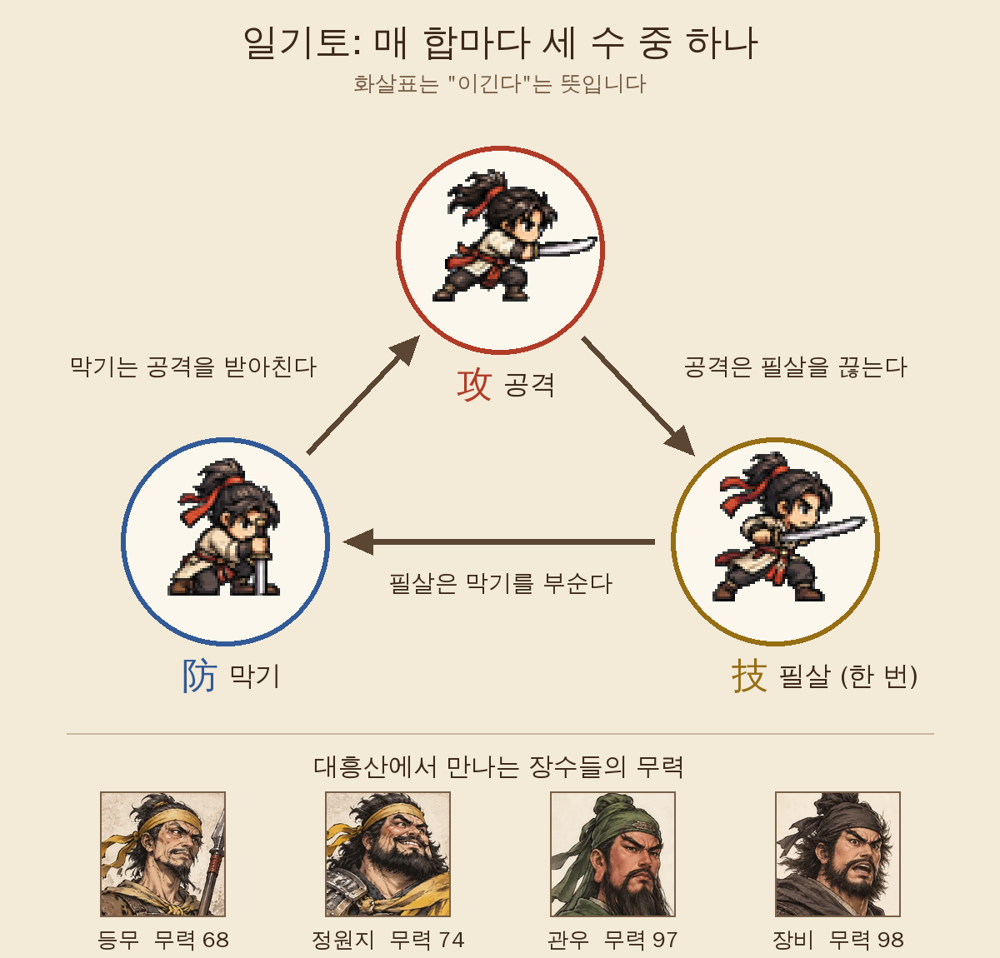

[7탄](/samguk-devlog-07-art)에서 도트와 수묵 초상, 두 가지 그림 이야기를 했습니다. 이번 8탄은 예고한 대로 **일기토**입니다. [6탄](/samguk-devlog-06-gear)에서 무기와 말이 무력을 올려 준다고 했는데, 그 무력이 실제로 쓰이는 곳이 바로 일기토입니다.

삼국지 하면 장수 둘이 군사들 앞에서 맞붙는 장면을 빼놓을 수 없습니다. 이 게임에서도 일기토는 따로 화면이 열리고, 음악도 바뀝니다. 다만 그냥 무력 숫자가 큰 쪽이 이기면 재미가 없어서, **가위바위보와 주사위**를 섞었습니다.

## 매 합마다 세 수 중 하나

일기토가 열리면 한소와 상대가 각각 하트 세 개를 들고 시작합니다. 먼저 상대를 세 번 맞히는 쪽이 이깁니다. 한 합마다 버튼 세 개 중 하나를 고릅니다.

- **攻 공격**: 먼저 칼을 내지릅니다.
- **防 막기**: 자세를 낮추고 받아칠 준비를 합니다.
- **技 필살**: 크게 한 방을 노립니다. 일기토 한 번에 **한 번만** 쓸 수 있습니다.

세 수는 가위바위보처럼 물고 물립니다.

- **공격은 필살을 끊습니다.** 크게 휘두르려는 틈을 먼저 찌릅니다.
- **필살은 막기를 부숩니다.** 웅크린 상대를 힘으로 밀어붙입니다.
- **막기는 공격을 받아칩니다.** 달려드는 칼을 흘리고 되받습니다.

위 그림의 도트 세 개는 실제로 일기토 화면에서 한소가 그 수를 고를 때 취하는 자세입니다. 공격은 7탄에서 말한 일곱 칸 중 공격 칸을 쓰고, 막기와 필살은 한소만 따로 가진 기술 자세 그림을 씁니다.

## 수를 읽으면 주사위 +3

가위바위보만으로는 운이 너무 큽니다. 그래서 고른 수는 **주사위에 보너스를 붙이는 역할**만 하고, 실제 승부는 주사위로 정합니다.

1. 두 사람이 각자 주사위 하나(1~6)를 굴립니다.
2. 내 수가 상대 수를 이기면, 즉 **상대의 수를 읽었으면 +3**을 받습니다.
3. 여기에 **무력 차이**가 더해집니다. 무력 10마다 1씩, 약한 쪽을 기준으로 강한 쪽에만 붙습니다. 예를 들어 무력 71인 한소와 무력 68인 등무가 붙으면 한소 쪽에 +1이 붙습니다.
4. 합이 큰 쪽이 상대 하트를 하나 깎습니다. 같으면 칼날만 부딪치고 다시 합니다.

그리고 **필살로 수를 읽어서 이기면 하트가 두 칸** 깎입니다. 한 번뿐인 필살을 언제 쓰느냐가 일기토의 가장 큰 고민거리입니다. 상대도 필살을 한 번 가지고 있어서, 상대가 필살을 이미 썼는지 기억해 두면 도움이 됩니다.

그럼 상대의 수는 어떻게 읽을까요? 매 합이 시작될 때 화면에 **상대의 자세**가 한 줄씩 나옵니다.

- "등무이(가) 칼끝을 낮추고 달려들 자세다…" → 공격할 것 같다
- "등무이(가) 발을 넓게 벌리고 자세를 낮춘다." → 막을 것 같다
- "등무이(가) 무기를 크게 뒤로 젖힌다!" → 필살을 노리는 것 같다

다만 이 묘사는 **열에 일곱 번만 맞습니다**. 나머지 세 번은 상대가 속임수를 쓰는 셈입니다. 그래서 묘사만 믿고 누르면 가끔 크게 당합니다. 문장의 '이(가)'는 아직 이름에 따라 조사를 바꾸지 못해서, 게임 안 문장을 그대로 옮겼습니다.

## 장수마다 버릇이 있다

상대가 매번 아무 수나 고르는 건 아닙니다. 장수마다 **어떤 수를 자주 고르는지** 비율을 따로 정했습니다.

| 장수   | 공격 | 막기 | 필살 |
| ------ | ---- | ---- | ---- |
| 장비   | 55%  | 20%  | 25%  |
| 관우   | 40%  | 30%  | 30%  |
| 정원지 | 45%  | 35%  | 20%  |
| 등무   | 30%  | 50%  | 20%  |
| 그 밖  | 40%  | 40%  | 20%  |

장비는 성격대로 일단 달려들고, 등무는 웅크려서 버티는 쪽입니다. 몇 합 겨뤄 보면 "이 사람은 공격을 많이 하네" 하는 감이 오도록 했습니다. 여기에 궁지에 몰리면 버릇이 조금 바뀝니다. 한소의 하트가 하나 남으면 상대는 공격을 더 자주 고르고, 상대 하트가 하나 남으면 아껴 둔 필살을 꺼낼 확률이 올라갑니다.

## 무력 차이가 25를 넘으면

주사위가 있으니 약해도 운이 좋으면 이길 수 있을까요? 일부러 그렇게 두지 않았습니다. **무력 차이가 25 이상**이면 일기토의 규칙이 바뀝니다.

- 약한 쪽이 수를 읽으면 공격이 들어가는 게 아니라 **간신히 막아낼** 뿐입니다.
- 약한 쪽이 수를 읽지 못하면 강한 쪽의 공격이 그대로 들어갑니다.

즉 약한 쪽은 버틸 수는 있어도 이길 수는 없습니다. 일기토를 시작할 때도 "무력 차이 ○○. 실력 차이가 너무 크다…"라고 미리 알려 줍니다.

한소의 무력은 **50 + 레벨×3 + 무기 무력 + 말 무력**입니다. 레벨 1에 낡은 검을 든 한소는 무력 53입니다. 위 그림에 있는 관우(97)나 장비(98)와는 차이가 40이 넘습니다. 초반에 이 둘에게 덤비면 결과는 정해져 있습니다. 주사위로는 넘을 수 없는 벽이 있다는 걸 보여 주고 싶었습니다.

## 어디서 일기토를 하나

지금 1장에서는 두 곳에서 일기토가 열립니다.

- **길 위의 떠돌이 무사**: 지도를 걷다 보면 칼을 멘 사내가 "한 수 겨뤄 보겠소?" 하고 길을 막아섭니다. 이 무사의 무력은 한소보다 조금 낮게(한소 무력에서 2~10 정도 뺀 값) 정해집니다. 이기면 그 무사가 **부대에 합류**하고, 지면 "다음에 다시 보지" 하고 떠납니다. 2탄에서 말한 용병 모으기의 또 다른 길입니다.
- **큰 전투의 장수**: 대흥산 같은 큰 전투에서는 적장이 일기토를 걸어오기도 하고, 한소가 적장 가까이 가면 **일기토 버튼**이 생기기도 합니다. 적장이 걸어온 일기토를 거절하면 우리 부대 사기가 떨어집니다. 이기면 명성이 오르고 사기가 크게 오르지만, 지면 한소가 크게 다친 채로 전투를 이어 가야 합니다.

큰 전투 쪽은 다음 편에서 자세히 이야기하겠습니다.

## 일기토 화면: 초상과 도트가 함께

7탄에서 도트와 수묵 초상을 화면마다 나눠 쓴다고 했는데, 일기토 화면은 **둘이 한 화면에 같이 나오는** 몇 안 되는 곳입니다.

- **양쪽 끝**: 한소와 상대의 수묵 초상, 이름, 무력, 하트 세 개가 있습니다. 수묵 초상이 없는 떠돌이 무사 같은 사람은 도트 얼굴로 대신합니다.
- **가운데**: 작은 무대가 있고, 그 위에 두 사람의 도트가 마주 섭니다. 이번 표지 그림이 이 무대를 블로그용으로 크게 꾸민 것입니다. 바탕은 실제 일기토 화면 배경 그림이고, 한소와 등무 도트, 베기 효과를 그 위에 제가 직접 올렸습니다.
- **아래**: 주사위 두 개와 공격·막기·필살 버튼이 있습니다.

버튼을 누르면 주사위가 데굴데굴 굴러가고, 무대 위의 두 도트가 가운데로 달려가 부딪칩니다. 공격이 들어가면 불꽃이 튀고 맞은 쪽이 하얗게 번쩍이며 뒤로 밀려납니다. 머리 위에는 "-1"이나 "-2"가 뜨고 화면이 흔들립니다. 같은 수가 나와 비기면 "챙!", 약한 쪽이 겨우 막으면 "막았다!"가 뜹니다. 필살을 쓸 때는 한소 뒤로 잔상이 남게 해서 한 방이라는 느낌을 냈습니다.

한 합의 연출은 1초 정도입니다. 부딪치기까지 0.3초, 맞고 밀려나는 데 0.3초, 제자리로 돌아오는 데 0.4초 정도로 나눴습니다. 일기토는 보통 여러 합이 이어지니, 한 합이 길면 금방 지루해집니다.

## 만들면서 든 생각

일기토를 만들면서 가장 신경 쓴 건 **세 가지의 무게**입니다. 주사위만 굴리면 플레이어가 할 일이 없고, 가위바위보만 있으면 무력이 의미가 없습니다. 그래서 **수 읽기(+3), 무력 차이, 주사위**가 서로 비슷한 무게가 되도록 했습니다. 무력이 비슷하면 수 읽기가 승부를 가르고, 무력이 조금 앞서면 유리하지만 방심하면 지고, 무력이 한참 모자라면 아예 이길 수 없습니다.

다음 9탄에서는 지금까지 이야기한 부대, 장비, 일기토가 모두 한꺼번에 쓰이는 **대흥산 대전투**를 이야기하겠습니다. 유비·관우·장비가 처음 이름을 떨친 그 싸움을 게임에서 어떻게 꾸몄는지 적어 보겠습니다.
