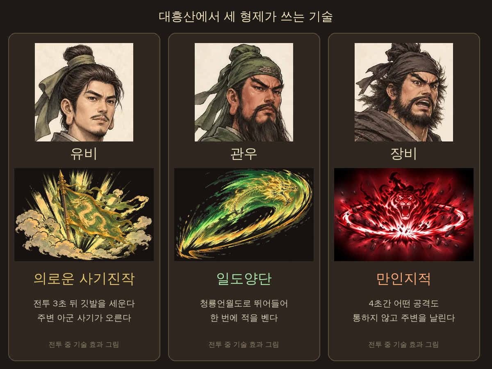

[8탄](/samguk-devlog-08-duel)에서 일기토 이야기를 하면서, 큰 전투 쪽은 다음 편에서 자세히 이야기하겠다고 했습니다. 이번 9탄은 예고한 대로 **대흥산 대전투**입니다. [5탄](/samguk-devlog-05-battle)의 부대 전투, [6탄](/samguk-devlog-06-gear)의 장비와 말, 8탄의 일기토가 모두 한꺼번에 쓰이는 1장의 마지막 싸움입니다.

역사에서는 184년, 유비·관우·장비가 의병을 일으켜 처음 이름을 떨친 싸움입니다. 황건적 정원지와 등무가 대군을 이끌고 왔고, 관우가 정원지를, 장비가 등무를 베었다고 전해집니다. 게임의 주인공 한소는 이 이야기를 이미 알고 있는 사람입니다. 그래서 이 전투는 **"아는 역사 앞에서 무엇을 할 것인가"** 를 고르는 자리로 만들었습니다.

## 소식이 오고, 편을 고른다

1장을 돌아다니며 의뢰를 하다 보면 어느 날 파발마가 들판을 가로지릅니다. "황건적이 대흥산에 모였다! 탁현 성에서 의병을 모은다!" 부대원들이 소식을 전해 줍니다. 두목은 정원지, 부장은 등무이고, 류가장 쪽에서는 노란 두건 무리가 용병을 산다는 소문도 들립니다.

여기서 길이 두 갈래로 나뉩니다.

- **의용군 쪽**: 탁현 성의 의병 모집 방을 찾아가 유비·관우·장비와 함께 싸웁니다.
- **황건 쪽**: 류가장의 수상한 사내를 찾아가면, 우리 편에 서면 **금 100냥**을 주겠다고 합니다. 받아들이면 정원지 쪽 용병으로 싸웁니다.

어느 쪽을 골라도 대흥산이 지도에 열리고, 바로 출진하지 않고 의뢰로 더 강해진 뒤에 가도 됩니다. [3탄](/samguk-devlog-03-map)에서 말한 1장 지도의 이야기가 여기로 모입니다.

## 출진 전: 역사를 따를까, 바꿀까

출진하기 직전에 한 번 더 고릅니다. 편마다 선택지가 두 개씩 있습니다.

| 편     | 역사를 따른다                                     | 역사를 바꾼다                                                  |
| ------ | ------------------------------------------------- | -------------------------------------------------------------- |
| 의용군 | 관우 곁을 지킨다 (관우가 정원지를 베면 명성 +3)   | 정원지의 목을 직접 노린다 (맨 앞에서 시작, 관우가 늦게 움직임) |
| 황건   | 퇴로를 미리 봐 둔다 (무너질 때 부하들과 빠져나감) | 정원지를 관우로부터 지킨다 (정원지 곁에서 시작, 70초 버티기)   |

고른 것에 따라 한소와 부대가 서는 자리가 달라지고, 관우가 정원지에게 달려드는 시점도 달라집니다. 역사를 따르면 관우는 전투 시작 32초쯤 정원지를 노리고, 의용군 쪽에서 역사를 바꾸기로 하면 50초쯤으로 늦춰집니다. 그 사이에 한소가 먼저 정원지에게 닿을 수 있느냐가 관건입니다.

그리고 1장을 다니면서 미리 해 둔 일이 여기서 돌아옵니다.

- 탁현 관청에 "곧 큰 무리가 모입니다"라고 **미리 알려 두었다면**, 관군 쪽 의병이 **20명** 더 늘어납니다. 전투가 시작되고 조금 뒤 "한소의 귀띔으로 미리 모은 의병 20명이 관군에 가세했다"라는 알림이 뜹니다.
- 유비에게 붉은 얼굴과 범 같은 수염의 사내를 곧 만날 거라고 **귀띔해 두었다면**, 유비가 전투 중에 "그대 말대로였소! 함께 갑시다!" 하고 외치며 사기를 조금 더 올려 줍니다.

## 지금까지 중 가장 큰 싸움터

5탄에서 이야기한 부대 전투와 같은 방식이지만, 판이 훨씬 큽니다. 보통 전투 싸움터가 1400×820이라면 대흥산은 **2400×1400**입니다. 바탕은 산기슭 전투용으로 따로 그린 그림을 깔았습니다.

의용군 쪽에서 싸우면 양쪽 병력은 이렇습니다.

- **우리 편**: 한소와 부대원, 의용군 보병 80명(관청에 알렸다면 100명), 기병 12기, 그리고 유비·관우·장비
- **황건**: 황건 보병 120명, 황건 기병 8기, 그리고 정원지·등무

황건 보병 가운데 아홉 명에 한 명은 멀리서 술법을 쓰는 **술법 병사**, 그 밖에도 일부는 **궁병**이라서 뒤쪽에 섭니다. 앞줄만 밀어붙이면 뒤에서 화살과 술법이 날아옵니다. 황건 쪽에서 싸우면 반대로 황건 110명과 기병 8기가 우리 편이 되고, 맞은편에 의용군 90명(관청에 알려졌다면 110명)과 기병 12기가 섭니다.

표지 그림은 이 싸움터를 블로그용으로 꾸민 것입니다. 바탕은 실제 대흥산 전투 바탕 그림이고, 양쪽 군사와 장수 도트를 제가 직접 배치했습니다. 실제 게임 화면은 아직 아껴 두겠습니다.

## 세 형제의 기술

대흥산에서는 유비·관우·장비가 각자 기술을 하나씩 씁니다. 기술을 쓸 때는 화면 가운데로 수묵 초상과 기술 이름이 띠처럼 지나가고, 기술마다 큰 효과 그림이 터집니다.

- **유비, 의로운 사기진작**: 전투가 시작되고 3초쯤 지나면 유비가 깃발을 세웁니다. 주변 아군에게 금빛 기운이 번지고 머리 위에 "사기 ×2"가 뜨며, 그 편의 사기가 크게 오릅니다. 사기는 모든 공격의 피해에 곱해지는 값이라 싸움 전체에 영향을 줍니다.
- **관우, 일도양단**: 관우가 적에게 칼을 대는 순간, 공중으로 뛰어올라 내려치며 그 적을 **한 번에** 쓰러뜨립니다. 근처의 적들도 피해를 입고 날아갑니다. 의용군 쪽에서는 9초에 한 번씩 씁니다.
- **장비, 만인지적**: 적이 가까이 있으면 "으아아아!" 하고 포효합니다. **4초 동안 어떤 공격도 통하지 않고**, 주변의 적을 모두 밀쳐 냅니다. 16초에 한 번씩 씁니다.

위 그림의 초상은 기술을 쓸 때 실제로 나오는 수묵 초상이고, 아래 세 장은 실제 전투에서 터지는 효과 그림입니다. 한 장으로 보기 좋게 모아서 글씨를 붙인 것은 블로그용으로 제가 새로 만든 것입니다.

세 사람이 너무 강해 보이죠? 일부러 그렇게 했습니다. 의용군 쪽에서는 든든한 형님들이고, 황건 쪽에서는 넘을 수 없는 벽입니다. 지금 데모에서는 유비·관우·장비가 쓰러지지 않게 해 두었습니다.

## 적장이 일기토를 걸어온다

싸움이 한창일 때 전투가 잠깐 멈추고 적장이 소리칩니다.

- 의용군 쪽이면 20초쯤에 **등무**가 "거기 갑옷도 변변찮은 용병 놈! 나 등무와 겨뤄 보겠느냐!"
- 황건 쪽이면 16초쯤에 **장비**가 "이놈! 황건에 붙은 용병 놈! 이 장익덕과 한판 붙어 보자!"

받아들이면 8탄에서 이야기한 일기토 화면이 열립니다. 거절하면 우리 부대 사기가 떨어집니다. 등무는 무력 68이라 해 볼 만하지만, 장비는 무력 98입니다. 8탄에서 말한 "무력 차이 25"의 벽이 바로 여기서 쓰입니다.

도발이 아니어도, 한소가 적장 가까이 가면 화면에 **일기토 버튼**이 생깁니다. 의용군 쪽이면 정원지나 등무, 황건 쪽이면 장비나 관우에게 직접 일기토를 걸 수 있습니다. 다만 한 전투에 일기토는 **한 번뿐**입니다.

- **이기면**: 그 장수가 그 자리에서 쓰러지고, 명성이 5 오르고, 우리 부대 사기가 크게 오릅니다.
- **지면**: 한소가 체력 4분의 1만 남은 채 전투를 이어 가야 합니다. 장비나 관우에게 지면 목숨은 살려 주고 돌려보냅니다.

## 전투는 어떻게 끝나나

대흥산 전투는 적을 전부 쓰러뜨려야 끝나는 싸움이 아닙니다. **정원지가 쓰러지는 순간**이 고비입니다.

- 정원지가 쓰러지면 화면에 **潰走(궤주)** 가 찍히고, 정원지 편 군사들이 모두 도망치기 시작합니다. 잠시 뒤 전투가 끝납니다.
- 의용군 쪽에서 역사를 따르기로 했고 정말 관우가 정원지를 베면, "역사의 증인" 알림과 함께 명성이 3 오릅니다.
- 황건 쪽에서 정원지를 지키기로 했다면, **70초 동안 정원지를 지켜 내면** **堅守(견수)** 가 찍히고 관군이 물러갑니다.
- 한소가 쓰러져도 전투는 끝납니다. 대신 결과가 달라집니다.

이기면 명성 5, 경험치는 **80 + 쓰러뜨린 적 수×2**를 받습니다. 많이 벨수록 레벨이 더 오릅니다.

## 그리고 엔딩

대흥산 전투가 끝나면 지금 데모의 **엔딩**이 나옵니다. 어느 편이었는지, 역사를 따랐는지 바꿨는지, 일기토에서 누구를 이겼는지, 한소가 쓰러졌는지에 따라 엔딩 제목과 글이 달라집니다. 지금 들어 있는 엔딩은 **의용군 쪽 4가지, 황건 쪽 4가지**입니다. 내용은 직접 보시는 게 좋을 것 같아 여기서는 적지 않겠습니다.

엔딩 화면에는 진영, 레벨, 무력, 명성, 쓰러뜨린 적, 흐른 날, 일기토 결과, 그리고 **역사를 몇 번 따르고 몇 번 바꿨는지**가 함께 나옵니다. 1장 내내 "역사를 따른다 / 바꾼다" 선택지에 표시를 해 둔 이유가 여기 있습니다.

대흥산만 따로 시험해 보고 싶을 때를 위해, 레벨 6에 부대원 7명으로 바로 대흥산 전투를 시작하는 **"대흥산 전투 바로 하기"** 판도 만들어 두었습니다. 만들면서 이 전투만 수십 번 다시 해야 해서 생긴 기능인데, 짧게 맛보기에도 좋아서 남겨 두었습니다.

## 만들면서 든 생각

대흥산을 만들면서 가장 고민한 건 **"역사를 아는 주인공이 할 일이 있느냐"** 였습니다. 관우가 정원지를 베고 끝나는 싸움이라면 플레이어는 구경꾼이 됩니다. 그래서 관우가 움직이는 시간을 정해 두고, 그 전에 한소가 먼저 닿을 수 있는 틈을 만들었습니다. 반대로 역사를 따르기로 하면 관우 곁에서 그 장면을 지켜보는 것 자체가 보상이 되도록 했습니다.

또 1장 내내 했던 작은 선택(관청에 귀띔하기, 유비에게 귀띔하기)이 마지막 싸움에서 의병 20명, 유비의 외침 한마디로 돌아오게 했습니다. 크지 않은 차이지만, "내가 한 일이 남는다"는 느낌을 주고 싶었습니다.

다음 10탄이 이 개발일지의 마지막 편입니다. 대흥산 다음에 무엇이 기다리는지, 황건 편 이야기와 스팀 출시까지 **앞으로의 계획**을 적어 보겠습니다.

## 함께 보면 좋은 글

- [삼국지 회귀 개발일지 10탄: 대흥산 다음 이야기와 스팀 준비](/samguk-devlog-10-next)
