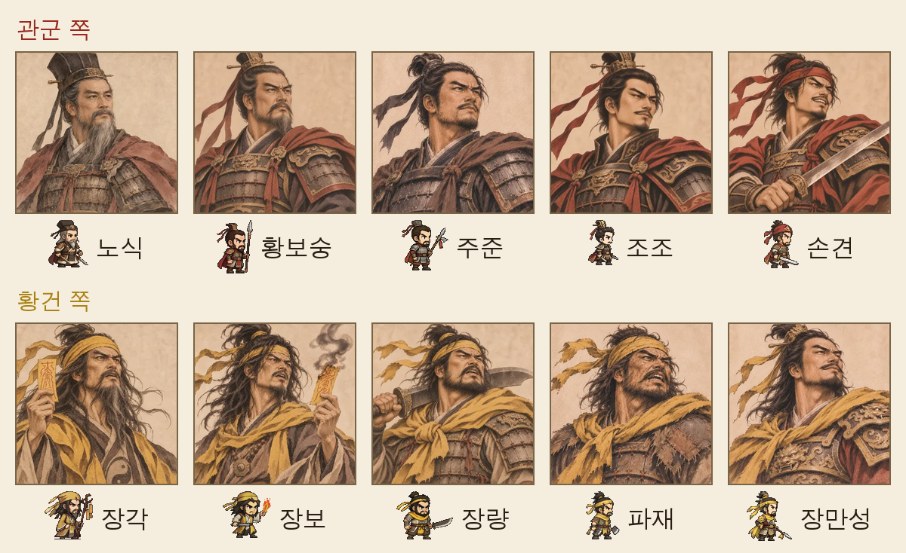

[9탄](/samguk-devlog-09-daeheung)에서 대흥산 대전투 이야기를 하면서, 다음 10탄이 이 개발일지의 마지막 편이라고 했습니다. 이번에는 예고한 대로 **앞으로의 계획**입니다. 대흥산 다음에 무엇이 기다리는지, 황건 쪽 장수들은 누가 나오는지, 그리고 스팀 출시를 위해 무엇을 준비해 두었는지 적어 보겠습니다.

## 지도에는 이미 다음 싸움터가 있다

[3탄](/samguk-devlog-03-map)에서 1장 지도 이야기를 했습니다. 지금 데모에서 실제로 싸우는 큰 전투는 대흥산 하나지만, 지도를 둘러보면 **아직 들어갈 수 없는 전장 네 곳**이 표시되어 있습니다. 이름 아래에 "다음 이야기"라고 적혀 있고, 그곳에 들러 보면 한소가 이렇게 혼잣말을 합니다.

> (…역사대로라면 이곳에서 큰 싸움이 벌어진다. 아직은 때가 아니다.)

네 곳은 이렇습니다.

| 전장        | 땅   | 게임 속 설명                                                                               |
| ----------- | ---- | ------------------------------------------------------------------------------------------ |
| 광종 전투   | 기주 | 장각이 틀어박힌 성. 노식이 포위하고, 뒤이어 동탁과 황보숭이 온다.                          |
| 청주 구원전 | 청주 | 유관장이 청주 태수 공경을 구하러 달려오는 싸움터.                                          |
| 장사 화공   | 예주 | 황건 파재의 대군이 풀숲에 진을 쳤다. 황보숭과 주준이 불로 친다. 조조가 처음 나타나는 싸움. |
| 완성 공략   | 형주 | 남양 황건 장만성·한충·손중이 지키는 성. 손견이 성벽을 오른다.                              |

모두 "1장 뒷이야기에서 열린다(준비 중)"로 묶어 두었습니다. 184년 황건적의 난에서 이름난 싸움들을 한소가 하나씩 지나가게 하는 것이 다음 목표입니다.

데모를 끝까지 하면 엔딩 화면 아래에도 한 줄이 나옵니다.

> 정식판에서는 이어서 청주 구원, 광종 전투, 그리고 반동탁 연합으로… 네임드 장수 등용, 인연 관계, 나이와 수명이 기다린다.

대흥산이 끝이 아니라 시작이라는 뜻으로 넣은 문장입니다. 이름난 장수를 부하로 들이고, 사람 사이의 인연이 쌓이고, 세월이 흐르면 나이를 먹는 것까지가 제가 그리는 정식판입니다.

## 미리 그려 둔 장수들

[7탄](/samguk-devlog-07-art)에서 이 게임의 사람 그림은 **도트와 수묵 초상 두 가지**라고 했습니다. 다음 싸움터에 나올 장수들도 두 그림을 모두 미리 만들어 두었습니다.

- **관군 쪽**: 노식, 황보숭, 주준, 조조, 손견
- **황건 쪽**: 장각, 장보, 장량(장각 삼형제), 파재, 장만성

이 그림들은 게임 파일에 이미 들어 있지만, 지금 데모에서는 아직 나오지 않는 **준비한 그림**입니다. 위 한 장은 블로그용으로 제가 모아서 이름을 붙인 것입니다. 표에 나온 동탁은 도트만 먼저 만들어 두었고 수묵 초상은 아직입니다.

수묵 초상은 모두 같은 그림체로 맞추려고 한 장씩 따로 요청해서 받았습니다. 같은 대화에서 여러 장을 뽑으면 그림체가 조금씩 흐트러져서, 네다섯 장마다 새로 시작하는 식으로 만들었습니다.

표지 그림의 바탕도 아직 게임에서 쓰지 않는 준비한 그림입니다. 마른 풀밭에 천막이 늘어선 진영 그림인데, 여기에 관군(황보숭·주준·조조)과 황건(파재) 쪽 도트를 블로그용으로 제가 배치했습니다. 풀숲에 진을 친 파재와 불로 치는 관군, 장사 싸움이 이런 분위기였으면 해서 골라 봤습니다.

## 황건 쪽으로 간 한소는

9탄에서 말했듯이 지금 데모에서도 대흥산 전에 **황건 쪽**을 고를 수 있습니다. 류가장의 수상한 사내에게 금 100냥을 받고 정원지 편에서 싸우는 길입니다.

그런데 위 그림의 황건 장수들을 보면, 황건 쪽을 고른 사람에게 장각 삼형제와 파재, 장만성은 적이 아니라 **같은 편 윗사람**입니다. 반대로 노식·황보숭·조조·손견은 맞서야 할 상대가 됩니다. 지도에도 이미 장각 삼형제의 고향인 **거록**(태평도의 본산)이 있고, 성 밖 곳곳에 누런 부적이 붙어 있다고 적어 두었습니다.

같은 싸움터를 어느 편에서 보느냐에 따라 전혀 다른 이야기가 되게 하는 것, 대흥산에서 시작한 이 방식을 다음 싸움터에서도 이어 가고 싶습니다. 남쪽 땅으로 갈수록 적이 많고 보상도 커지게 해 두었으니, 한소가 어느 편이든 점점 더 큰 판으로 들어가게 됩니다.

## 스팀을 위해 해 둔 것

이 게임은 처음부터 **브라우저에서 바로 도는 웹 게임**으로 만들었습니다. 따로 설치하거나 빌드할 것 없이 파일 하나를 열면 됩니다. 모바일 가로 화면을 먼저 맞췄고, PC는 그다음에 맞췄습니다.

스팀에 내려면 데스크톱 프로그램으로 바꿔야 하는데, 이 부분은 미리 길을 터 두었습니다.

- **포장**: 웹 게임을 Electron이나 Tauri로 감싸서 데스크톱 프로그램으로 만들 생각입니다.
- **저장**: 지금은 진행 상황을 브라우저에 저장합니다. 저장하는 곳을 세 줄짜리 코드 한 군데에 모아 두어서, 스팀 판에서는 **그 세 줄만 파일 저장으로 바꾸면** 되게 해 두었습니다.
- **영어판**: 첫 화면에 **English** 버튼이 있습니다. 누르면 영어판으로 바뀌고, 고른 언어를 기억합니다. 영어판 저장은 한국어판과 따로 합니다. 한글 원문과 번역을 표로 모아 두고, 도구를 한 번 돌리면 영어판이 새로 만들어지는 방식이라 글을 고쳐도 영어판을 손으로 다시 고칠 필요가 없습니다.

그 밖에 전투를 빨리 보고 싶은 분들을 위해 **전투 2배속**도 넣었습니다. 한 번에 두 배의 시간을 흘리지 않고 두 번에 나눠 계산하게 했고, 걷는 모습만은 1.3배까지만 빨라지게 했습니다.

## 데모는 지금 해 볼 수 있습니다

1장 데모는 itch.io에서 브라우저로 바로 해 볼 수 있습니다. 9탄에서 적지 않은 엔딩 8가지도 여기서 직접 확인해 보세요.

- 「삼국지 회귀」 데모: [https://zinnote.itch.io/samguk-hoegwi](https://zinnote.itch.io/samguk-hoegwi)

## 열 편을 마치며

[1탄](/samguk-devlog-01-why)에서 "나라면 그 시대에 이렇게 살겠다"는 상상을 게임으로 옮겨 보겠다고 했습니다. 그 뒤로 첫 용병들, 1장 지도, 의뢰판, 부대 전투, 장비와 말, 도트와 수묵, 일기토, 대흥산까지 하루 한 편씩 적어 왔습니다. 적다 보니 제가 무엇을 만들었고 무엇이 아직 비어 있는지가 더 또렷해졌습니다.

비어 있는 곳은 위에 적은 네 싸움터와 그 장수들입니다. 연속 개발일지는 여기서 마치지만, 광종이나 청주 싸움터가 열리면 그때 또 따로 적어 두겠습니다. 끝까지 읽어 주셔서 고맙습니다.

## 함께 보면 좋은 글

- [삼국지 회귀 개발일지 11탄: 들판을 걷다 보면 생기는 일들](/samguk-devlog-11-road)
