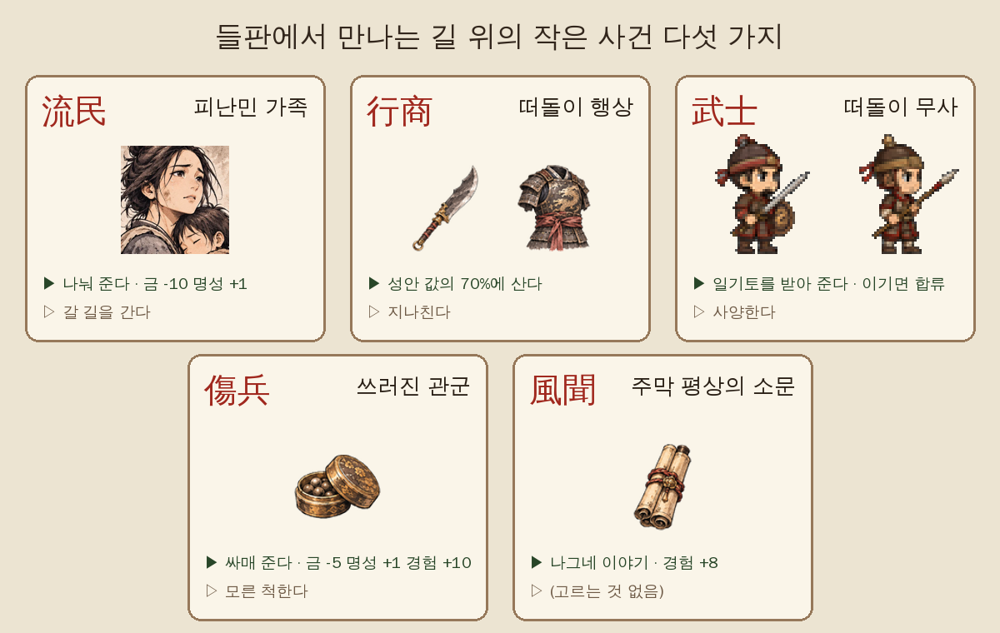

[10탄](/samguk-devlog-10-next)에서 연속 개발일지는 마친다고 했는데, 다시 읽어 보니 열 편 동안 미처 적지 못한 이야기가 꽤 남아 있었습니다. 그래서 몇 편 더 이어서 적어 보려고 합니다. 11탄은 **큰 지도를 걸어 다닐 때 생기는 일들**입니다.

[3탄](/samguk-devlog-03-map)에서 1장 지도를, [4탄](/samguk-devlog-04-quests)에서 의뢰판을 소개했습니다. 의뢰를 받고 목적지까지 가는 길이 그냥 빈 길이면 심심합니다. 그래서 길 위에 **작은 사건**과 **돌아다니는 적**을 두었습니다.

## 언제 사건이 생기나

들판을 걷는 동안 게임은 한소가 걸은 거리를 셉니다. 일정 거리를 걸을 때마다 한 번씩 주사위를 굴리는데, **45% 확률**로 길 위의 사건이 하나 생깁니다.

다만 몇 가지 경우에는 생기지 않게 했습니다.

- 마을이나 성 같은 장소 바로 근처일 때
- 호위 의뢰로 수레를 데려가는 중일 때(호위 중에는 따로 매복이 있습니다)

사건이 생기면 한소는 그 자리에 멈추고, 작은 창이 뜹니다. 대부분은 "할까, 말까" 두 가지 중 하나를 고르는 짧은 장면입니다.

## 다섯 가지 작은 사건

위 그림은 블로그용으로 제가 카드처럼 정리한 것입니다. 실제 게임에서는 그림 없이 제목과 한자, 설명, 선택 단추만 있는 창이 뜹니다. 카드 속 그림 중 행상의 박도·찰갑과 떠돌이 무사 도트는 게임에서 쓰는 그림이고, 피난민 초상과 약함·두루마리는 아직 게임에서 쓰지 않는 **준비한 그림**입니다.

### 피난민 가족 (流民)

> 길가에 아이를 업은 여인과 노인이 주저앉아 있다. 며칠을 굶은 얼굴이다.

먹을 것과 돈을 나눠 주면 **금 10을 쓰고 명성이 1** 오릅니다. 그냥 지나가면 연석이 "…대장, 그냥 가요?" 하고 묻고, 한소는 속으로 "전부 구할 수는 없다"고 생각합니다. 어느 쪽이 옳다고 정하지 않고, 대사 한 줄씩만 남기게 했습니다.

### 떠돌이 행상 (行商)

[6탄](/samguk-devlog-06-gear)에서 소개한 그 행상입니다. 한소가 아직 갖고 있지 않은 물건 하나를 **성안 값의 70%** 에 팝니다. 사면 바로 장착됩니다. 모든 물건을 다 갖고 있으면 행상은 더 나오지 않습니다.

### 떠돌이 무사 (武士)

칼을 멘 사내가 길을 막고 "한 수 겨뤄 보겠소?" 하고 묻습니다. [8탄](/samguk-devlog-08-duel)의 **일기토**로 겨뤄서 이기면 부대에 들어옵니다. 창에는 이 사람의 성격(예를 들어 용맹, 술꾼, 겁쟁이 같은 것)이 미리 적혀 있어서, 데려갈지 말지 보고 고를 수 있습니다. 부대 자리가 꽉 차 있으면 이 사건은 나오지 않습니다.

### 쓰러진 관군 (傷兵)

다리를 다친 관군 병사가 쓰러져 있습니다. 상처를 싸매 주면 **금 5를 쓰고 명성 +1, 경험 +10** 을 얻고, 병사가 소식 하나를 알려 줍니다.

이 사건은 한소가 어느 편인지에 따라 글이 달라집니다. [9탄](/samguk-devlog-09-daeheung)에서 말한 황건 쪽을 고른 뒤라면, 병사는 노란 두건을 보고 겁먹은 눈을 합니다. 그래도 살려 주면 "…황건인데 나를 살려 주다니" 하며 관군이 어디로 올라갈지 흘려 줍니다. 같은 사건이라도 편에 따라 다른 이야기가 되게 하는 작은 연습이었습니다.

### 주막 평상의 소문 (風聞)

이것만은 고르는 것이 없습니다. 길가 주막 평상에서 나그네들이 수군거리는 이야기를 듣고, **경험 +8** 을 얻습니다. 소문은 네 가지입니다.

| 나그네의 소문                                        | 한소의 속마음                                |
| ---------------------------------------------------- | -------------------------------------------- |
| 남쪽에서 장각이라는 도사가 부적 물로 병을 고친다더군 | 곧 "창천이죽 황천당립"을 외치며 들고일어난다 |
| 장사꾼 장세평과 소쌍이 탁군에서 말을 판다던데        | 유비에게 군자금을 대 줄 사람들이다           |
| 낙양에선 환관들이 벼슬을 돈 받고 판다지 뭔가         | 십상시… 이 나라가 무너지는 이유 중 하나다    |
| 요즘 하늘에 꼬리 달린 별이 떴다더라. 흉한 징조래     | 징조든 아니든, 난리는 온다                   |

나그네는 그냥 떠도는 말을 하는데, 한소는 역사책에서 읽은 사람이라 그 말이 무슨 뜻인지 압니다. [1탄](/samguk-devlog-01-why)에서 말한 "현대 사람이 그 시대에 떨어진다"는 설정을 이런 작은 장면에서 조금씩 보여 주고 싶었습니다.

### 명성이 쌓이면

피난민을 돕거나 관군을 살려 주면 오르는 명성은 의뢰 보상과 똑같이 쌓입니다. 명성이 어느 정도 모이면(또는 날짜가 충분히 지나면) 파발꾼이 들판을 가로지르며 대흥산 소식을 전합니다. 착한 일을 많이 할수록 큰 이야기가 조금 빨리 시작되는 셈입니다.

## 들판을 돌아다니는 적

사건과 별개로, 지도 위에는 **늘 돌아다니는 적 무리**가 있습니다. 탁군 근처에 처음부터 정해 둔 다섯 무리가 있고, 그 밖에는 지도 위 장소마다 주변에 한두 무리가 자리 잡습니다. 장소에서 조금 떨어진 들판에 자기 영역을 두고, 그 안을 천천히 서성입니다.

어떤 무리가 나오는지는 땅마다 다릅니다.

| 땅   | 나오는 무리                  | 숫자 배율 |
| ---- | ---------------------------- | --------- |
| 유주 | 산적 무리, 마적 떼           | 1배       |
| 기주 | 황건 무리, 태평도 신도, 도적 | 1.4배     |
| 청주 | 청주 황건, 황건 무리         | 1.5배     |
| 연주 | 도적 떼, 황건 잔당           | 1.5배     |
| 사례 | 관도 도적                    | 1.6배     |
| 예주 | 영천 황건, 황건 무리         | 1.8배     |
| 형주 | 남양 황건, 황건 무리         | 2배       |

한 무리는 보통 3~5명에 땅의 배율을 곱한 숫자입니다. 그래서 1장의 시작인 유주에서는 서너 명이지만, 남쪽 형주로 내려가면 열 명 가까이 됩니다. 큰 싸움터 근처에는 **황건 대군 척후**라는 더 큰 무리가 나옵니다. [10탄](/samguk-devlog-10-next)에서 "남쪽 땅으로 갈수록 적이 많아진다"고 한 것이 바로 이 표입니다.

## 피할까, 싸울까

적 무리에 가까이 다가가면 창이 하나 뜹니다. 몇 명인지, 그리고 무리의 도트가 줄지어 보입니다. 산적이면 맨 앞에 외눈 두목이, 황건이면 노란 두건들이 섞여 나옵니다. 표지 그림이 바로 이 장면을 블로그용으로 크게 다시 꾸민 것입니다. 바탕은 실제 작은 전투에서 쓰는 들판 그림입니다.

- **피한다**: 무리를 피해 조금 돌아갑니다. 잠깐 동안은 그 무리가 다시 덤비지 않습니다.
- **싸운다**: [5탄](/samguk-devlog-05-battle)의 부대 전투로 들어갑니다.

싸울 때 적 숫자는 무리 숫자에 한소 레벨의 절반만큼 더 붙습니다. 한소가 강해질수록 같은 무리도 조금씩 더 많아지게 한 것입니다. 이기면 쓰러뜨린 적 숫자에 따라 금과 경험을 받고, 명성은 오르지 않습니다. 명성은 의뢰나 사람을 돕는 일에서만 오르게 나눠 두었습니다. 쓰러뜨린 무리는 시간이 조금 지나면 자기 자리에서 다시 나타납니다.

## 만들면서 든 생각

처음에는 들판의 적만 있었습니다. 그런데 의뢰 하나 하러 가는 길에 싸움만 서너 번 하게 되니 지루했습니다. 그래서 싸움이 아닌 일, 돈을 쓰고 명성을 얻거나 그냥 소문을 듣는 일을 섞었습니다.

사건 하나하나는 몇 줄짜리 코드지만, 한소가 어떤 사람인지 플레이하는 사람이 정하게 해 주는 장면이라 생각보다 중요했습니다. 피난민을 매번 돕는 한소도, 갈 길만 가는 한소도 둘 다 이 게임의 한소입니다.

## 다음 편 예고

다음 12탄에서는 **주막과 용병 고용** 이야기를 하겠습니다. 떠돌이 창병·검병·궁병·기병을 데려오는 방법, 그리고 오늘 잠깐 나온 용병 **성격** 여러 가지가 싸움에서 어떻게 달라지는지 적어 보겠습니다.

1장 데모는 itch.io에서 브라우저로 바로 해 볼 수 있습니다.

- 「삼국지 회귀」 데모: [https://zinnote.itch.io/samguk-hoegwi](https://zinnote.itch.io/samguk-hoegwi)
