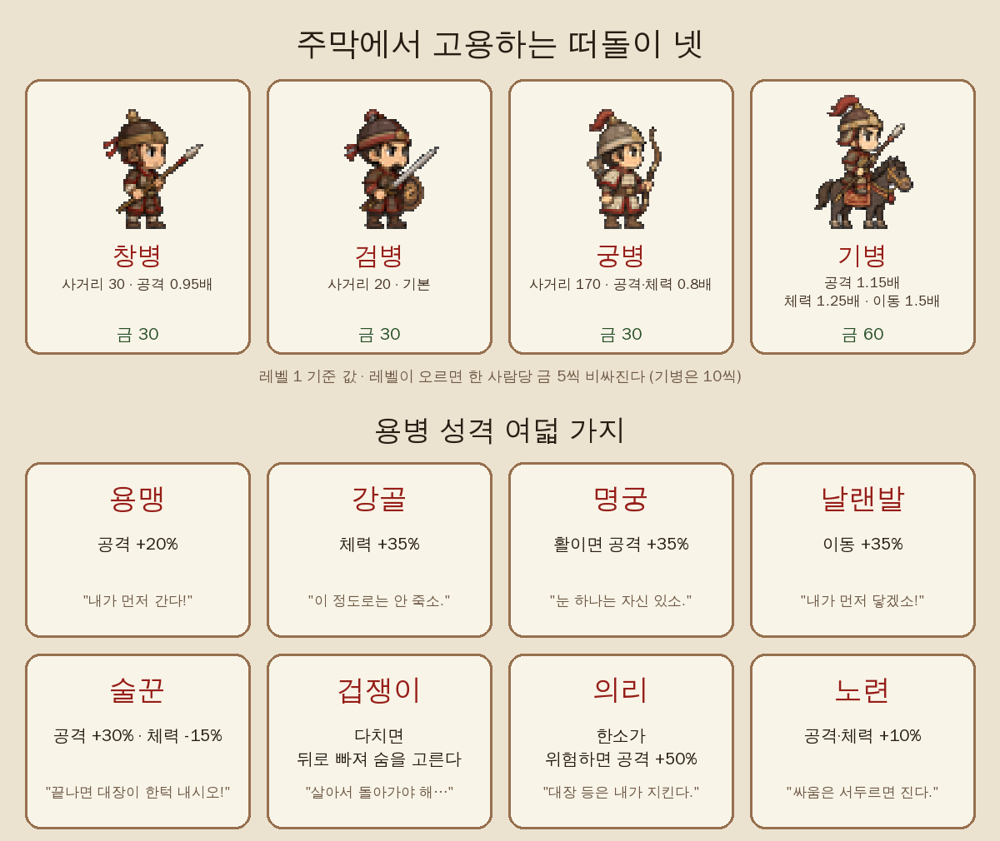

[11탄](/samguk-devlog-11-road)에서는 들판을 걷다가 만나는 사건과 적을 적었습니다. 그 끝에 "다음은 주막과 용병 고용"이라고 예고했으니, 12탄은 **주막에서 사람을 고르는 이야기**입니다.

[2탄](/samguk-devlog-02-party)에서 첫 용병 셋과 성격 특성 여덟 가지의 이름을 소개했고, [5탄](/samguk-devlog-05-battle)에서는 싸움터에서 성격이 한마디씩 튀어나오는 모습을 적었습니다. 이번에는 그 사이를 채워 보겠습니다. 새 용병을 **어디서, 얼마에, 어떤 기준으로** 데려오는지, 그리고 성격 하나가 숫자로는 얼마나 차이 나는지입니다.

## 주막은 성에만 있다

주막은 마을마다 있지 않습니다. 탁현, 계, 남피, 거록 같은 **성**과 도읍 낙양에만 있습니다. 성에 들어가면 대장간, 마구간과 함께 "주막 · 용병 고용 · 소문" 단추가 뜹니다. 누상촌이나 흑석촌 같은 작은 마을에는 의뢰판은 있어도 주막은 없습니다. 사람을 모으려면 큰 고을로 가야 한다는 느낌을 주고 싶었습니다.

주막에 들어가면 맨 위에 **주막 주인**이 앉아 있습니다. 표지 왼쪽 위에서 웃고 있는 아저씨입니다. 표지 바탕의 들판 풍경은 아직 게임 코드에서 쓰지 않는 **준비한 그림**이고, 주인 초상과 용병 도트 넷은 실제 주막 창에 나오는 그림입니다. 주인은 들를 때마다 소문을 한 줄씩 흘립니다. "도살업자 장비네 고기는 질겨도 술은 좋아" 같은 말인데, [4탄](/samguk-devlog-04-quests)에서 적은 그 소문입니다.

## 오늘 주막에 있는 사람들

위 그림은 블로그용으로 제가 정리한 것입니다. 도트 넷은 실제 주막 창에 뜨는 그림 그대로입니다.

주막에는 늘 네 사람이 있습니다. **떠돌이 창병, 검병, 궁병, 기병**이 한 명씩입니다. 이름은 왕패, 손덕, 이혁, 정무 같은 열네 개 이름 가운데서 뽑고, 이미 부대에 있는 이름은 빼고 고릅니다. 성격도 여덟 가지 중 하나가 무작위로 붙습니다.

이 네 사람은 **하루가 지나면 모두 바뀝니다.** 오늘 겁쟁이 기병만 있어서 아쉬웠다면 하루 뒤에 다시 오면 됩니다. 그리고 그날의 네 사람은 어느 성 주막에 가도 같습니다. 탁현에서 본 의리 창병이 마음에 걸린다면 남피 주막에서도 그 사람을 데려올 수 있습니다. 성마다 따로 만들면 성을 돌며 좋은 성격만 고르는 놀이가 될 것 같아서 하나로 묶었습니다.

## 값과 정원

고용하는 값은 한소의 레벨을 따라 오릅니다.

| 한소 레벨 | 창병·검병·궁병 | 기병   | 부대 정원 |
| --------- | -------------- | ------ | --------- |
| 1         | 금 30          | 금 60  | 3명       |
| 2         | 금 35          | 금 70  | 4명       |
| 3         | 금 40          | 금 80  | 6명       |
| 4         | 금 45          | 금 90  | 7명       |
| 5         | 금 50          | 금 100 | 9명       |
| 6 이상    | 레벨마다 +5    | +10    | 10명      |

기병은 말값까지 쳐서 늘 두 배입니다. 정원은 한소가 데리고 다닐 수 있는 부대원 수인데, 레벨 1에는 3명입니다. 마철·단목현·연석 셋으로 이미 꽉 차 있으니, **레벨 1에서는 주막에 가도 고용 단추가 눌리지 않습니다.** 의뢰를 한두 개 끝내고 레벨이 오른 뒤에야 넷째 부대원을 들일 수 있습니다. 처음 시작 돈이 금 40이라, 레벨 2가 되어도 기병은 한참 모아야 합니다.

정원이 차 있을 때 새 사람을 들이고 싶으면 부대 창에서 누군가를 **해고**해야 합니다. 다만 부대원이 한 명만 남았을 때는 "혼자 남을 수는 없어요" 하고 막습니다.

## 주막 용병은 조금 약하게 시작한다

코드에는 부대원마다 기본 배율이 있습니다. 처음 셋과 길에서 일기토로 이겨서 데려온 무사는 1배인데, **주막에서 돈으로 산 용병은 0.95배**로 시작합니다. 체력과 공격이 5% 낮습니다.

돈만 내면 바로 오는 사람이니 손발이 덜 맞는다는 생각이었습니다. 대신 [5탄](/samguk-devlog-05-battle)에서 적은 대로 적을 8명 쓰러뜨릴 때마다 5%씩 강해지니, 첫 고비만 넘기면 금방 따라잡습니다.

무기 갈래마다 숫자도 다릅니다.

- **창병**: 사거리 30으로 검보다 조금 길고, 공격은 0.95배
- **검병**: 사거리 20, 모든 것이 기본값
- **궁병**: 사거리 170으로 멀리서 쏘지만, 공격과 체력이 0.8배
- **기병**: 공격 1.15배, 체력 1.25배, 이동이 1.5배 빠름

기병이 두 배 값을 받는 이유가 이 숫자입니다.

## 성격 하나가 만드는 차이

성격 효과는 그림에 적은 대로입니다. 이것이 실제로 얼마나 차이 나는지 보려고, 레벨 1의 주막 검병 한 사람에게 성격만 바꿔 붙여 계산해 봤습니다.

| 성격        | 체력 | 공격 |
| ----------- | ---- | ---- |
| (효과 없음) | 75   | 7.0  |
| 용맹        | 75   | 8.4  |
| 강골        | 101  | 7.0  |
| 술꾼        | 64   | 9.1  |
| 노련        | 83   | 7.7  |

같은 값을 냈는데 강골 검병은 체력이 100을 넘고, 술꾼 검병은 공격이 가장 세지만 제일 먼저 쓰러질 수 있습니다. 숫자로 보면 노련이 평범해 보이지만, 단점이 없어서 오래 데리고 다니기 편합니다.

숫자로 안 보이는 성격도 있습니다.

- **명궁**은 활을 쓸 때만 공격이 35% 오릅니다. 그래서 명궁 창병은 사실 특성이 없는 것과 같습니다. 주막에서 명궁이 붙은 사람을 보면 궁병인지 먼저 확인해야 합니다. 명궁 궁병이면 0.8배로 약한 공격이 7.6까지 올라 검병보다 셉니다.
- **날랜발**은 이동이 35% 빨라집니다. 기병에게 붙으면 원래 빠른 1.5배에 또 곱해져서, 싸움이 시작되자마자 혼자 적진에 먼저 닿습니다.
- **의리**는 한소의 체력이 40% 아래로 떨어진 동안만 공격이 50% 오릅니다. 평소에는 평범하다가 대장이 몰릴 때 갑자기 세집니다.
- **겁쟁이**는 체력이 30% 아래로 떨어지면 "살, 살려 줘!" 하고 적에게서 멀어집니다. 숨어 있는 동안 체력이 조금씩 차오르고, 70%까지 회복하면 "좋아, 다시 간다!" 하며 돌아옵니다.

겁쟁이를 만들 때 가장 고민했습니다. 단점만 있는 성격이면 아무도 안 데려갈 테니까요. 그런데 도망쳐 있는 동안 회복한다는 건, 쓰러지지 않고 끝까지 살아남는다는 뜻이기도 합니다. 적을 8명 쓰러뜨려야 강해지는 규칙과 합쳐 보면, 오래 살아남는 겁쟁이가 의외로 고참이 되기도 합니다.

## 고용한 순간의 한마디

고용 단추를 누르면 그 사람이 성격에 맞는 첫마디를 던집니다. 용맹이면 "겁먹을 것 없다, 따라와!", 술꾼이면 "끝나면 대장이 한턱 내시오!" 같은 식입니다. 성격마다 대사가 두 개씩 있어서 둘 중 하나가 나옵니다. 숫자만 다른 병사가 아니라 사람을 들인다는 느낌을 이 한 줄로 주고 싶었습니다.

## 만들면서 든 생각

처음에는 주막에 사람을 많이 세워 두려고 했습니다. 그런데 열 명이 넘으니 고르는 재미보다 비교하는 피로가 더 컸습니다. 그래서 무기 갈래마다 딱 한 명씩, 하루에 네 명만 두었습니다. "오늘은 이 넷 중에서 고른다"는 쪽이 고민도 짧고, 마음에 드는 사람이 나왔을 때 기쁨도 더 컸습니다.

## 다음 편 예고

다음 13탄에서는 **흑풍채** 이야기를 하겠습니다. 흑석촌을 괴롭히던 산적 소굴과 두목 흑풍, 그리고 싸움에서 이긴 뒤 산적을 사로잡아 부대원으로 삼는 이야기입니다. 오늘 적은 주막 말고 사람을 얻는 또 하나의 길입니다.

1장 데모는 itch.io에서 브라우저로 바로 해 볼 수 있습니다.

- 「삼국지 회귀」 데모: [https://zinnote.itch.io/samguk-hoegwi](https://zinnote.itch.io/samguk-hoegwi)

## 함께 보면 좋은 글

- [삼국지 회귀 개발일지 13탄: 흑풍채, 두목을 사로잡아 부하로 삼기](/samguk-devlog-13-heukpung)
