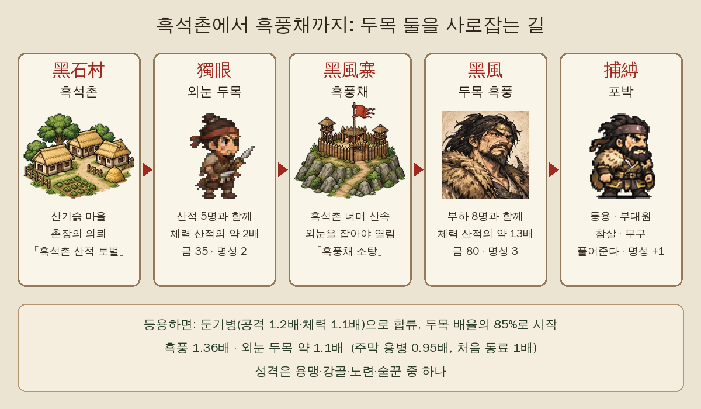

[12탄](/samguk-devlog-12-tavern)에서 주막에서 돈을 주고 용병을 들이는 이야기를 했습니다. 이번 13탄은 예고한 대로 사람을 얻는 또 하나의 길, **흑풍채** 이야기입니다. 싸워서 이긴 산적 두목을 사로잡아 부하로 삼는 방법입니다.

흑풍이라는 이름은 [4탄](/samguk-devlog-04-quests)의 의뢰판과 [6탄](/samguk-devlog-06-gear)의 전리품에서 이미 몇 번 나왔습니다. 그때는 의뢰 보상과 빼앗는 장비 이야기만 했으니, 이번에는 **두목과 싸우는 방식**과 **사로잡은 뒤**를 중심으로 적어 보겠습니다.

## 흑석촌에서 흑풍채까지

위 그림은 블로그용으로 제가 정리한 것입니다. 마을·산채 아이콘은 큰 지도에서 쓰는 그림이고, 흑풍의 수묵 초상과 도트도 게임에서 그대로 씁니다.

흐름은 이렇습니다.

1. **흑석촌**(黑石村)은 유주 서북쪽 산기슭의 작은 마을입니다. 게임 속 설명은 "검은 돌이 많은 산기슭 마을. 요즘 산적이 내려와 곡식을 빼앗아 간다."입니다. 의뢰판을 처음 열면 촌장이 "산적 때문에 마을이 말라 죽고 있소…" 하고 하소연합니다.
2. 먼저 열리는 의뢰는 **흑석촌 산적 토벌**입니다. 외눈박이 두목이 산적 다섯을 데리고 있습니다.
3. 외눈 두목을 잡고 돌아오면 촌장이 이렇게 말합니다.

   > 허나 그 외눈박이는 흑풍채 흑풍의 졸개일 뿐이오. 뿌리를 뽑아 주시오.

4. 그제야 **흑풍채 소탕** 의뢰가 의뢰판에 붙습니다. 흑풍채(黑風寨)는 흑석촌 너머 산속에 있고, "나무 울타리 너머로 횃불이 보인다"고 적어 두었습니다.
5. 의뢰를 받고 흑풍채에 가면 장소 창에 **소굴 공격** 단추가 생깁니다. 의뢰 없이 가면 "흑석촌 촌장의 의뢰가 필요하다"며 눌리지 않습니다.

졸개부터 잡고 나서야 진짜 두목에게 가는 길이 열리게 한 것은, 의뢰 두 개를 하나의 짧은 이야기로 묶고 싶어서였습니다.

## 두목은 무엇이 다른가

두목 싸움도 [5탄](/samguk-devlog-05-battle)의 부대 전투와 같은 방식으로 자동으로 흘러갑니다. 다른 점은 적 한 명이 **두목**으로 표시된다는 것입니다.

- 두목은 이름이 머리 위에 뜨고, 발밑에 붉은 테두리가 그려지며, 도트가 일반 병사보다 조금 크게(1.15~1.2배) 그려집니다.
- 체력은 기본값에 두목 배율을 곱하고, 공격은 1.1배가 됩니다.
- 싸움 목표도 "적을 모두 물리쳐라"가 아니라 **"○○을(를) 쓰러뜨려 사로잡아라"** 로 바뀝니다.
- 두 싸움 모두 평지가 아니라 **산 배경**에서 벌어집니다.

숫자로 보면 차이가 꽤 큽니다. 레벨 1 기준으로 일반 산적의 체력이 38이라면, 외눈 두목은 78로 약 두 배입니다. 흑풍은 바탕부터 체력 300짜리 덩치에 배율 1.6이 붙어서 **480**, 산적 열세 명쯤의 체력입니다. 공격도 산적의 두 배가 넘습니다. 게다가 흑풍 옆에는 외눈 차림의 부하 둘과 산적 여섯이 함께 나옵니다.

싸우기 전에 흑풍이 먼저 한마디 합니다.

> 감히 흑풍채에 발을 들여? 네놈 목을 문짝에 걸어 주마!

한소는 "다들 준비해. 저놈만 잡으면 이 일대가 조용해진다."라고 받습니다.

## 쓰러뜨리면 죽지 않고 포박

두목의 체력이 0이 되면 쓰러져 사라지는 대신 머리 위에 **"포박!"** 글자가 뜨고 붙잡힙니다. 쓰러뜨린 숫자에도 똑같이 하나로 셉니다.

싸움이 끝나면 포박 창이 뜹니다. 두목의 초상과 함께 "무릎이 꿇린 채 노려본다"는 문장, 그리고 세 가지 선택이 나옵니다.

- **등용**: 부대원으로 삼습니다.
- **참살**: 베고 무구를 얻습니다. 흑풍이라면 6탄에서 소개한 귀두도·쇄자갑·흑풍마를 얻고, 따로 무구가 없는 외눈 두목이라면 낡은 무구 몇 점(금 15)을 얻습니다.
- **풀어준다**: 명성이 1 오릅니다. "풀려난 자는 고개를 숙이고 산으로 사라졌다."

외눈 두목에게서도 똑같이 세 가지를 고를 수 있습니다. 흑풍 앞에서 처음 고르는 게 아니라, 졸개 두목에서 한 번 연습해 보게 되는 셈입니다.

## 등용한 산적은 얼마나 센가

12탄에서 부대원마다 기본 배율이 있다고 했습니다. 처음 동료 셋은 1배, 주막에서 돈으로 산 용병은 0.95배였습니다. 사로잡은 두목은 **두목 배율의 85%** 로 들어옵니다.

| 부대원           | 기본 배율 | 무기 갈래 |
| ---------------- | --------- | --------- |
| 처음 동료 셋     | 1배       | 각자 다름 |
| 주막 용병        | 0.95배    | 고른 갈래 |
| 등용한 외눈 두목 | 약 1.1배  | 둔기      |
| 등용한 흑풍      | 1.36배    | 둔기      |

등용한 두목은 모두 **둔기**를 듭니다. 둔기는 공격 1.2배, 체력 1.1배로 근접 갈래 중 가장 묵직합니다. 여기에 흑풍의 1.36배가 곱해지니, 돈 한 푼 안 들이고 부대에서 가장 센 사람이 들어오는 경우가 많습니다. 일행 창에는 출신이 **"등용한 산적"** 으로 적힙니다.

성격은 12탄의 여덟 가지 중에서 산적다운 넷, **용맹·강골·노련·술꾼** 가운데 하나가 무작위로 붙습니다. 겁쟁이나 명궁 같은 것은 나오지 않게 했습니다.

들어올 때 하는 말도 두 가지 중 하나입니다.

> …목숨을 살려 준 은혜, 칼로 갚겠소.
>
> 흥, 대장 그릇은 되는군. 따라가 주지.

다만 부대 정원이 꽉 차 있으면 등용 단추가 눌리지 않습니다. 흑풍을 데려오고 싶다면 소굴에 가기 전에 자리 하나를 비워 둬야 합니다.

## 세 갈래 중 무엇이 정답일까

참살은 한소 자신이 강해지고, 등용은 부대가 강해지고, 풀어주면 이름이 남습니다. 흑풍마는 지도 이동과 전투 속도를 함께 올려 주는 좋은 말이라, 저도 시험할 때마다 고민했습니다.

일부러 정답이 없게 숫자를 맞췄습니다. 흑풍을 부하로 들이면 지도를 다니며 마주치는 산적 싸움이 훨씬 편해지고, 무구를 가지면 한소 혼자 버티는 힘이 세집니다. 9탄의 대흥산처럼 큰 싸움을 앞두고 어느 쪽이 나을지, 플레이하는 사람마다 답이 다를 거라 생각합니다.

## 표지 그림

표지의 들판 바탕은 게임 파일에 들어 있지만 아직 게임 화면에서는 쓰지 않는 **준비한 그림**입니다. 그 위에 한소 일행과 흑풍·외눈 두목·산적 도트를 블로그용으로 제가 세워 보았습니다. 게임에서 흑풍과 싸우는 곳은 이런 들판이 아니라 산 배경입니다.

## 다음 편 예고

다음 14탄에서는 **날짜와 쉬기, 저장** 이야기를 하겠습니다. 이 게임에서 하루가 어떻게 흐르는지, 하루 쉬기를 누르면 무엇이 바뀌는지, 그리고 진행 상황이 어디에 어떻게 저장되는지 적어 보겠습니다.

1장 데모는 itch.io에서 브라우저로 바로 해 볼 수 있습니다.

- 「삼국지 회귀」 데모: [https://zinnote.itch.io/samguk-hoegwi](https://zinnote.itch.io/samguk-hoegwi)

## 함께 보면 좋은 글

- [삼국지 회귀 개발일지 14탄: 하루가 흐르는 방식과 쉬기, 저장](/samguk-devlog-14-days)
