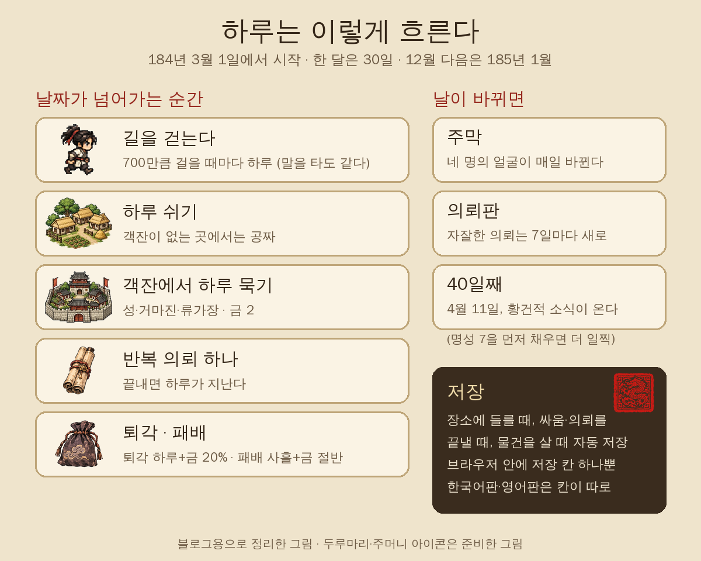

[13탄](/samguk-devlog-13-heukpung)에서는 흑풍채 두목을 사로잡아 부하로 삼는 이야기를 했습니다. 그 끝에 예고한 대로 14탄은 조금 조용한 주제입니다. **게임 속 하루가 어떻게 흐르는지**, **하루 쉬기**를 누르면 무엇이 바뀌는지, 그리고 **진행이 어디에 저장되는지**입니다.

싸움이나 장수처럼 눈에 띄는 부분은 아니지만, 만들면서 생각보다 고민을 많이 한 곳입니다.

## 달력은 184년 3월 1일부터

화면 왼쪽 위에는 늘 날짜가 떠 있습니다. 새로 시작하면 **184년 3월 1일**입니다. 첫 대사도 "서기 184년 봄, 탁군."으로 시작합니다.

게임 안에서는 날짜를 "며칠째인가" 하는 숫자 하나로만 셉니다. 화면에 보여 줄 때만 그 숫자를 달력으로 바꾸는데, 계산을 단순하게 하려고 **한 달을 모두 30일**로 잡았습니다. 그래서 31일이나 2월 28일 같은 날은 나오지 않습니다. 12월 30일 다음 날은 **185년 1월 1일**이 됩니다.

## 날짜가 넘어가는 순간

위 그림은 블로그용으로 제가 정리한 것입니다. 마을·성 아이콘은 큰 지도에서 쓰는 그림이고, 두루마리와 주머니 아이콘은 게임 파일에는 있지만 아직 쓰지 않는 **준비한 그림**입니다.

시간은 저절로 흐르지 않습니다. 가만히 지도를 보고만 있으면 날짜는 그대로입니다. 하루가 넘어가는 경우는 다음과 같습니다.

- **길을 걷는다**: 지도 위에서 일정 거리(코드 숫자로 700)를 걸을 때마다 하루가 지납니다. 길 위에서는 더 빨리 걷지만, 날짜는 **걸린 시간이 아니라 걸은 거리**로 셉니다. [6탄](/samguk-devlog-06-gear)에서 소개한 말을 타면 화면에서는 빨리 도착하지만, 같은 거리를 가면 날짜는 똑같이 흐릅니다.
- **하루 쉬기**: 어느 장소에 들어가든 창 아래에 이 단추가 있습니다. 누르면 "하루를 쉬었다." 한 줄과 함께 날짜가 하루 넘어갑니다.
- **반복 의뢰 하나**: [4탄](/samguk-devlog-04-quests)에서 적은 자잘한 반복 의뢰는 끝내면 하루가 지납니다. 이야기에 얽힌 의뢰는 날짜를 쓰지 않습니다.
- **퇴각**: 싸움 도중 물러나면 하루가 지나고 금을 20% 잃습니다.
- **패배**: 쓰러지면 가장 가까운 성이나 마을의 객잔에서 깨어납니다. "사흘을 앓아누웠고" 라는 문장대로 **사흘**이 지나고, 지니고 있던 금의 절반이 사라집니다.

## 하루 쉬기와 객잔에서 묵기

같은 단추라도 장소에 따라 글자가 바뀝니다.

- 성과 큰 도시, 그리고 거마진·류가장에서는 **"객잔에서 하루 묵기 (금 2)"** 입니다. 금이 2보다 적으면 "금이 모자라요" 하고 묵을 수 없습니다.
- 그 밖의 마을이나 산채에서는 그냥 **"하루 쉬기"** 이고 돈이 들지 않습니다.

여기서 하나 밝혀 두면, 쉬어도 **체력이 회복되는 것은 아닙니다.** 이 게임에서는 싸움이 끝나면 다친 부대원이 다시 일어나고, 다음 싸움은 늘 체력이 가득 찬 채로 시작합니다. 그래서 하루 쉬기는 몸을 추스르는 단추라기보다 **"하루를 넘긴다"** 는 단추에 가깝습니다.

그럼 왜 하루를 넘기고 싶을까요. 바로 아래 이야기 때문입니다.

## 날이 바뀌면 달라지는 것

- **주막**: [12탄](/samguk-devlog-12-tavern)에서 적었듯 주막에는 하루에 네 명만 서 있습니다. 날짜가 바뀌면 이름과 성격이 새로 뽑힙니다. 마음에 드는 용병이 없으면 객잔에서 하루 묵고 다시 주막에 가 보면 됩니다. 금 2로 얼굴을 바꿔 보는 셈입니다.
- **의뢰판**: 반복 의뢰는 한 번 뽑히면 **7일** 동안 그대로 붙어 있고, 그 뒤에 새 의뢰로 바뀝니다.
- **40일째**: 명성이 7에 이르거나, 날짜가 **40일째(4월 11일)** 에 닿으면 파발마가 들판을 가로지르며 황건적이 대흥산에 모였다는 소식이 옵니다. 그 뒤 이야기는 [9탄](/samguk-devlog-09-daeheung)에서 적은 대흥산 대전투로 이어집니다.

마지막 줄이 이 장치를 넣은 이유입니다. 명성을 부지런히 쌓으면 소식이 일찍 오고, 느긋하게 돌아다녀도 40일째에는 반드시 옵니다. 어떤 식으로 놀아도 이야기가 멈추지 않게 하고 싶었습니다.

데모 엔딩 화면에는 **흐른 날**이 며칠이었는지도 함께 나옵니다. 같은 결말이라도 며칠 만에 도착했는지 비교해 보는 재미가 있습니다.

## 저장은 자동, 칸은 하나

이 게임에는 "저장하기" 단추가 없습니다. 대신 일이 하나 끝날 때마다 알아서 저장합니다.

- 지도에서 장소에 들어갈 때
- 싸움이 끝나거나 의뢰를 받고 끝낼 때
- 물건을 사거나 용병을 고용하고 내보낼 때
- 장비를 바꿀 때

저장하는 곳은 서버가 아니라 **플레이하는 사람의 브라우저 안**입니다. 웹 브라우저가 사이트마다 조금씩 내어 주는 저장 공간(localStorage)에 진행 상황을 통째로 글자로 바꿔 넣습니다. 날짜, 명성, 금, 레벨, 장비, 부대원과 그 성격, 받은 의뢰, 지도 위 위치까지 모두 들어갑니다. 그래서 따로 가입하지 않아도 되고, 브라우저를 닫았다 열면 첫 화면에 **이어하기** 단추가 생깁니다.

저장 칸은 하나뿐입니다. 여러 칸을 두면 불리할 때 되돌리는 버릇이 생기기 쉬워서, 고른 것을 그대로 안고 가는 쪽을 택했습니다. 처음부터 하고 싶으면 설정 창의 **처음부터 다시** 단추를 누르면 저장이 지워집니다. 데모 엔딩에서 다시 시작해도 마찬가지입니다.

몇 가지는 저장 칸과 따로 둡니다.

- 효과음·배경음·음량·화면 흔들림·전투 기본 속도 같은 **설정**은 진행과 다른 칸에 둡니다. 처음부터 다시 해도 설정은 남습니다.
- **한국어판과 영어판은 저장 칸이 따로**입니다. 한쪽에서 하던 진행이 다른 쪽을 덮어쓰지 않습니다. 고른 언어도 기억해 두었다가 다음에 그 언어로 엽니다.
- [9탄](/samguk-devlog-09-daeheung)의 **대흥산 전투 바로 하기** 판은 아예 저장하지 않습니다. 시험 삼아 해 봐도 본편 진행은 그대로입니다.

브라우저 저장 공간을 못 쓰는 환경(사생활 보호 모드 등)에서도 게임이 멈추지 않게, 읽고 쓰는 부분을 한곳에 모아 실패하면 조용히 넘어가게 했습니다. [10탄](/samguk-devlog-10-next)에서 스팀판을 만들 때 저장 부분 세 줄만 바꾸면 된다고 한 것이 바로 이 묶음입니다.

## 만들면서 든 생각

처음에는 날짜를 시계처럼 흐르게 할까도 생각했습니다. 그런데 그렇게 하면 지도를 보며 고민하는 동안에도 날이 가서, 생각하는 시간이 손해가 됩니다. 그래서 **움직이거나 쉬거나 일을 할 때만** 날이 가게 했습니다. 고민은 공짜, 행동에는 하루가 드는 구조입니다.

## 표지 그림

표지의 노을 진 강가 풍경은 게임의 **데모 엔딩 화면 뒤에 깔리는 그림**입니다. 그 위에 연석·단목현·한소·마철 도트를 블로그용으로 제가 세워 보았습니다. 하루를 마치고 해 지는 들판을 내려다보는 장면을 떠올리며 골랐습니다.

## 다음 편 예고

다음 15탄에서는 **영어판 만들기** 이야기를 하겠습니다. 한국어로 쓴 대사와 설명을 어떻게 뽑아내 영어로 옮기고, 영어판을 따로 어떻게 만들어 내는지 적어 보겠습니다. 오늘 적은 "저장 칸이 따로"인 이유도 거기서 조금 더 이야기하겠습니다.

1장 데모는 itch.io에서 브라우저로 바로 해 볼 수 있습니다.

- 「삼국지 회귀」 데모: [https://zinnote.itch.io/samguk-hoegwi](https://zinnote.itch.io/samguk-hoegwi)

## 함께 보면 좋은 글

- [삼국지 회귀 개발일지 15탄: 영어판은 이렇게 만들었습니다](/samguk-devlog-15-english)
