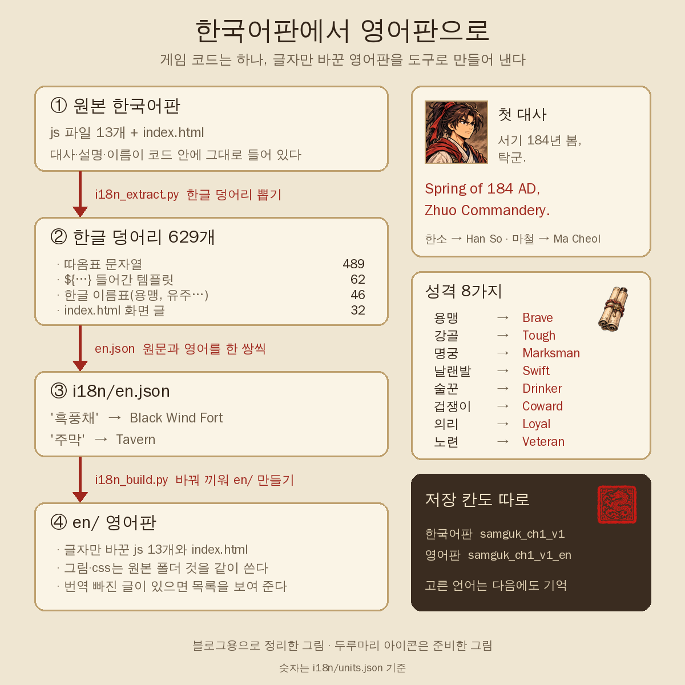

[14탄](/samguk-devlog-14-days)에서는 게임 속 하루가 흐르는 방식과 저장 이야기를 했습니다. 그 끝에 예고한 대로 15탄은 **영어판 만들기**입니다.

「삼국지 회귀」 첫 화면에는 **새로 시작**, **이어하기**, **도움말** 옆에 **English** 단추가 있습니다. 누르면 같은 게임이 영어로 열립니다. 오늘은 이 영어판을 어떻게 만들었는지 적어 보겠습니다.

## 글자가 코드 안에 흩어져 있었다

보통 여러 언어를 지원하는 게임은 처음부터 글을 따로 모아 두고, 코드에서는 "몇 번 글"처럼 번호로 불러 씁니다. 저는 그렇게 하지 않았습니다. 한국어판만 생각하고 만들어서, 대사와 설명과 이름이 **코드 곳곳에 한국어 그대로** 들어가 있었습니다.

이걸 하나하나 번호로 바꾸려면 게임 코드를 거의 다 손봐야 합니다. 그래서 거꾸로 했습니다. 한국어판 코드는 그대로 두고, **한국어 글만 영어로 바꿔 끼운 복사본**을 도구로 만들어 내기로 했습니다.

## 네 단계로 만드는 영어판

위 그림은 블로그용으로 제가 정리한 것입니다. 한소 초상과 붉은 도장은 게임에서 쓰는 그림이고, 두루마리 아이콘은 게임 파일에는 있지만 아직 쓰지 않는 **준비한 그림**입니다.

1. **한글 덩어리 뽑기**: 첫 번째 도구(`i18n_extract.py`)가 게임 코드 파일 13개와 첫 화면 파일(index.html)을 읽고, 한글이 든 글자 덩어리를 모두 뽑아 목록으로 만듭니다. 주석은 건너뜁니다.
2. **목록 보기**: 지금 목록에는 **629개**가 들어 있습니다. 따옴표로 감싼 보통 글이 489개, 중간에 숫자나 이름이 끼어드는 글(템플릿)이 62개, 한글로 지은 이름표가 46개, 화면 틀에 적힌 글이 32개입니다. 가장 많이 나온 파일은 필드 이동과 장소 창을 맡은 `field.js`로 229개였습니다.
3. **번역 파일**: `i18n/en.json`에 **한국어 원문과 영어를 한 쌍씩** 적습니다. "흑풍채"는 Black Wind Fort, "주막"은 Tavern이 되는 식입니다.
4. **영어판 만들기**: 두 번째 도구(`i18n_build.py`)가 한국어판 코드를 다시 읽으면서 덩어리마다 짝이 되는 영어로 바꿔 끼우고, 그 결과를 `en/` 폴더에 씁니다. 화면 틀의 언어 표시도 `lang="en"`으로 바꿉니다.

중요한 점은 **영어판 폴더는 손으로 고치지 않는다**는 것입니다. 한국어판에서 대사 하나를 고치면 도구를 다시 돌려 영어판을 새로 만듭니다. 그때 영어 짝이 없는 글이 생기면 도구가 **"번역 없음"** 목록을 보여 주고, 그 글을 번역 파일에 넣은 뒤 다시 돌리면 됩니다. 오늘 확인해 보니 빠진 글 없이 영어판이 만들어졌습니다.

그림과 화면 꾸밈(css)은 복사하지 않습니다. 영어판도 원본 폴더의 그림을 그대로 가져다 씁니다. 그래서 그림을 하나 바꾸면 두 판에 함께 바뀝니다.

## 도구가 잡아 주는 실수

글을 바꿔 끼우다 보면 게임이 깨질 수 있는 곳이 몇 군데 있습니다. 그래서 도구에 확인을 넣었습니다.

- **중간에 끼는 값**: "퇴각했다. 금 -(잃은 금)"처럼 글 사이에 숫자가 끼는 문장이 있습니다. 영어로는 "Retreated. Gold -(잃은 금)"이 됩니다. 영어는 말 순서가 달라서 끼는 자리가 앞뒤로 옮겨 가도 되지만, **끼는 값 자체가 빠지거나 바뀌면** 도구가 문제로 알려 줍니다.
- **작은따옴표**: 영어에는 I'm, Guan Yu's 같은 작은따옴표가 자주 나옵니다. 코드에서는 작은따옴표가 글의 끝을 뜻하기도 해서, 번역에는 모양이 비슷한 다른 따옴표(’)를 쓰기로 정했습니다.
- **한글 이름표**: 성격 이름이나 지역 이름처럼 코드 안에서 이름표로 쓰는 한글도 있습니다. 이런 곳도 영어 이름표로 바꿔 끼우고, 어떻게 바꿔야 할지 모르는 쓰임새를 만나면 도구가 멈추고 알려 줍니다.
- **한국어 단추**: 영어판 첫 화면에는 거꾸로 **한국어** 단추가 있어야 합니다. 이 글자까지 영어로 바뀌면 곤란해서, 코드에 한글을 직접 쓰지 않고 문자 번호로 적어 도구가 건드리지 않게 했습니다.

## 이름은 어떻게 옮겼나

이름을 옮기는 기준은 둘로 나눴습니다.

- **역사 속 인물과 땅 이름**은 중국어 읽기를 따랐습니다. 유비는 Liu Bei, 관우는 Guan Yu, 정원지는 Cheng Yuanzhi, 탁군은 Zhuo, 유주는 Youzhou입니다. 영어권에서 삼국지를 읽은 사람에게 익숙한 이름이기 때문입니다.
- **이 게임에서 만든 인물**은 한국어 소리대로 적었습니다. 한소는 Han So, 마철은 Ma Cheol, 연석은 Yeon Seok, 단목현은 Danmok Hyeon입니다.

[12탄](/samguk-devlog-12-tavern)에서 소개한 용병 성격 8가지도 영어 이름이 있습니다. 용맹은 Brave, 강골은 Tough, 명궁은 Marksman, 날랜발은 Swift, 술꾼은 Drinker, 겁쟁이는 Coward, 의리는 Loyal, 노련은 Veteran입니다.

창 제목 옆에 작게 붙은 한자(도움말의 助言, 주막의 酒幕 같은 것)는 영어판에서도 그대로 두었습니다. Help 助言, Tavern 酒幕처럼 보입니다. 분위기를 살리는 장식이라 남겨 두는 편이 낫다고 봤습니다.

첫 대사도 예로 들어 보면, "서기 184년 봄, 탁군."은 영어판에서 "Spring of 184 AD, Zhuo Commandery."로 시작합니다.

## 영어판 저장 칸을 따로 둔 이유

[14탄](/samguk-devlog-14-days)에서 한국어판과 영어판은 저장 칸이 따로라고 적었습니다. 이유는 이렇습니다.

브라우저의 저장 공간은 **사이트 단위**로 나뉩니다. 한국어판과 영어판은 같은 사이트 안의 다른 폴더일 뿐이라, 그냥 두면 같은 저장 공간을 함께 씁니다. 같은 이름으로 저장하면 한쪽 진행이 다른 쪽을 덮어쓰게 됩니다.

그래서 게임이 켜질 때 화면 틀의 언어 표시를 보고, 영어판이면 저장 이름 끝에 `_en`을 붙이게 했습니다. 한국어판은 `samguk_ch1_v1`, 영어판은 `samguk_ch1_v1_en`에 저장됩니다.

고른 언어는 진행과 별도로 기억합니다. English 단추를 한 번 누르면, 다음에 한국어판 주소로 들어와도 영어판으로 바로 넘어갑니다. 주소 끝에 붙은 `#daeheung`(대흥산 전투로 바로 가기)도 함께 넘겨서 영어판에서도 그대로 쓸 수 있습니다.

## 만들면서 든 생각

처음부터 여러 언어를 생각하고 만들었다면 더 깔끔했을 겁니다. 그래도 한국어판 코드를 하나도 뜯어고치지 않고 영어판을 얻었다는 점은 마음에 듭니다. 게임을 계속 고쳐 나가는 동안에는 한국어판만 신경 쓰고, 마지막에 도구를 한 번 돌리면 됩니다.

번역은 기계가 대신해 주지 않으니, 글이 늘어날수록 번역 파일도 함께 늘어납니다. 대사를 쓸 때 영어로 옮기기 쉬운지도 조금씩 생각하게 됐습니다.

## 표지 그림

표지 바탕은 게임에서 지역 지도를 그릴 때 쓰는 **수묵 지역 지도** 그림 가운데 거록 지역 것입니다. 그 길 위에 연석·단목현·한소·마철 도트를 걷게 하고, 탁군과 Zhuo가 위아래로 적힌 이정표는 블로그용으로 제가 그려 넣었습니다. 같은 길을 두 언어로 안내한다는 뜻으로 만들었습니다.

## 다음 편 예고

예고해 둔 이야기는 이번 15탄까지입니다. 다음 편을 이어 쓰게 되면 그때 주제를 알려 드리겠습니다.

1장 데모는 itch.io에서 브라우저로 바로 해 볼 수 있습니다.

- 「삼국지 회귀」 데모: [https://zinnote.itch.io/samguk-hoegwi](https://zinnote.itch.io/samguk-hoegwi)

## 함께 보면 좋은 글

- [삼국지 회귀 개발일지 16탄: 짚신 장수 유비와 성문 앞의 세 사람](/samguk-devlog-16-trio)
