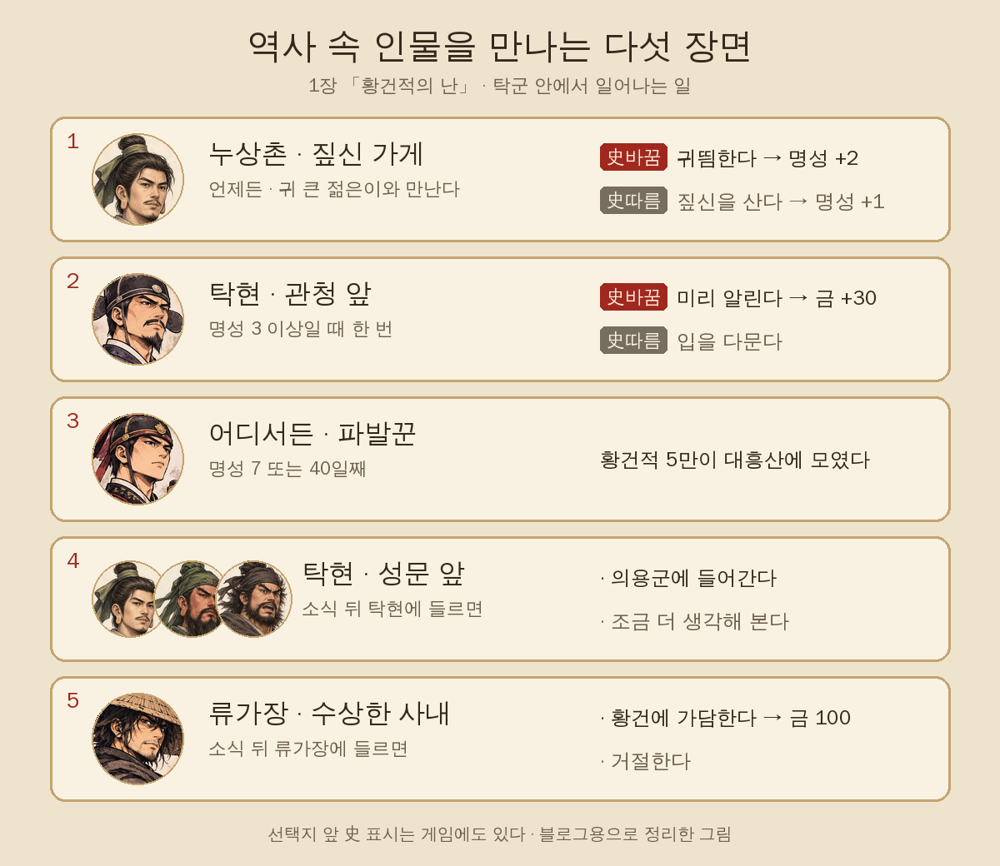

[15탄](/samguk-devlog-15-english)에서 영어판 이야기를 끝으로 예고해 둔 주제를 다 썼습니다. 그런데 아직 적지 않은 이야기가 남아 있어서, 16탄부터 조금 더 이어 가 보겠습니다.

오늘은 **역사 속 인물을 처음 만나는 장면**입니다. 「삼국지 회귀」의 주인공 한소는 현대 서울에서 떨어진 사람이라서, 눈앞의 젊은이가 나중에 누가 되는지 압니다. 그 "알고 있다"는 느낌을 게임 안에서 어떻게 살렸는지 적어 보겠습니다.

## 다섯 장면, 모두 탁군 안에서

위 그림은 블로그용으로 제가 정리한 것입니다. 동그란 초상은 모두 게임 대화창에 실제로 나오는 수묵 초상입니다.

1장 「황건적의 난」에서 이야기가 움직이는 장면은 크게 다섯 개입니다. 모두 [3탄](/samguk-devlog-03-map)에서 소개한 탁군 안, 탁현을 가운데 두고 서쪽의 누상촌과 동쪽의 류가장에서 일어납니다. 멀리 가지 않아도 역사의 첫 장면을 다 볼 수 있게 했습니다.

## 1. 누상촌 짚신 가게: 귀 큰 젊은이

누상촌 장소 창에는 처음부터 **짚신 가게** 단추가 있습니다. 아직 만나기 전이라 설명은 "???"로만 나옵니다. 지도에 적힌 마을 설명도 "돗자리와 짚신을 파는 젊은이가 산다는데, 귀가 유난히 크다고 한다"가 전부입니다. 삼국지를 아는 분이라면 여기서 벌써 누군지 눈치챕니다.

들어가 보면 뽕나무 아래에서 젊은이가 돗자리를 엮고 있고, 이름을 밝힙니다. 유비, 자는 현덕. 한소의 속마음은 딱 한 줄입니다. "(…유비다. 정말 유비야.)" 이 한 줄을 쓰려고 이 장면을 만들었다고 해도 될 정도로, 제가 제일 좋아하는 대사입니다.

여기서 고를 수 있는 건 둘입니다.

- **"곧 붉은 얼굴과 범 같은 수염의 사내를 만나실 겁니다."**: 역사를 미리 귀띔합니다. 명성이 2 오르고, 유비가 한소를 기억합니다.
- **짚신 한 켤레를 산다**: 아무것도 바꾸지 않습니다. 명성이 1 오릅니다.

이 만남은 이야기 진행과 상관없이 처음부터 할 수 있습니다. 한 번 만나면 단추 설명이 "귀 큰 젊은이"로 바뀝니다.

## 2. 탁현 관청 앞: 아무것도 모르는 관리

명성이 3 이상이 된 뒤 탁현에 들어가면 관리가 한마디 합니다. "요즘 남쪽에서 태평도 무리가 수상하다는 소문이 있소. 뭐, 별일이야 있겠소." 한소는 곧 황건적 5만이 대흥산에 모인다는 걸 압니다.

- **"대흥산을 지켜보시오. 곧 큰 무리가 모입니다."**: 관리가 사람을 풀어 보겠다며 알려 준 값으로 금 30을 줍니다.
- **입을 다문다**: 역사대로 흘러가게 둡니다.

이 장면은 딱 한 번만 나옵니다. 놓치면 다시 오지 않습니다.

## 3. 파발꾼: 이야기가 한 단계 넘어가는 순간

명성이 7이 되거나 날짜가 40일째가 되면, 먼지를 뒤집어쓴 파발꾼이 달려와 외칩니다. "황건적이 대흥산에 모였다! 탁현 성에서 의병을 모은다!" 부대원 셋이 차례로 두목은 정원지, 부장은 등무라는 것, 탁현 성문에 방이 붙었다는 것, 류가장 쪽에서 노란 두건을 쓴 자들이 용병을 산다는 소문을 전해 줍니다.

[14탄](/samguk-devlog-14-days)에서 적은 "40일째 황건 소식"이 바로 이 장면입니다. 의뢰를 열심히 해서 명성을 빨리 채우면 더 일찍 옵니다. 이때부터 화면 위의 목표 글도 "탁현 성의 의병 모집 방, 또는 류가장의 수상한 사내를 찾아가자"로 바뀝니다.

## 4. 탁현 성문 앞: 세 사람이 모이는 장면

소식을 들은 뒤 탁현에 들르면, 의병 모집 방 앞에서 한숨 쉬는 유비에게 장비가 "사내대장부가 한숨만 쉬다니!" 하고 끼어들고, 관우가 "나도 의병에 들려고 왔소" 하며 다가옵니다. 셋이 뜻을 모으는 모습을 한소는 옆에서 봅니다. "(도원결의… 내 눈앞에서 역사가 시작되고 있다.)"

그리고 유비가 한소에게 손을 내밉니다. 여기서 **의용군에 들어간다**를 누르면 바로 관군 편이 되고, **조금 더 생각해 본다**를 누르면 탁현 장소 창으로 돌아갑니다. 생각해 보기로 했다면, 그 뒤로는 탁현 장소 창에 생긴 **의병 모집 방** 단추로 언제든 들어갈 수 있습니다.

원래 역사에서 세 사람이 의형제를 맺는 곳은 복숭아밭이지만, 게임에서는 한소가 그 자리를 볼 수 있도록 성문 앞 방 앞으로 장면을 옮겼습니다. 대사도 원전을 그대로 옮기지 않고 짧게 새로 썼습니다.

## 5. 류가장 수상한 사내: 반대편의 제안

같은 때 류가장에 가면 장원 안에 **수상한 사내** 단추가 생깁니다. 사내는 "창천은 이미 죽었고 황천이 설 것이오"라며, 황건 편에 서면 **금 100냥**을 주겠다고 합니다. 가담하면 바로 금 100이 들어오고 대흥산의 황건 진영으로 가게 됩니다. 거절하면 류가장으로 돌아옵니다.

두 제안 모두 창에 "한 번 고르면 데모에서는 바꿀 수 없어요"라는 작은 글을 붙였습니다. 어느 편에 서느냐가 [9탄](/samguk-devlog-09-daeheung)의 대흥산 대전투를 통째로 바꾸기 때문입니다.

## 선택지 앞의 '史' 표시

1번과 2번 장면의 선택지 앞에는 붉은 **史** 글자가 붙습니다. 그 선택이 역사를 따르는지 바꾸는지를 게임이 세어 두는 표시입니다. 귀띔하면 "바꾼 선택", 입을 다물거나 짚신만 사면 "따른 선택"으로 셉니다.

센 결과는 두 곳에서 볼 수 있습니다. 하나는 한소 정보 창의 **「史 · 한소가 아는 역사」** 칸입니다. "184년 봄: 장각의 태평도가 황건을 두르고 들고일어난다" 같은 역사 줄이 적혀 있고, 유비에게 귀띔했다면 "탁현에서 유비·관우·장비가 의병을 일으킨다" 줄 뒤에 **(유비에게 미리 귀띔했다)**가 붙습니다. 관청에 알렸다면 대흥산 줄에 **(탁현 관청에 미리 알렸다)**가 붙습니다. 맨 아래에는 "역사를 따른 선택 몇 · 바꾼 선택 몇"이 나옵니다. 다른 하나는 9탄에서 적은 엔딩 화면입니다.

두 번의 귀띔이 대흥산에서 의병 20명, 유비의 외침 한마디로 돌아온다는 이야기는 9탄에 적어 두었습니다. 오늘은 그 씨앗을 뿌리는 쪽 이야기였습니다.

## 만들면서 든 생각

역사 속 인물을 게임에 넣을 때 가장 조심한 건, 한소가 주인공 자리를 빼앗지 않는 것이었습니다. 유비·관우·장비의 장면은 원래 그들의 이야기입니다. 그래서 한소는 대부분 옆에서 지켜보고, 속마음 한 줄로만 끼어듭니다. 대신 **귀띔할지 말지**처럼 작은 선택 하나씩만 손에 쥐여 주었습니다. 역사를 다 아는 사람이 할 수 있는 일은 생각보다 작다는 느낌이 1장의 분위기와 맞는다고 생각했습니다.

## 표지 그림

표지는 게임 큰 지도에 깔리는 **지역 수묵 지도** 가운데 산과 길이 함께 있는 부분을 잘라 바탕으로 쓰고, 그 위에 한소 도트와 유비·관우·장비 도트를 블로그용으로 제가 세운 것입니다. 네 도트 모두 게임에서 쓰는 그림입니다. 성문 앞에서 처음 마주 선 순간을 떠올리며 만들었습니다.

## 다음 편 예고

다음 17탄에서는 **소리** 이야기를 하겠습니다. 「삼국지 회귀」의 효과음과 배경 음악은 소리 파일 없이 코드로 만들어 냅니다. 칼 소리와 북소리를 어떻게 코드로 내는지, 필드와 전투 음악이 어떻게 다른지 적어 보겠습니다.

1장 데모는 itch.io에서 브라우저로 바로 해 볼 수 있습니다.

- 「삼국지 회귀」 데모: [https://zinnote.itch.io/samguk-hoegwi](https://zinnote.itch.io/samguk-hoegwi)

## 함께 보면 좋은 글

- [삼국지 회귀 개발일지 17탄: 소리 파일 없이 칼 소리와 북소리 만들기](/samguk-devlog-17-sound)
- [삼국지 회귀 개발일지 15탄: 영어판은 이렇게 만들었습니다](/samguk-devlog-15-english)
- [삼국지 회귀 개발일지 9탄: 대흥산 대전투, 1장의 마지막 싸움](/samguk-devlog-09-daeheung)
