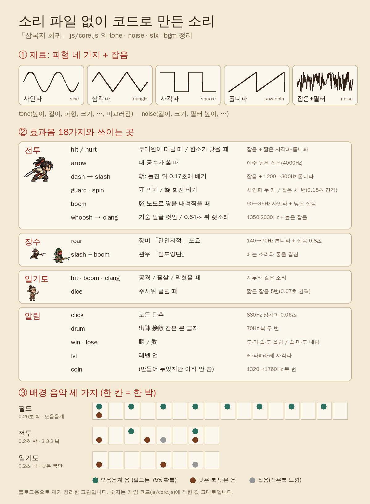

[16탄](/samguk-devlog-16-trio)에서는 1장에서 유비·관우·장비를 처음 만나는 다섯 장면을 적었습니다. 예고대로 오늘은 **소리** 이야기입니다.

「삼국지 회귀」 폴더를 열어 보면 그림은 잔뜩 있는데 소리 파일은 하나도 없습니다. mp3도, wav도 없습니다. 그런데 게임을 켜면 단추 누르는 소리, 칼 소리, 북소리, 음악이 다 납니다. 전부 브라우저에 들어 있는 **WebAudio**로 그때그때 만들어 내기 때문입니다.

## 왜 소리 파일을 안 썼나

이유는 단순합니다. 혼자 만드는 게임이라 효과음을 하나하나 구하고, 저작권을 확인하고, 크기를 줄이는 일이 생각보다 큽니다. 브라우저 게임이라 파일이 늘어날수록 처음 여는 시간도 길어집니다. 그래서 1장 데모는 "소리는 코드로만"이라고 정하고 시작했습니다.

## 재료는 두 가지: 음 하나, 잡음 하나

위 그림은 블로그용으로 제가 정리한 것입니다. 숫자는 게임 코드(js/core.js)에 적힌 값 그대로 옮겼고, 표 옆의 도트는 게임에서 쓰는 그림입니다.

소리를 만드는 함수는 사실상 두 개뿐입니다.

- **tone**: 정해진 높이의 음을 하나 냅니다. 파형(사인파·삼각파·사각파·톱니파), 길이, 크기를 정할 수 있고, 마지막에 **미끄러짐** 값을 주면 음이 그 높이까지 쭉 내려가거나 올라갑니다. 소리는 0.005초 만에 커졌다가 길이만큼 서서히 사라집니다.
- **noise**: '쏴' 하는 잡음을 냅니다. 1초짜리 잡음을 처음 한 번만 만들어 두고, 필터로 어느 높이만 남길지 정해서 꺼내 씁니다. 높은 쪽만 남기면 바람 소리나 칼 스치는 소리, 낮은 쪽만 남기면 땅 울리는 소리가 됩니다.

이 두 개를 겹치고, 시간을 조금씩 어긋나게 해서 효과음을 만듭니다.

## 효과음 18가지

효과음은 sfx라는 함수 하나에 이름표를 붙여 모아 두었습니다. 몇 개만 꺼내 보면 이렇습니다.

- **쇳소리(clang)**: 1350Hz 삼각파와 2030Hz 사인파를 같이 울리고, 아주 높은 잡음을 짧게 얹습니다. 두 음의 높이가 딱 떨어지는 비율이 아니라서 '챙' 하고 금속처럼 들립니다. 일기토에서 공격이 막혔을 때 납니다.
- **쿵(boom)**: 90Hz 사인파를 35Hz까지 끌어내리고, 낮은 잡음을 겹칩니다. 한소의 怒(노도)로 땅을 내려찍을 때 납니다.
- **포효(roar)**: 140Hz 톱니파를 70Hz까지 내리면서 잡음을 0.8초 동안 깔았습니다. 대흥산에서 장비가 「만인지적」을 쓸 때만 나는 소리입니다.
- **주사위(dice)**: 아주 짧은 잡음 다섯 번을 0.07초 간격으로 냅니다. [8탄](/samguk-devlog-08-duel)의 일기토 주사위를 굴릴 때 '다다닥' 하는 소리입니다.
- **승리·패배·레벨 업**: 이건 음 몇 개를 차례로 냅니다. 승리는 도·미·솔·도로 올라가고, 패배는 솔·미·도로 내려갑니다. 레벨 업은 레·파#·라·레를 사각파로 빠르게 올려서 옛날 게임 느낌을 냈습니다.

[5탄](/samguk-devlog-05-battle)에서 소개한 한소의 기술 네 개에도 소리를 하나씩 붙였습니다. 斬은 돌진 소리(dash)가 나고 0.17초 뒤에 베는 소리(slash)가 이어집니다. 守는 사인파 두 개로 '웅' 하는 막기 소리, 旋은 잡음을 0.18초 간격으로 세 번 내서 세 바퀴 도는 느낌을 냈습니다. 기술을 쓸 때 장수 얼굴이 화면을 가로지르는 연출에는 '휙'(whoosh)이 나고, 무기가 있으면 0.64초 뒤에 쇳소리가 따라옵니다.

화면에 出陣·接敵 같은 큰 글자가 뜰 때는 70Hz 북을 두 번 칩니다. 勝·大勝·堅守는 승리 소리, 敗·敗走는 패배 소리로 바뀝니다.

하나 고백하면, **동전 소리(coin)**는 만들어 두었는데 아직 게임 어디에서도 부르지 않습니다. 그래서 18가지 가운데 실제로 들을 수 있는 건 17가지입니다.

## 수십 명이 동시에 때리면 생기는 일

부대 전투에서는 병사 수십 명이 한꺼번에 싸웁니다. 맞을 때마다 소리를 다 내면 소리가 뭉개져서 '지지직' 하는 소음이 되기 쉽습니다.

그래서 같은 소리는 짧은 시간 안에 다시 나지 않게 막았습니다. 기본은 0.03초, 때리는 소리(hit)는 0.06초, 화살(arrow)은 0.08초, 한소가 맞는 소리(hurt)는 0.12초 안에 다시 오면 무시합니다. 또 아무나 때릴 때 소리를 내지 않고, **내 부대원이나 이름 있는 장수가 때릴 때**, **내 궁수가 쏠 때**, **한소가 맞을 때**만 소리를 냅니다. 적끼리, 적이 내 병사를 때리는 소리는 일부러 뺐습니다.

## 배경 음악 세 가지

음악도 악보 파일이 없습니다. 일정한 박마다 코드가 "이번 박에 무엇을 칠지" 정하는 아주 단순한 방식입니다.

- **필드 음악**: 0.26초마다 한 박. 두 박에 한 번, 75% 확률로 음을 하나 뜯습니다. 음은 **오음음계**(도·레·미·솔·라처럼 다섯 음만 쓰는 음계, 코드 이름은 PENTA)에서 무작위로 고르고, 30%는 한 옥타브 위로 올립니다. 16박마다 낮은 음을 길게 한 번 깔아 줍니다. 삼각파에 한 옥타브 위 사인파를 살짝 섞어서 현을 뜯는 소리처럼 만들었습니다.
- **전투 음악**: 0.2초마다 한 박, 8박이 한 묶음. 1·4·7번째 박에 낮은 북(65Hz에서 40Hz로 떨어지는 사인파)을 쳐서 '둥··둥··둥·' 하는 3-3-2 박자를 만들고, 5번째 박에 작은북 같은 잡음, 3·7번째 박에 오음음계 음을 하나씩 얹습니다.
- **일기토 음악**: 0.2초 박에 4박마다 아주 낮은 북(55Hz)만 칩니다. 둘이 맞서는 긴장감만 남기고 싶어서 멜로디를 뺐습니다.

음을 무작위로 고르기 때문에 필드 음악은 똑같이 반복되는 법이 없습니다. 오음음계는 아무 음이나 이어 붙여도 거슬리는 소리가 잘 안 나서, 이런 방식에 잘 맞았습니다. 전투가 시작되면 전투 음악으로, 일기토 창이 열리면 일기토 음악으로, 필드로 돌아오면 다시 필드 음악으로 바뀝니다.

## 설정 창의 다섯 가지

설정 창에는 소리와 화면에 관한 칸 다섯 개가 있습니다.

- **효과음**, **배경 음악**: 각각 켜고 끌 수 있습니다. 배경 음악을 다시 켜면 지금 있는 곳의 음악이 바로 다시 나옵니다.
- **음량**: 누를 때마다 30%, 50%, 70%, 100% 순서로 돕니다. 처음 값은 70%입니다. 음악은 효과음보다 작게(0.35배) 깔리도록 따로 줄여 두었습니다.
- **화면 흔들림**: 怒나 필살기처럼 큰 기술에서 화면이 흔들리는데, 어지러운 분은 끌 수 있습니다.
- **전투 기본 속도**: ×1과 ×2 중에 고릅니다.

[14탄](/samguk-devlog-14-days)에서 적은 것처럼 이 설정은 진행 저장과 다른 칸에 둡니다. 처음부터 다시 해도 설정은 남습니다.

## 만들면서 든 생각

브라우저는 사용자가 화면을 한 번 누르기 전까지 소리를 막아 둡니다. 그래서 첫 소리는 대개 첫 단추를 누를 때 납니다. 모든 단추에 짧은 '틱' 소리(click)를 붙여 둔 덕분에, 그 첫 클릭이 자연스럽게 소리를 깨우는 역할도 합니다. 소리가 막혀 있는 동안에는 음악도 쉬면서 기다립니다.

소리 파일 없이 만든 소리는 아무래도 옛날 게임 같습니다. 대신 게임 크기가 작고, 소리 높이나 길이를 숫자 하나로 바로 바꿔 볼 수 있다는 게 좋았습니다. 혼자 만드는 1장 데모에는 이 정도가 맞다고 생각했습니다.

## 표지 그림

표지는 게임 큰 지도에 깔리는 **지역 수묵 지도** 가운데 황하 부분, 강이 가로지르는 곳을 잘라 바탕으로 썼습니다. 그 위에 칼을 휘두르는 한소 도트와 도적 도트, 베기 이펙트를 블로그용으로 제가 배치했습니다. 도트와 이펙트는 게임에서 쓰는 그림이고, 둥근 소리 물결은 소리 이야기라서 제가 덧그린 것입니다.

## 다음 편 예고

다음 18탄에서는 **땅을 누르면 걷는다**, 이동과 길 찾기 이야기를 하겠습니다. 지도에서 아무 곳이나 누르면 한소가 알아서 길을 찾아가는데, 길 위와 들판에서 걷는 속도가 어떻게 다른지, 작은 지도와 큰 지도는 어떻게 그리는지 적어 보겠습니다.

1장 데모는 itch.io에서 브라우저로 바로 해 볼 수 있습니다. 소리를 켜고 해 보시면 오늘 적은 소리를 직접 들어 보실 수 있습니다.

- 「삼국지 회귀」 데모: [https://zinnote.itch.io/samguk-hoegwi](https://zinnote.itch.io/samguk-hoegwi)

## 함께 보면 좋은 글

- [삼국지 회귀 개발일지 16탄: 짚신 장수 유비와 성문 앞의 세 사람](/samguk-devlog-16-trio)
- [삼국지 회귀 개발일지 5탄: 싸움은 자동, 기술 네 개만 내 손으로](/samguk-devlog-05-battle)
