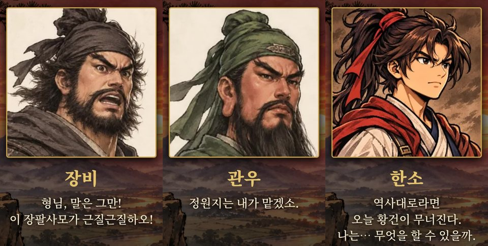
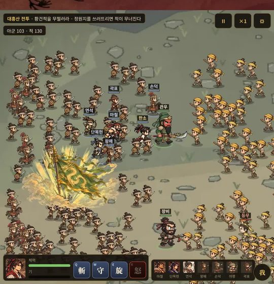
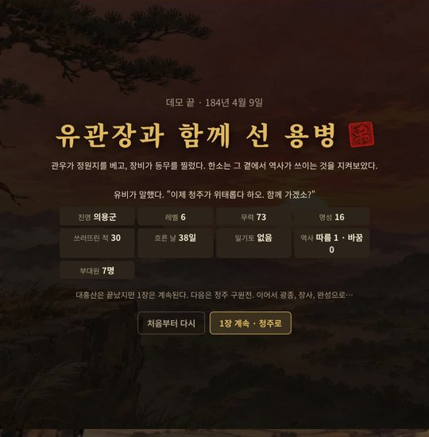

두 번째 게임 「**삼국지 회귀**」의 첫 홍보 쇼츠를 유튜브에 올렸습니다. 이번 영상은 **ZIN인디게임** 채널에 올렸습니다. 게임이 어떤 이야기인지는 [개발일지 1탄](/samguk-devlog-01-why)에 적어 두었습니다.

## 영상 보기

  

    <iframe
      src="https://www.youtube-nocookie.com/embed/K65Yi2cUvrw"
      title="삼국지 속으로 회귀했다… 유비·관우·장비와 함께 싸운다"
      style="position: absolute; inset: 0; width: 100%; height: 100%; border: 0;"
      allow="accelerometer; autoplay; clipboard-write; encrypted-media; gyroscope; picture-in-picture"
      allowfullscreen
      loading="lazy"
    ></iframe>
  

영상이 안 보이면 [유튜브에서 바로 보기](https://youtube.com/shorts/K65Yi2cUvrw)를 눌러 주세요.

## 어떤 영상인가요?

약 21초 길이의 세로 영상입니다. **"184년 · 황건적의 난, 삼국지 속으로 회귀했다"**라는 문구로 시작합니다.

### 유비·관우·장비, 그리고 한소

먼저 유비, 관우, 장비가 한 명씩 나오고, 마지막으로 주인공 **한소**가 나옵니다. 인물마다 한마디씩 대사를 넣었습니다.

- **장비**: "형님, 말은 그만! 이 장팔사모가 근질근질하오!"
- **관우**: "정원지는 내가 맡겠소."
- **한소**: "역사대로라면 오늘 황건이 무너진다. 나는… 무엇을 할 수 있을까."

### 대흥산 전투

그다음은 1장의 **대흥산 전투**입니다. 자막은 **"역사책에서 읽던 그 전투, 그 한가운데에 내가 있다"**입니다. 아군과 황건적 수백 명이 한 화면에서 싸우고, 그 사이에 한소와 관우, 장비가 함께 있습니다.

### 그리고 역사가 쓰였다

전투가 끝나면 **"유관장과 함께 선 용병"** 결과 화면이 나옵니다. 관우가 정원지를 베고, 장비가 등무를 찌르고, 한소는 그 곁에서 역사가 쓰이는 것을 지켜봅니다.

영상은 **"삼국지 회귀, 1장 데모 · 무료 플레이, 한국어 / English"**와 **"역사를 따를까, 바꿀까?"**라는 문구로 끝납니다.

## 더 보기

삼국지 회귀가 어떻게 만들어지고 있는지는 개발일지 [1탄](/samguk-devlog-01-why), [2탄](/samguk-devlog-02-party), [3탄](/samguk-devlog-03-map)에 정리해 두었습니다.
