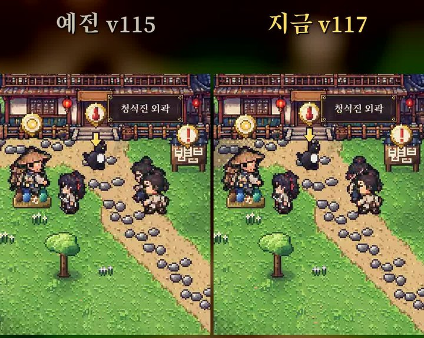
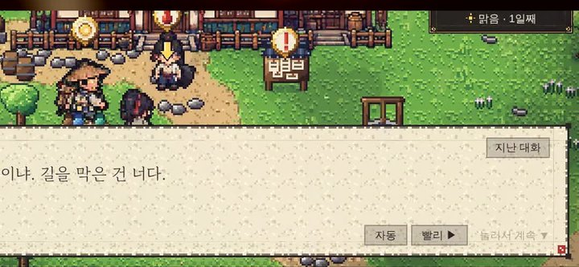

> 🎮 **직접 해 보기:** 데모 「청석진 · 프롤로그」는 [itch.io에서 무료로 플레이](https://zinnote.itch.io/cheongseok-demo)할 수 있어요. 설치 없이 브라우저에서 바로 실행되고, 휴대폰은 가로로 눕혀서 하면 됩니다.

[첫 홍보 쇼츠](/wuxia-shorts-byeokryeok)에 이어, 이번에는 게임을 고쳐 가는 과정을 보여 드리는 **개발일지** 쇼츠를 시작했습니다. 그 첫 편입니다.

이번 영상은 지난번과 달리 **제 목소리로 직접 설명**했습니다.

## 영상 보기

  

    <iframe
      src="https://www.youtube-nocookie.com/embed/Hz8fHt9e_Fc"
      title="혼자 무협 RPG 만드는 개발일지 #1 쇼츠"
      style="position: absolute; inset: 0; width: 100%; height: 100%; border: 0;"
      allow="accelerometer; autoplay; clipboard-write; encrypted-media; gyroscope; picture-in-picture"
      allowfullscreen
      loading="lazy"
    ></iframe>
  

영상이 안 보이면 [유튜브에서 바로 보기](https://youtube.com/shorts/Hz8fHt9e_Fc)를 눌러 주세요.

## 이번에 고친 것 1: 걷는 모습

약 36초 길이의 세로 영상입니다. 이번 업데이트에서는 **걷는 모습**을 다듬었습니다. 주인공 **한소**와 동료 **연화**, **마철**, 마을 사람들, 그리고 적까지 걷는 그림을 새로 바꿨습니다.

영상에서는 예전 버전(v115)과 지금 버전(v117)을 나란히 놓고 같은 길을 걷게 해서 비교했습니다. 왼쪽이 예전, 오른쪽이 지금입니다.

## 이번에 고친 것 2: 대화창 버튼

대화창 오른쪽 아래에 있는 **자동**, **빨리** 버튼도 이제 잘 보이게 바꿨습니다. 대화를 자동으로 넘기거나 빠르게 넘기고 싶을 때 누르면 됩니다.

## 앞으로

개발일지는 게임을 고칠 때마다 이어서 올릴 생각입니다. 게임에 나오는 인물들은 [청석진 사람들](/wuxia-characters)에, 그림을 만드는 방식은 [그림 못 그리는 1인 개발자의 고뇌](/wuxia-solo-dev-art-struggle)에 정리해 두었습니다.
