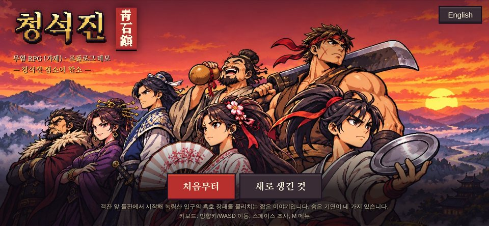
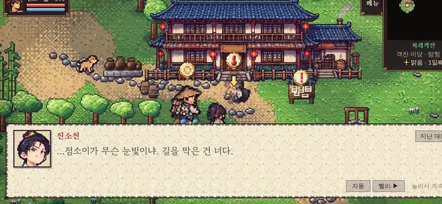
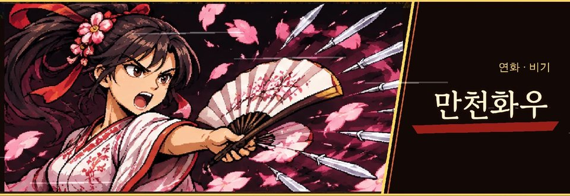
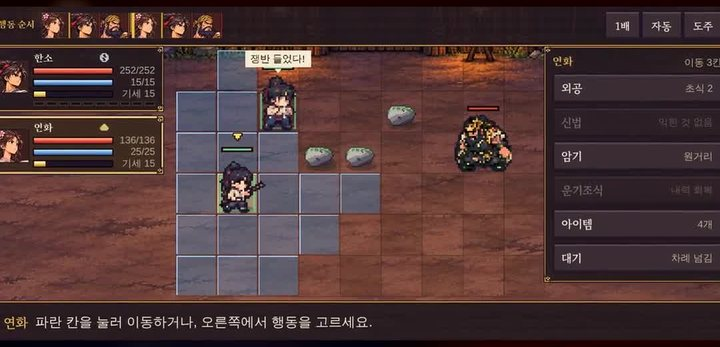
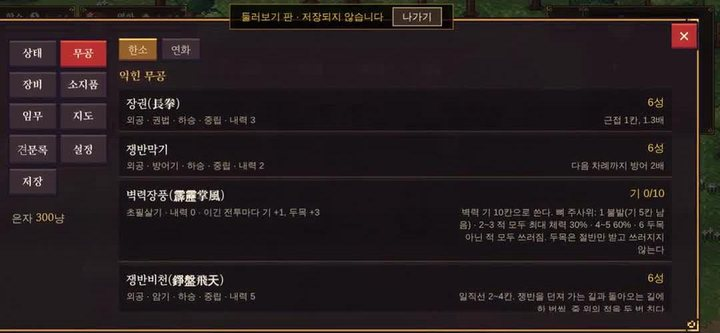

> 🎮 **직접 해 보기:** 데모 「청석진 · 프롤로그」는 [itch.io에서 무료로 플레이](https://zinnote.itch.io/cheongseok-demo)할 수 있어요. 설치 없이 브라우저에서 바로 실행되고, 휴대폰은 가로로 눕혀서 하면 됩니다.

[개발일지 1편](/wuxia-devlog1-shorts-walking)에 이어 2편입니다. 이번에는 업데이트를 정말 많이 했습니다. 특히 **디자인**이 많이 바뀌었습니다. 이번 영상도 제 목소리로 직접 설명했습니다.

## 영상 보기

  

    <iframe
      src="https://www.youtube-nocookie.com/embed/KEpI4Sd_oGw"
      title="혼자 만드는 무협 RPG 개발일지 #2 쇼츠"
      style="position: absolute; inset: 0; width: 100%; height: 100%; border: 0;"
      allow="accelerometer; autoplay; clipboard-write; encrypted-media; gyroscope; picture-in-picture"
      allowfullscreen
      loading="lazy"
    ></iframe>
  

영상이 안 보이면 [유튜브에서 바로 보기](https://youtube.com/shorts/KEpI4Sd_oGw)를 눌러 주세요.

## 1. 타이틀 화면을 완전히 바꿨습니다

게임을 켜면 처음 나오는 화면을 새로 만들었습니다. **노을 진 벼랑 위에 일행이 모여 있는 그림**입니다. 쟁반을 든 점소이 **한소**를 앞에 두고, 동료들과 산적 두목까지 한 화면에 모았습니다.

아래에는 **처음부터**와 **새로 생긴 것** 버튼이 있고, 오른쪽 위의 **English** 버튼으로 영어로 바꿔서 할 수도 있습니다.

## 2. 얼굴 그림과 대화창

한소와 동료들, 산적 두목까지 **얼굴 그림을 모두 고화질로** 바꿨습니다. 대화창 디자인도 함께 바꿔서, 말하는 사람의 얼굴과 이름이 대화창 왼쪽에 크게 나옵니다.

## 3. 비기를 쓰면 화면 가득 큰 그림이

전투에서 **비기**(필살기)를 쓰면 화면 가득 큰 그림이 나오게 했습니다. 산적 두목 **흑호 장패**의 **흑호멸천**과, 동료 **연화**의 **만천화우**입니다.

## 4. 전투 배경도 고화질로

칸 위에서 움직이는 턴제 전투의 **배경**도 고화질로 바꿨습니다.

## 5. 새로운 재미, 뼈 주사위와 벽력장풍

이번 업데이트에서 가장 새로운 것은 **뼈 주사위**입니다.

한소의 무공 중 **벽력장풍**은 초필살기입니다. 전투에서 이길 때마다 **기**가 1칸 모이고(두목을 이기면 3칸), 기 10칸이 다 모이면 쓸 수 있습니다. 쓸 때 뼈 주사위를 굴려서 나온 숫자로 결과가 정해집니다.

| 주사위 | 결과                                                           |
| ------ | -------------------------------------------------------------- |
| 1      | 불발 (기는 5칸 남음)                                           |
| 2~3    | 적 모두에게 최대 체력의 30% 피해                               |
| 4~5    | 적 모두에게 최대 체력의 60% 피해                               |
| 6      | 두목이 아닌 적은 모두 쓰러짐. 두목은 절반만 받고 쓰러지지 않음 |

뼈 주사위는 벽력장풍에만 쓰이는 게 아닙니다. **영약을 먹을 때도** 주사위를 굴리고, 높은 숫자가 나오면 좋은 결과가 나옵니다.

## 6. 무공 합성과 이펙트

**무공 합성**도 업데이트했습니다. 합성할 때 **무공 이펙트**도 새로 넣었습니다.

## 앞으로

이번 편은 그림과 화면을 많이 바꾼 업데이트였습니다. 개발일지는 앞으로도 게임을 고칠 때마다 이어서 올리겠습니다. 게임에 나오는 인물들은 [청석진 사람들](/wuxia-characters)에, 그림을 만드는 방식은 [그림 못 그리는 1인 개발자의 고뇌](/wuxia-solo-dev-art-struggle)에 정리해 두었습니다.
