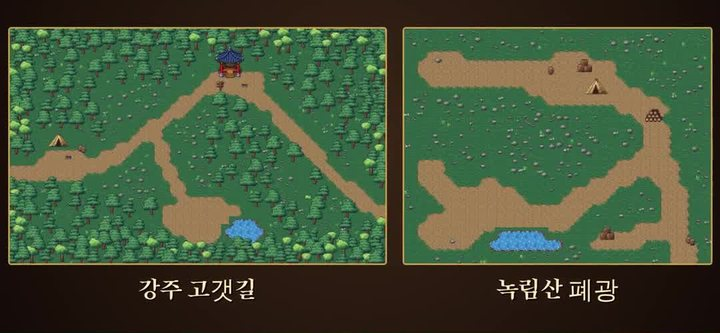
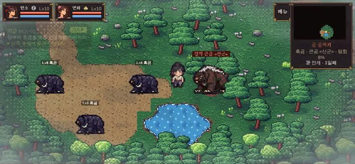
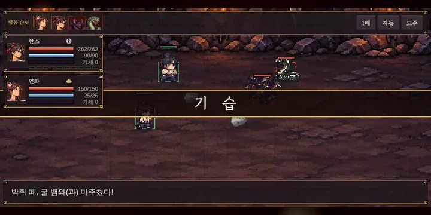
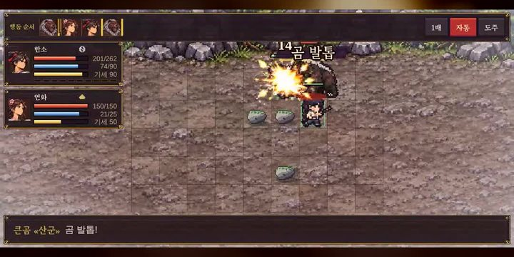
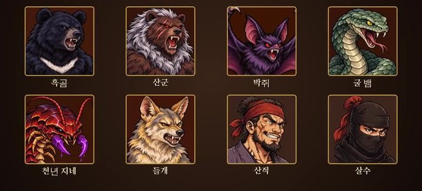

> 🎮 **직접 해 보기:** 데모 「청석진 · 프롤로그」는 [itch.io에서 무료로 플레이](https://zinnote.itch.io/cheongseok-demo)할 수 있어요. 설치 없이 브라우저에서 바로 실행되고, 휴대폰은 가로로 눕혀서 하면 됩니다.

[개발일지 2편](/wuxia-devlog2-title-bone-dice)에 이어 3편입니다. 이번에는 **새로운 곳이 두 군데** 생겼고, **강적**도 등장합니다. 이번 영상도 제 목소리로 직접 설명했습니다.

## 영상 보기

  

    <iframe
      src="https://www.youtube-nocookie.com/embed/jLjUJ8HVfBQ"
      title="혼자 만드는 무협 RPG 개발일지 #3 쇼츠"
      style="position: absolute; inset: 0; width: 100%; height: 100%; border: 0;"
      allow="accelerometer; autoplay; clipboard-write; encrypted-media; gyroscope; picture-in-picture"
      allowfullscreen
      loading="lazy"
    ></iframe>
  

영상이 안 보이면 [유튜브에서 바로 보기](https://youtube.com/shorts/jLjUJ8HVfBQ)를 눌러 주세요.

## 새 지역 두 곳

### 1. 강주 고갯길

첫 번째는 **강주 고갯길**입니다. 1장 끝에서 다리를 건너면 넘는 고개예요.

고갯길에는 **산적 초소**도 있고, **곰 골짜기**에서는 **흑곰 세 마리**와 싸웁니다.

### 2. 녹림산 폐광

두 번째는 **녹림산 폐광**입니다. 어두운 굴이라 **횃불이 없으면 적이 먼저 덮칩니다.**

폐광에 맞춰 **굴 뱀**, **박쥐 떼**, **천년 지네** 같은 새로운 적도 그렸습니다.

## 강적 등장: 붉은 이름표를 단 적

그리고 **강적**이 생겼습니다. 이름표가 **붉은색**인 적입니다. 위 곰 골짜기 사진에서 붉은 이름표를 단 **큰곰 «산군»**이 바로 강적이에요.

강적은 **우리가 세질수록 같이 세집니다.** 대신 이기면 **경험치를 5배**로 받습니다.

## 타격감이 더 세졌습니다

무공으로 적을 치면 **타격감**이 더 세지도록 바꿨습니다. 칠 때 **큰 타격 그림**과 **충격파**가 나오고, **피해 숫자**도 크게 나옵니다.

## 짐승과 산적 얼굴도 고화질로

[2편](/wuxia-devlog2-title-bone-dice)에서 한소와 동료들 얼굴을 고화질로 바꾼 데 이어, 이번에는 **짐승과 산적 얼굴**도 모두 고화질로 바꿨습니다. 흑곰, 산군, 박쥐, 굴 뱀, 천년 지네, 들개, 산적, 살수입니다.

## 앞으로

이번 편은 갈 수 있는 곳과 싸울 상대가 늘어난 업데이트였습니다. 개발일지는 앞으로도 이어서 올리겠습니다. 지난 개발일지는 [1편](/wuxia-devlog1-shorts-walking), [2편](/wuxia-devlog2-title-bone-dice)에서 볼 수 있습니다.
