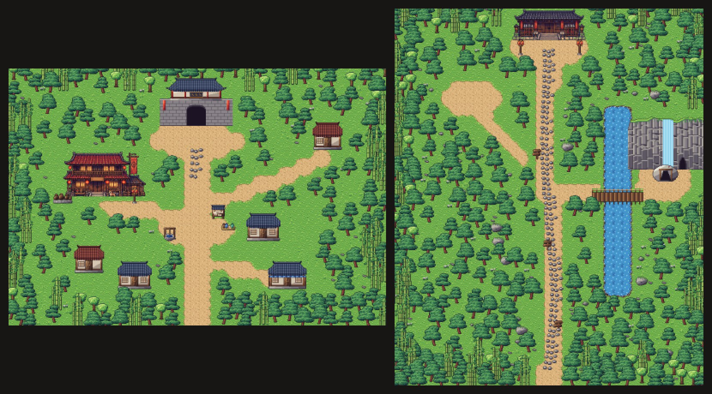
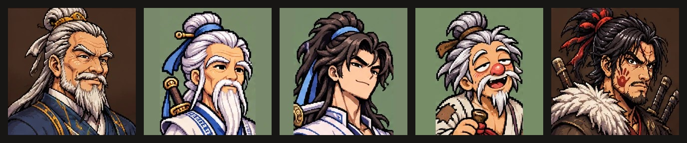
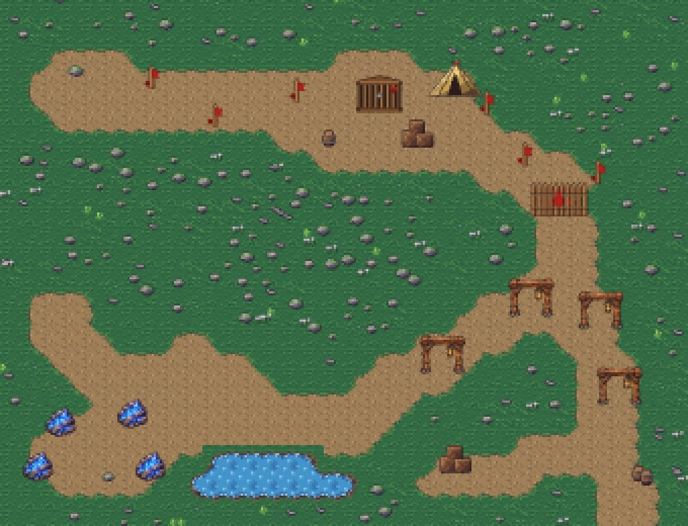

> 🎮 **직접 해 보기:** 데모 「청석진 · 프롤로그」는 [itch.io에서 무료로 플레이](https://zinnote.itch.io/cheongseok-demo)할 수 있어요. 설치 없이 브라우저에서 바로 실행되고, 휴대폰은 가로로 눕혀서 하면 됩니다.

[개발일지 3편](/wuxia-devlog3-new-areas-rivals)에 이어 4편입니다. 3편이 v131~v135 이야기였다면, 이번에는 그 뒤 **v136부터 v141까지** 바뀐 것을 정리했습니다. 게임 안 업데이트 소식에 적어 둔 내용을 바탕으로 썼습니다.

## 3장 정 길 «청운산»

이번 업데이트에서 가장 큰 변화입니다. 2장 갈림길에서 **단목현**을 따라가면 **청운검문**으로 가는 3장 정 길 «청운산»이 열립니다.

새로 생긴 것은 이렇습니다.

- 새 지도 **청운진**과 **청운산 산길**
- 산을 오르며 넘는 **돌계단 세 관문**
- 산길의 **구름객잔**
- 강적 **백년 학**
- 두목 **혈랑대주 사혁**

그리고 **외문제자**가 되면 무공 합성 **운중검**과 **백의철봉진**이 열립니다.

### 중립 길에는 «상 받는 날»

3장 중립 길 «미끼» 뒤에는 **«상 받는 날»** 이야기가 붙었습니다. 무림맹 부맹주가 흑룡방 창고를 턴 공으로 상금을 내리는 장면이고, 강주성 성문 안 마당에서 볼 수 있습니다.

## 청운산 사람들, 제 얼굴과 제 모습으로

3장에 나오는 **위지강, 운허자, 백운호, 노 사숙, 사혁**이 대화와 인물 도감에 자기 얼굴로 나옵니다. 강적 **백년 학**도 새로 그렸습니다.

얼굴뿐 아니라 걷는 모습도 바꿨습니다. 이제 다섯 사람이 **제 모습으로 걸어 다닙니다.** 관문 비무와 사혁과의 싸움은 **청운산 돌계단 마당**에서 벌어집니다.

## 녹림산 폐광 다듬기

3편에서 소개한 **녹림산 폐광**도 더 다듬었습니다.

- **횃불 빛**이 더 넓게 비칩니다.
- **바위벽**이 울퉁불퉁해졌습니다.
- 갱도 버팀목, 푸른 수정, 혈살각 목책, 나무 우리, 붉은 표식을 새로 놓았습니다.
- 굴에서만 나오는 **전용 곡**이 생겼습니다.

### 새 의뢰 «폐광의 박쥐»

1장 청석진 객잔 오른쪽에 있는 **노광부 탁씨**가 부탁을 합니다. 폐광 곁굴에 두고 온 **아버지의 곡괭이**를 찾아 달라는 의뢰예요. 해결하면 **60냥**과 장신구 **«광부의 손곡괭이»**(근력 +2)를 받습니다.

## 강적이 미니맵에 남습니다

3편에서 생긴 붉은 이름표의 **강적**은 이제 **한 번 보면 멀리 있어도 미니맵에 붉은 점으로 남습니다.** 다시 찾아가서 싸우기 쉬워졌습니다.

## 정리

| 버전      | 바뀐 것                                              |
| --------- | ---------------------------------------------------- |
| v136      | 폐광 다듬기, 새 의뢰 «폐광의 박쥐», 강적 미니맵 표시 |
| v139      | 3장 정 길 «청운산», 중립 길 «상 받는 날»             |
| v140~v141 | 청운산 사람들 얼굴과 걷는 모습                       |

## 앞으로

이번 편은 이야기가 3장까지 이어진 업데이트였습니다. 개발일지는 앞으로도 이어서 올리겠습니다. 지난 개발일지는 [1편](/wuxia-devlog1-shorts-walking), [2편](/wuxia-devlog2-title-bone-dice), [3편](/wuxia-devlog3-new-areas-rivals)에서 볼 수 있습니다.
