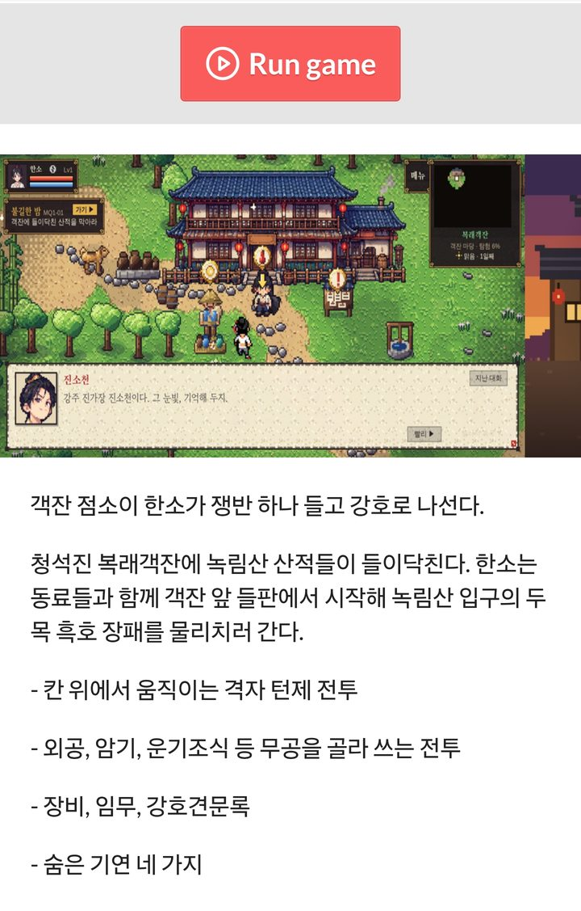
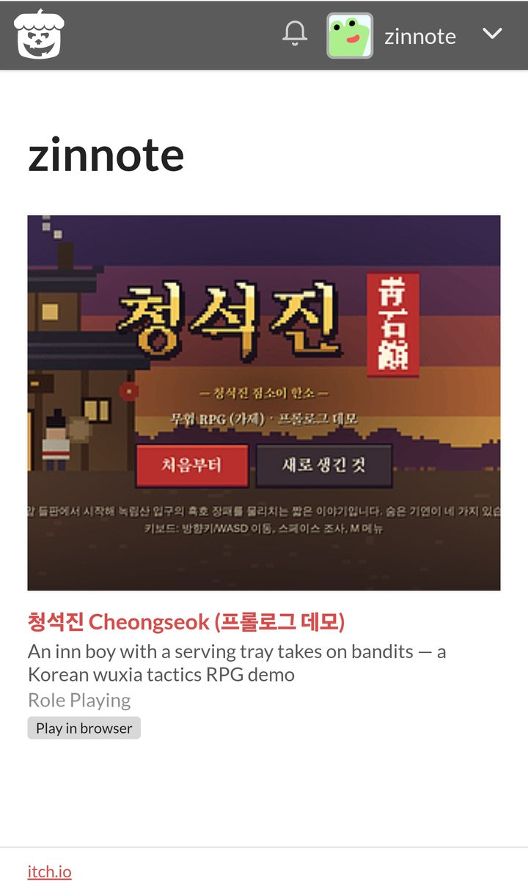
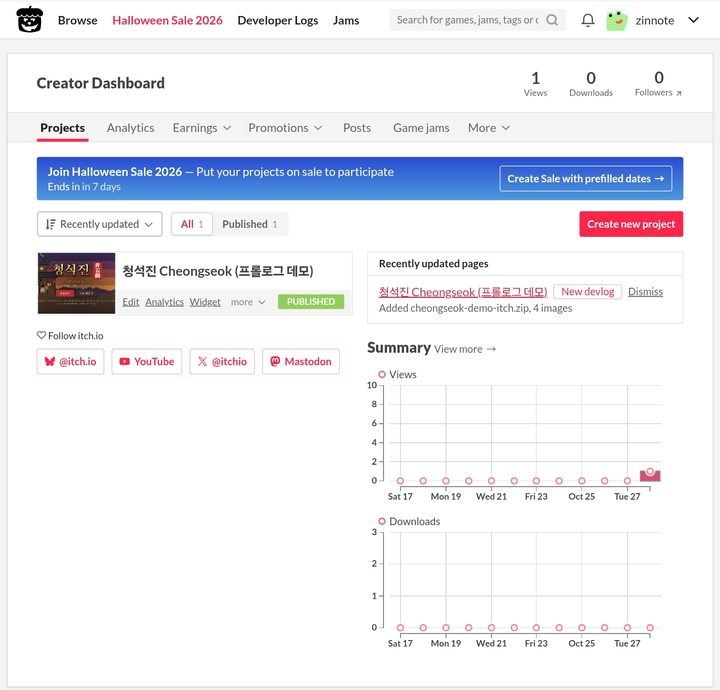

> 🎮 **바로 해 보기:** [zinnote.itch.io/cheongseok-demo](https://zinnote.itch.io/cheongseok-demo). 설치 없이 브라우저에서 실행되고, 휴대폰은 가로로 눕혀서 하면 됩니다.

직접 만들고 있는 무협 RPG의 프롤로그 데모 **「청석진 Cheongseok」**를 인디 게임 사이트 **itch.io**에 올렸습니다. 누구나 무료로, 내려받지 않고 바로 해 볼 수 있습니다.

## 왜 itch.io부터 올렸나요?

최종 목표는 휴대폰 앱스토어와 Steam 출시입니다. 그 전에 실제로 사람들이 해 보고 반응을 들을 곳이 필요했습니다. itch.io는 인디 게임을 무료로 올릴 수 있고, **웹(HTML) 게임을 페이지 안에서 바로 실행**해 주기 때문에 첫 공개 장소로 골랐습니다.

## 실제로 올라간 화면

게임 페이지에서 **Run game** 버튼을 누르면 바로 게임이 시작됩니다. 설명은 한국어와 영어로 함께 적었습니다.

제 itch.io 페이지(zinnote)에도 첫 프로젝트로 걸렸습니다. **Play in browser** 표시가 붙어 있습니다.

관리 화면에는 **PUBLISHED(공개됨)** 표시와 함께 첫 조회수 1이 찍혔습니다.

## 올리면서 막혔던 부분

휴대폰으로만 하다 보니 생각보다 여러 번 막혔습니다. 같은 걸 해 보실 분들께 도움이 되도록 적어 둡니다.

1. **제목부터 적어야 합니다.** 제목을 비워 두고 파일을 고르면 "Please provide a title" 오류가 나면서 업로드가 안 됩니다. itch.io는 파일을 고르는 순간 프로젝트를 저장하기 때문입니다.
2. **Kind of project를 HTML로 바꿔야 합니다.** 기본값인 Downloadable로 두면 zip 파일이 "실행 파일"로 올라가서 브라우저에서 실행되지 않습니다.
3. **"This file will be played in the browser"에 체크**해야 Run game 버튼이 생깁니다.
4. **Mobile friendly에 체크**해야 휴대폰에서도 열립니다.
5. 올리기 직전에 확인해 보니 **시험용으로 넣어 둔 무공(벽력장풍)**이 남아 있어서, 그 무공을 뺀 파일로 다시 올렸습니다.

## 데모에서 할 수 있는 것

- 칸 위에서 움직이는 턴제 전투
- 외공, 암기, 운기조식 등 무공을 골라 쓰는 전투
- 장비, 임무, 강호견문록
- 숨은 기연 네 가지
- 한국어와 영어 지원

데모의 이야기와 인물은 [첫 데모 소개 글](/wuxia-demo-chungseokjin)과 [청석진 사람들](/wuxia-characters)에 정리해 두었습니다.

## 다음 목표

1. 해 보신 분들의 의견 모으기 (itch.io 페이지 아래에 댓글을 남길 수 있습니다)
2. 1장 이야기 끝까지 채우기
3. Steam 데모 페이지 준비하기

해 보시고 어려웠던 점이나 재미있었던 점을 댓글로 남겨 주시면 큰 힘이 됩니다.
