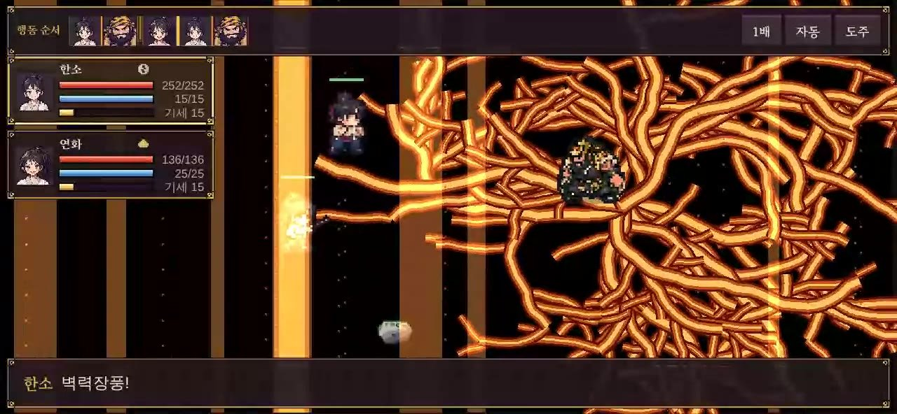
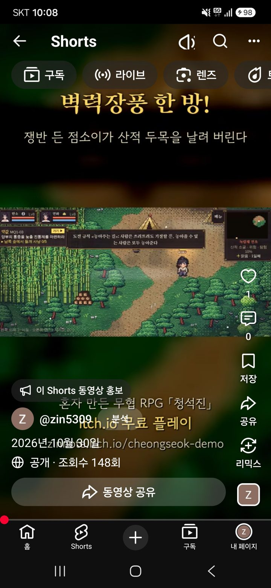

> 🎮 **직접 해 보기:** 데모 「청석진 · 프롤로그」는 [itch.io에서 무료로 플레이](https://zinnote.itch.io/cheongseok-demo)할 수 있어요. 설치 없이 브라우저에서 바로 실행되고, 휴대폰은 가로로 눕혀서 하면 됩니다.

itch.io에 데모를 올린 뒤로, 게임을 더 많은 분께 보여 줄 방법을 찾다가 **유튜브 쇼츠**로 짧은 홍보 영상을 만들어 올렸습니다. 2026년 10월 30일에 올린 첫 홍보 쇼츠입니다.

## 영상 보기

  

    <iframe
      src="https://www.youtube-nocookie.com/embed/mbaBogYz-FI"
      title="벽력장풍 한 방! 무협 RPG 청석진 홍보 쇼츠"
      style="position: absolute; inset: 0; width: 100%; height: 100%; border: 0;"
      allow="accelerometer; autoplay; clipboard-write; encrypted-media; gyroscope; picture-in-picture"
      allowfullscreen
      loading="lazy"
    ></iframe>
  

영상이 안 보이면 [유튜브에서 바로 보기](https://youtube.com/shorts/mbaBogYz-FI)를 눌러 주세요.

## 어떤 영상인가요?

29초 길이의 세로 영상입니다. 주인공 **한소**가 산적 두목 **장패**와 싸우다가 **벽력장풍**으로 한 방에 날려 버리는 장면을 담았습니다. 영상 위아래에는 이런 문구를 넣었습니다.

- **벽력장풍 한 방!**
- 쟁반 든 점소이가 산적 두목을 날려 버린다
- 혼자 만든 무협 RPG 「청석진」, itch.io 무료 플레이

배경 음악도 영상에 맞춰 따로 만들어 넣었습니다.

## 실제로 올라간 화면

휴대폰 유튜브 앱에서 확인한 화면입니다. 채널 **@zin5309**에 **공개**로 올라갔고, 캡처할 때 조회수는 148회였습니다.

## 미리 알려 드릴 점: 벽력장풍은 데모에 없습니다

영상 속 **벽력장풍**은 개발 중에 시험용으로 넣어 둔 무공입니다. [itch.io에 데모를 올릴 때](/wuxia-itch-release) 이 무공은 빼고 올렸기 때문에, **지금 데모에서는 쓸 수 없습니다.** 영상만 보고 데모를 하신 분이 헷갈리지 않도록 미리 적어 둡니다.

데모에서는 칸 위에서 움직이는 턴제 전투와 외공, 암기, 운기조식 같은 무공을 직접 해 볼 수 있습니다. 이야기와 인물은 [첫 데모 소개 글](/wuxia-demo-chungseokjin)과 [청석진 사람들](/wuxia-characters)에 정리해 두었습니다.

## 앞으로

쇼츠는 앞으로도 한 주에 몇 개씩 꾸준히 올려 볼 생각입니다. 게임 장면 중 보고 싶은 것이 있으면 itch.io 페이지나 유튜브 댓글로 알려 주세요.
