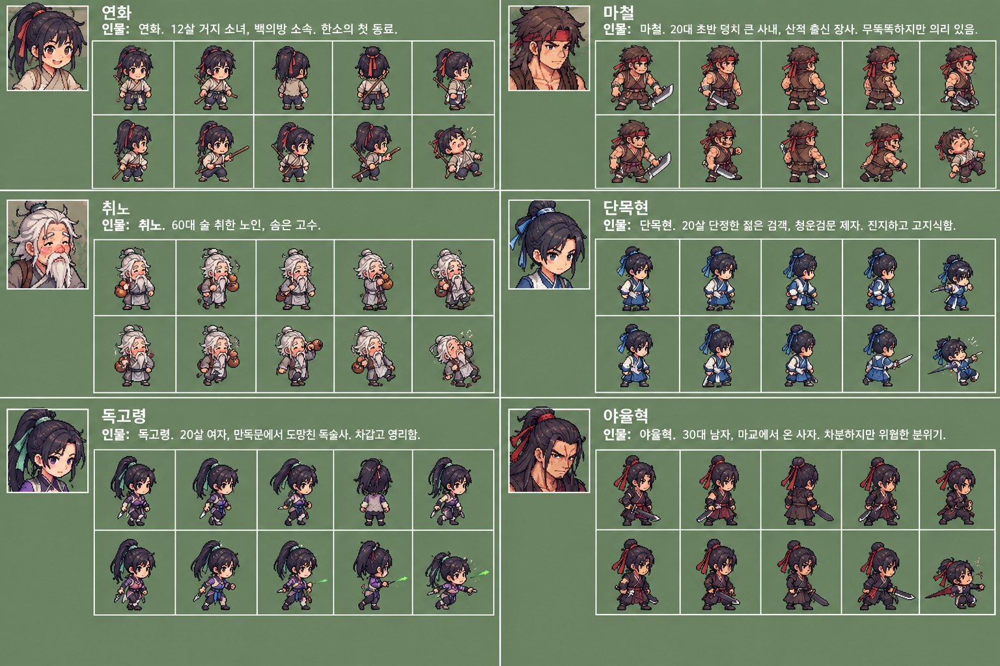
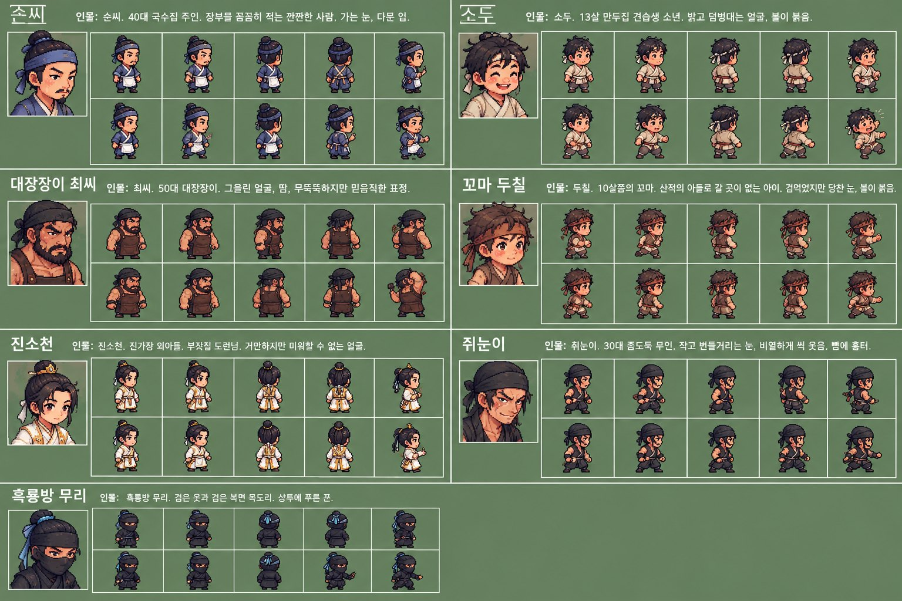
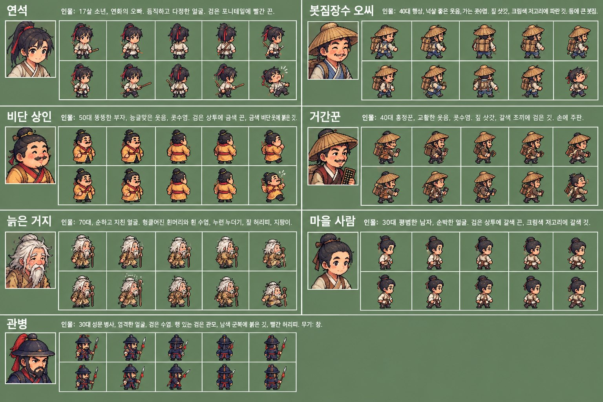
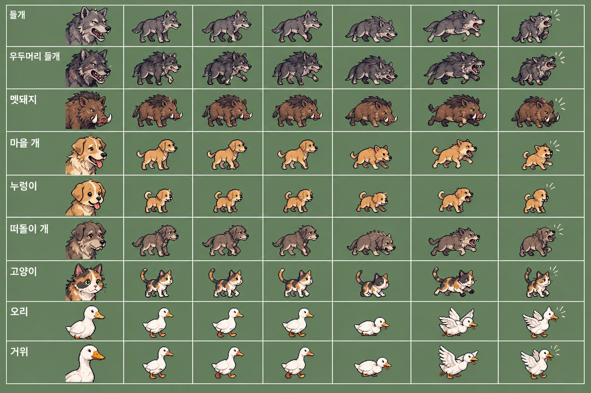
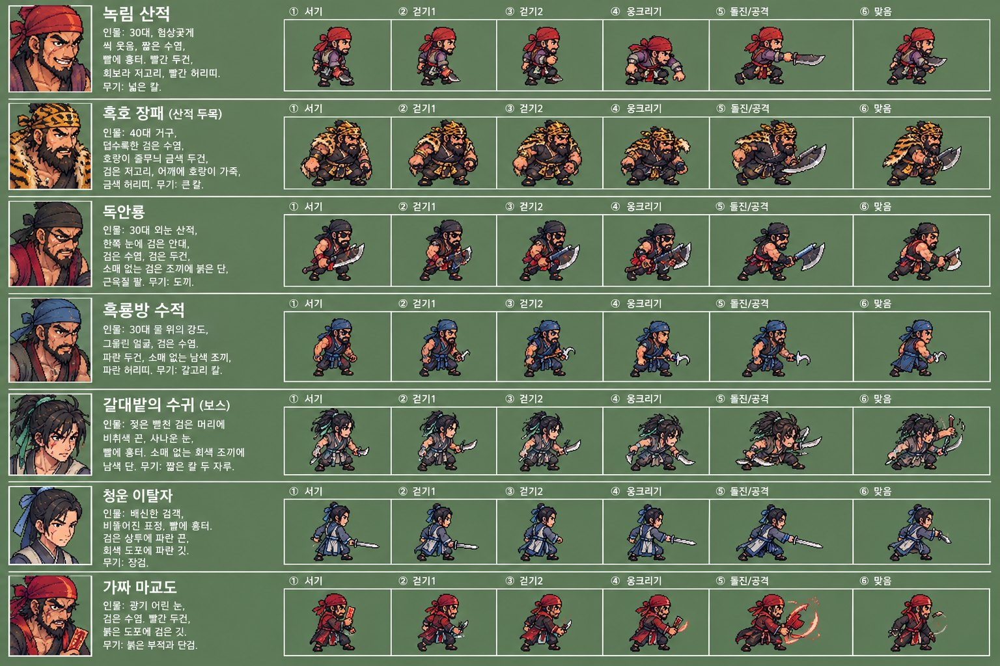
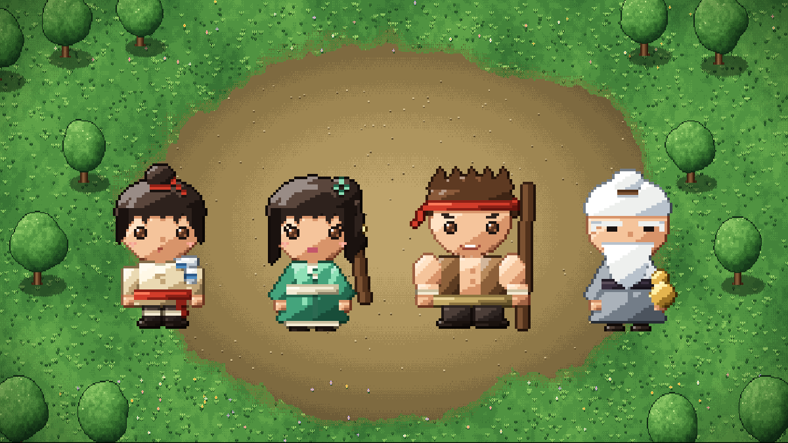

> 🎮 **직접 해 보기:** 최신 데모 「청석진 · 프롤로그」를 [itch.io에서 무료로 플레이](https://zinnote.itch.io/cheongseok-demo)할 수 있어요. 설치 없이 브라우저에서 바로 실행되고, 휴대폰은 가로로 눕혀서 하면 됩니다.

혼자 게임을 만들면 뭐가 제일 힘드냐고 묻는다면, 저는 망설임 없이 **그림**이라고 답하겠습니다. 이야기는 쓰면 되고, 전투 규칙은 숫자를 고치면 됩니다. 그런데 그림은 손이 안 따라 줍니다. 저는 사람 얼굴을 동그라미 두 개와 선 하나로밖에 못 그립니다.

이 글은 그림 못 그리는 40대 아재가 어떻게 캐릭터 수십 명을 게임에 집어넣고 있는지, 그리고 그 과정에서 매일 하는 고민을 적어 둔 것입니다.

## 지금의 작업 방식: 둘이서 한 장을 만든다

제 그림 작업은 두 단계로 나뉩니다.

1. **ChatGPT가 설정화를 그립니다.** "12살 거지 소녀, 백의방 소속, 밝은 표정, 빨간 머리끈" 같은 식으로 인물 설명을 적어 주면, 얼굴 초상과 앞·뒤·옆 모습, 걷기와 공격 동작까지 한 장에 모아서 그려 줍니다.
2. **클로드가 그걸 도트로 다시 찍습니다.** 제가 쓰는 게임용 그림은 사람이 손으로 찍은 게 아니라, 파이썬 코드가 한 점 한 점 찍어 내는 도트입니다. ChatGPT 그림을 보여 주고 "이 느낌으로 32픽셀 캐릭터로 만들어 줘"라고 하면, 클로드가 코드를 고쳐서 도트 그림을 뽑아 냅니다.

그러니까 저는 그림을 한 장도 직접 그리지 않습니다. 대신 **"이 사람은 이런 사람이다"를 글로 설명하고, 나온 결과를 보고 고쳐 달라고 하는 일**을 합니다. 디자이너라기보다는 잔소리하는 감독에 가깝습니다.

## ChatGPT가 그려 준 설정화들

실제로 받은 그림 몇 장을 보여 드리겠습니다. 한소의 동료들부터입니다.

왼쪽 위가 거지 소녀 **연화**, 그 옆이 산적 출신 장사 **마철**, 아래가 술 취한 노인 **취노**입니다. 인물 소개 글을 한 줄 적어 주면 이렇게 얼굴과 동작을 한 번에 뽑아 주니, 처음 봤을 때는 솔직히 감탄했습니다.

청석진 마을 사람들도 이렇게 만들었습니다. 국수집 주인 순씨, 대장장이 최씨, 만두집 견습생 소두, 산적의 아들 꼬마 두칠까지요.

길에서 만나는 행인들, 그리고 들판의 짐승들입니다. 들개와 우두머리 들개, 멧돼지, 마을 개, 고양이, 오리, 거위까지. 오리와 거위는 전투와 상관없지만, 마을이 살아 있어 보이려면 이런 것들이 돌아다녀야 합니다.

마지막은 적들입니다. 녹림 산적, 두목 흑호 장패, 외눈 산적 독안룡, 강 위의 흑룡방 수적. 서기, 걷기, 웅크리기, 돌진, 맞음까지 여섯 동작을 한 줄로 정리해 달라고 했습니다.

## 그런데 이걸 게임에 바로 못 씁니다

여기서부터가 고뇌의 시작입니다. 위 그림들은 보기에는 도트 같지만, **게임에 바로 넣을 수 있는 도트가 아닙니다.**

- **칸이 안 맞습니다.** 게임의 캐릭터는 정확히 32×32 같은 격자 안에 들어가야 합니다. ChatGPT 그림은 캐릭터마다 크기가 조금씩 다르고, 점 하나하나가 격자에 딱 맞게 찍힌 게 아닙니다. 확대해 보면 점이 반쯤 걸쳐 있거나 색이 수백 가지로 번져 있습니다.
- **동작끼리 안 이어집니다.** 걷기 1과 걷기 2를 번갈아 보여 줘야 걷는 것처럼 보이는데, 두 장의 머리 위치, 다리 길이가 미묘하게 달라서 붙여 놓으면 덜컹거립니다.
- **같은 사람이 매번 조금씩 다릅니다.** 연화를 다시 그려 달라고 하면 머리끈 색이 바뀌거나 옷이 달라집니다. 설정화로는 괜찮지만, 게임 안에서는 한 사람이 한 모습이어야 합니다.
- **배경이 붙어 있습니다.** 초록 바탕을 떼어 내는 것부터 일입니다.

그래서 ChatGPT 그림은 **"이 사람은 이렇게 생겼다"는 참고 자료**로 쓰고, 실제 게임 그림은 클로드가 코드로 다시 찍습니다. 코드로 찍으면 크기가 항상 같고, 색 수를 제한할 수 있고, 걷기 동작도 다리 위치만 바꿔서 자연스럽게 이어집니다. 같은 코드를 다시 돌리면 늘 같은 그림이 나오니, 연화는 언제나 같은 연화입니다.

아래가 그렇게 해서 실제 게임에 들어간 모습입니다. 설정화와 비교해 보면, 훨씬 단순하지만 넷이 한 화면에 서 있을 때 어색하지 않습니다.

## 매일 하는 고민들

**1. 어디까지 닮게 할 것인가.** ChatGPT 설정화는 예쁩니다. 그대로 옮기고 싶습니다. 그런데 32픽셀 안에서는 머리끈 하나, 수염 한 줄이 점 두세 개입니다. 뭘 남기고 뭘 버릴지 매번 정해야 합니다. 마철은 빨간 머리띠와 넓은 어깨만 남기고 나머지는 포기했습니다. 그래도 마철로 보이면 성공입니다.

**2. 내 그림이라고 할 수 있나.** 설명은 제가 썼고, 선택도 제가 했지만, 선 하나 제 손으로 그은 게 없습니다. 이 게임의 그림이 "내 것"이냐고 물으면 아직도 답을 못 하겠습니다. 다만 한 가지는 확실합니다. 이 방식이 없었다면 이 게임은 캐릭터가 동그라미 두 개짜리였거나, 아예 시작도 못 했을 겁니다.

**3. 끝이 없습니다.** 마을 사람 한 명 추가하면 초상 하나, 동작 여섯 개입니다. 지금 세어 보니 사람만 서른 명 가까이 됩니다. 1장을 마치려면 아직 더 필요합니다. 혼자 하는 일이라 "오늘은 여기까지"를 정해 주는 사람도 없습니다.

**4. 그림에 시간을 쓰는 동안 게임은 멈춰 있습니다.** 그림을 만지는 날은 전투 규칙도, 이야기도 한 줄 안 나갑니다. 그림이 없으면 게임이 허전하고, 그림만 하면 게임이 안 나옵니다. 이 줄타기가 1인 개발의 진짜 고뇌인 것 같습니다.

## 그래도 계속하는 이유

ChatGPT가 그려 준 연화의 웃는 얼굴을 보고, 클로드가 찍어 준 도트 연화가 들판에서 걸어 다니는 걸 봤을 때, 머릿속에만 있던 아이가 처음으로 움직였습니다. 그 순간이 좋아서 계속합니다.

그림 못 그리는 사람도 게임을 만들 수 있는 시대가 됐습니다. 다만 그림을 **안 그려도 되는** 건 아니고, **다르게 그리는** 것에 가깝습니다. 설명하고, 고르고, 버리고, 다시 부탁하는 일. 그게 제 그림 그리기입니다.

다음 글에서는 이렇게 만든 캐릭터들이 실제 전투 화면에서 어떻게 움직이는지 보여 드리겠습니다. 이야기의 큰 반전은 여전히 게임에서 직접 확인하실 수 있도록 남겨 둡니다.
