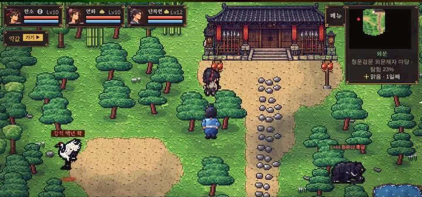
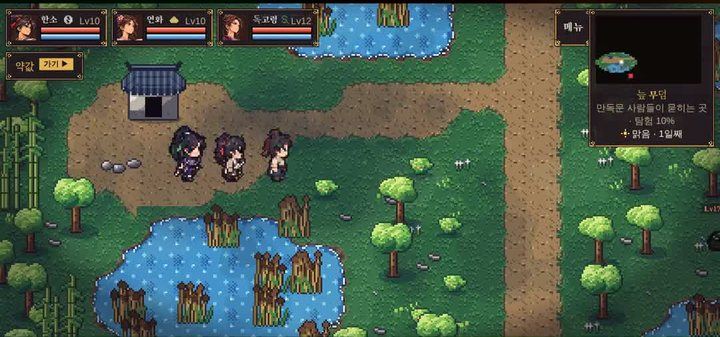
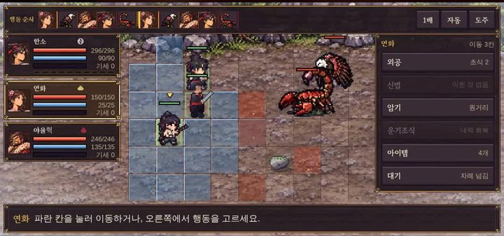
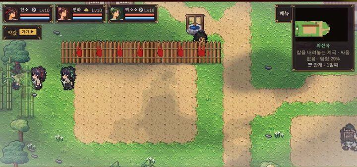
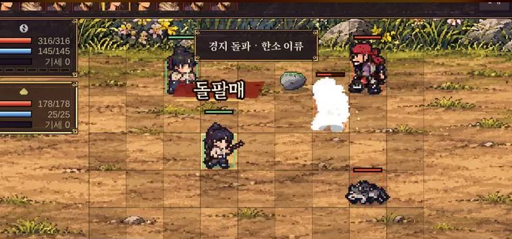
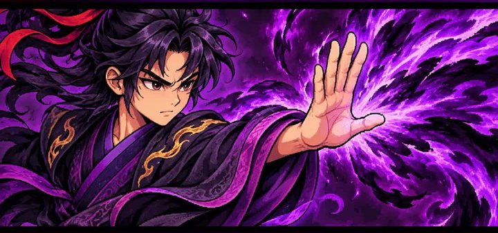

> 🎮 **직접 해 보기:** 데모 「청석진 · 프롤로그」는 [itch.io에서 무료로 플레이](https://zinnote.itch.io/cheongseok-demo)할 수 있어요. 설치 없이 브라우저에서 바로 실행되고, 휴대폰은 가로로 눕혀서 하면 됩니다.

개발일지와 별도로, 게임을 처음 보는 분께 한눈에 보여 드리려고 **30초짜리 예고편**을 만들어 유튜브 쇼츠로 올렸습니다. 개발일지와 달리 목소리 없이 음악과 자막만 넣었습니다.

## 영상 보기

  

    <iframe
      src="https://www.youtube-nocookie.com/embed/v3yb0bPuzqk"
      title="혼자 만든 무협 RPG 청석진 30초 예고편"
      style="position: absolute; inset: 0; width: 100%; height: 100%; border: 0;"
      allow="accelerometer; autoplay; clipboard-write; encrypted-media; gyroscope; picture-in-picture"
      allowfullscreen
      loading="lazy"
    ></iframe>
  

영상이 안 보이면 [유튜브에서 바로 보기](https://youtube.com/shorts/v3yb0bPuzqk)를 눌러 주세요.

## 예고편 속 장면

예고편은 **"점소이 소년 한소, 강호로 나서다"**라는 문구로 시작합니다. 그다음 한소가 갈 수 있는 길을 차례로 보여 줍니다.

### 3장 · 정의 길 «청운산»

청운산 길은 [개발일지 #4](/wuxia-devlog4-cheongunsan)에서 자세히 소개했습니다.

### 3장 · 사파의 길 «만독림»

### 3장 · 마교의 길 «혈사곡»

### 4장 · 네 길이 만나는 곳 «의선곡»

## 합성 무공 «붕산철장»

두 무공을 하나로 합치는 **무공 합성**으로 만든 합성 무공 **붕산철장**도 넣었습니다.

## 고른 길마다 달라지는 한소

어느 길을 고르느냐에 따라 한소의 모습도 달라집니다. 예고편에는 비기를 쓸 때 화면 가득 나오는 한소의 컷인도 담았습니다.

예고편 마지막은 칸 위에서 무공으로 겨루는 턴제 전투 장면과, itch.io 무료 플레이 안내로 끝납니다.

## 더 보기

게임을 고쳐 가는 과정은 개발일지 [1편](/wuxia-devlog1-shorts-walking), [2편](/wuxia-devlog2-title-bone-dice), [3편](/wuxia-devlog3-new-areas-rivals), [4편](/wuxia-devlog4-cheongunsan)에 정리해 두었습니다.
